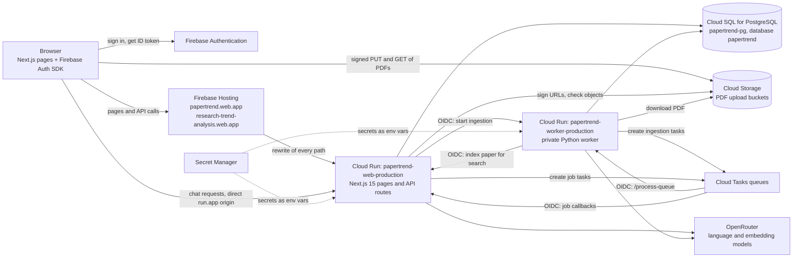
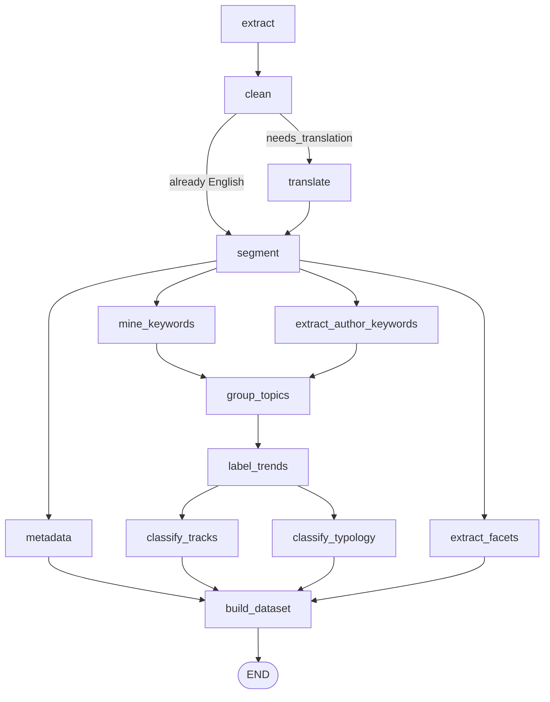
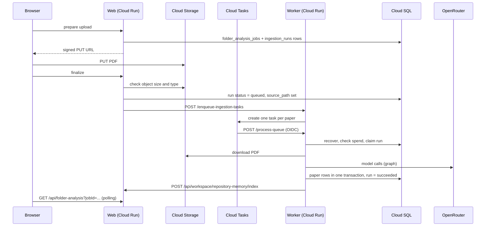
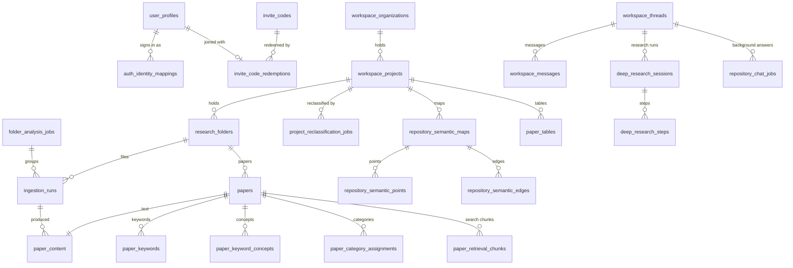

# Papertrend: complete documentation

This file joins the nine reference chapters in `docs/` into one document. Each
chapter is also its own file in `docs/`, and those files are the ones to edit;
this file is rebuilt from them. For what Papertrend is and how to start, see
[README.md](README.md).

## Contents

1. [System Overview and Architecture](#1-system-overview-and-architecture)
2. [Setup and Local Development](#2-setup-and-local-development)
3. [Frontend and API Architecture](#3-frontend-and-api-architecture)
4. [Python Graphs and Nodes](#4-python-graphs-and-nodes)
5. [Worker Queue and Analysis Pipeline](#5-worker-queue-and-analysis-pipeline)
6. [Data Model and Schema](#6-data-model-and-schema)
7. [Testing and Quality](#7-testing-and-quality)
8. [Deployment and Operations Runbook](#8-deployment-and-operations-runbook)
9. [Module catalog](#9-module-catalog)

## 1. System Overview and Architecture

This chapter explains what Papertrend does for a user, which services run it, how the three main requests (uploading a paper, reading the dashboard, asking in chat) travel through those services, how sign-in and data ownership work, and where things live in the repository. Later chapters go deeper: [Frontend and API](#3-frontend-and-api-architecture), [Python graphs and nodes](#4-python-graphs-and-nodes), [Worker and analysis pipeline](#5-worker-queue-and-analysis-pipeline), [Data model](#6-data-model-and-schema) and [Deployment and operations](#8-deployment-and-operations-runbook).

The project moved from Supabase (database, storage, auth) and Vercel (hosting) to Google Cloud in 2026. The migration is recorded in docs/10 to docs/19. Some legacy code from that period is still in the tree and is marked as legacy in [Module catalog](#9-module-catalog).

### What Papertrend does

Papertrend turns a collection of research papers (PDF files) into structured data that can be searched, charted and questioned. It was built for the English as an International Language (EIL) program, Faculty of Arts, Chulalongkorn University, and also works for general research collections.

The main ideas a user meets:

- **Repository.** A named collection of papers that belongs to one account. In the code and database a repository is a *project* (`eil-dashboard/src/app/api/workspace/projects/route.ts`). Each repository has an analysis profile (see [Repository taxonomy profiles](#repository-taxonomy-profiles)).
- **Upload.** The user adds PDFs from their computer or from Google Drive (Picker). The production limits are 10 MB per file (`MAX_UPLOAD_BYTES=10485760`) and 80 pages (`MAX_PDF_PAGES=80`), set in `cloudbuild.web.production.yaml`.
- **Analysis of each paper.** A background worker reads the PDF, translates it if needed, splits it into sections, and extracts metadata (title, year), the author's keywords, mined keywords grouped into topics, topic labels, a category under the repository's profile, a research typology and method facets. The graph is `build_ingestion_graph` in `graphs.py`; details are in chapters 04 and 05.

The signed-in workspace has these pages (navigation in `eil-dashboard/src/components/workspace/WorkspaceShell.tsx`):

| Page | Route | What it is for |
| --- | --- | --- |
| Home | `/workspace/home` | Recent papers, analysis progress, a place to continue. |
| Dashboard | `/workspace/dashboard` | Four tabs (`TAB_DEFINITIONS` in `eil-dashboard/src/components/DashboardClient.tsx`): **Semantic Map** (the default: papers placed by meaning, with relationship lines), **Area Analysis** (trends and categories over years), **Keyword Explorer** (keywords and themes), **Adaptive** (insights computed from the papers' data, with an optional checked write-up and a question box). |
| Chat | `/workspace/chat` | Questions answered from the selected papers, with citations to papers and passages. |
| Table | `/workspace/table` | An extraction table: papers as rows, user-chosen columns that the model fills from each paper (`eil-dashboard/src/app/api/workspace/tables/[id]/fill/route.ts`). |
| Library | `/workspace/library` | Every paper with its status, thumbnail, PDF preview and stored analysis; failed papers can be tried again and finished ones analysed again. |
| Settings | `/workspace/settings` | Repository settings (including the analysis profile) and account settings. |

A paper opens in place on any workspace page through `PaperViewerProvider` (`eil-dashboard/src/components/workspace/PaperViewerProvider.tsx`).

Chat has two controls worth knowing about:

- **Effort.** Low, Medium and High (`eil-dashboard/src/lib/chat-effort.ts`) answer inside the request; they differ in how many papers are read and how carefully claims are checked. **Max** is a separate research engine (`eil-dashboard/src/lib/deep-research/`) that plans, reads each chosen paper, writes and checks the answer as a background job.
- **Chart mode.** The model turns the question into a chart specification and code computes the numbers from the same data the dashboard uses (`eil-dashboard/src/lib/chat-chart.ts`). The model never writes a number into the chart.

The chat model list is in `eil-dashboard/src/lib/chat-models.ts` (currently GPT-6 Luna through OpenRouter). Embeddings for search use `REPOSITORY_EMBEDDING_MODEL` (`openai/text-embedding-3-small` in the production build file).

### Runtime topology

Everything runs in the Google Cloud project `research-trend-analysis`, region `asia-southeast1`.



| Component | What it does | Where it is defined |
| --- | --- | --- |
| Firebase Authentication | Signs users in with email and password, Google or Facebook (`eil-dashboard/src/components/auth/AuthPanel.tsx`, `eil-dashboard/src/lib/firebase-client.ts`). | Firebase project `research-trend-analysis`. |
| Firebase Hosting | Serves the two public hostnames and forwards every path to the web service. It holds no app code and no data. | `firebase.json`, `.firebaserc` (targets `production` and `short`). |
| Web service | Next.js 15 app: the pages and every `/api/*` route, including chat, search indexing, Max research, semantic maps and reclassification. | `eil-dashboard/`, deployed by `cloudbuild.web.production.yaml`. |
| Worker service | Private Python service (`node_service.py`) that runs the paper analysis pipeline (`graphs.py`, `nodes/`, `eil-dashboard/worker/`). It also creates the ingestion Cloud Tasks when the web service asks. | Repository root, deployed by `cloudbuild.worker.production.yaml`. |
| Cloud SQL | The application database (PostgreSQL). | Schema in `eil-dashboard/cloudsql/`. |
| Cloud Storage | PDF files. Production and the pilot use separate buckets. | `GCS_UPLOAD_BUCKET` in the build files. |
| Cloud Tasks | Runs long work outside a browser request. Three production queues: `papertrend-ingestion-production` (paper analysis, to the worker), `papertrend-app-tasks-production` (chat reports, semantic maps, reclassification, to the web) and `papertrend-research-production` (Max research, to the web). | Queue names in the build files. |
| Secret Manager | Credentials, mounted as environment variables at deploy time (`--set-secrets`). | See chapter 08 for the names. |
| OpenRouter | Language models for analysis and chat, and embedding models. Reached through an OpenAI-compatible client (`OPENAI_BASE_URL`, `eil-dashboard/src/lib/openai.ts`, `nodes/model_router.py`). | External. |

Two design choices shape the topology:

- **Firebase Hosting has a fixed 60-second request limit and buffers streamed responses** (comments in `eil-dashboard/src/lib/chat-http.ts` and `eil-dashboard/src/lib/chat-cors.ts`). So PDFs go straight between the browser and Cloud Storage, chat requests go straight to the web service's `run.app` address (`NEXT_PUBLIC_DIRECT_API_URL`), and anything longer runs as a Cloud Task that calls back on `APP_PUBLIC_URL` (the direct `run.app` address, never `web.app`).
- **The worker is not reachable from the internet without a Google identity.** Production deploys it with `--no-allow-unauthenticated`, and its handler checks an OIDC token on every POST (`_is_authorized_worker_request` in `node_service.py`).

A separate pair of pilot services (`papertrend-web-cloudsql-pilot`, `papertrend-worker-cloudsql-pilot`) runs the `test` branch against the same database with the staging bucket. Chapter 08 covers it.

### Flow 1: upload and analysis

1. The user picks files in the Add papers dialog (`eil-dashboard/src/components/workspace/AnalyzeFlowModal.tsx`). The browser hashes each file and sends name, size and hash to `POST /api/admin/import/prepare`.
2. The route verifies the user, checks the limits and skips files this account has already analysed successfully (matched by SHA-256 hash in `eil-dashboard/src/lib/cloudsql/ingestion-repository.ts`; a failed earlier upload does not block a retry). It creates one ingestion run per file in Cloud SQL, with a snapshot of the repository's profile, and returns signed upload URLs that are valid for 15 minutes (`UPLOAD_URL_MINUTES` in `eil-dashboard/src/lib/paper-upload-url.ts`).
3. The browser uploads each PDF directly to Cloud Storage with a `PUT` to its signed URL. The bytes never pass through Firebase Hosting or the web service.
4. The browser calls `POST /api/admin/import/finalize`. The route asks Storage whether each object really exists, marks those runs `queued` and calls `triggerWorkerQueueWithRetries` (`eil-dashboard/src/lib/worker-queue-start.ts`).
5. The web service calls the worker's `/enqueue-ingestion-tasks` with an OIDC identity token (`eil-dashboard/src/lib/worker-trigger.ts`). The worker creates Cloud Tasks on the ingestion queue that call its own `/process-queue`, each carrying an OIDC token for the tasks service account (`_enqueue_ingestion_tasks` in `node_service.py`). If that fails, the web service calls `/process-queue` directly.
6. `/process-queue` starts one background batch at a time (`NODE_SERVICE_ASYNC_MAX_RUNS=1`). A busy worker answers 429 to a Cloud Task so the task is retried later.
7. The batch (`eil-dashboard/worker/process_ingestion_queue.py`) claims a run, downloads the PDF from Cloud Storage, runs the ingestion graph, and writes the results to Cloud SQL while sending heartbeats. It records the model spend and leaves papers queued while the site-wide daily spend limit is reached (`eil-dashboard/worker/spend_limits.py`).
8. When a run succeeds, the worker asks the web service to index the paper for search (`SEARCH_INDEX_URL`, which is `/api/workspace/repository-memory/index`; `eil-dashboard/worker/search_index.py`). The web service chunks the text and stores embeddings.
9. Meanwhile the browser polls `POST /api/workspace/runs/status` (`eil-dashboard/src/hooks/useIngestionRuns.ts`) and shows progress. If papers are queued but never start, the progress card offers "Start processing now" (`/api/folder-analysis/start`).

### Flow 2: reading the dashboard

1. The browser loads `/workspace/dashboard` through Firebase Hosting. The page is a client component (`DashboardClient.tsx`).
2. The page gets a fresh Firebase ID token and calls `GET /api/workspace/dashboard-data` for the open repository (`eil-dashboard/src/app/api/workspace/dashboard-data/route.ts`, `maxDuration = 30`).
3. The route verifies the token, resolves the owner and reads papers, keywords, topics, categories and years for that owner and repository (`eil-dashboard/src/lib/dashboard-data-server.ts`).
4. Year, category and search filters are applied in the browser (`eil-dashboard/src/lib/dashboard-filters.ts`). "Show all" keeps every paper in the repository, including papers analysed under an older profile.
5. The Semantic Map tab reads a stored map from `/api/workspace/semantic-map`. Building or rebuilding a map is a Cloud Task that calls `/api/workspace/semantic-map/jobs/process`; it reuses stored embeddings and lays papers out with PCA or UMAP (`eil-dashboard/src/lib/semantic-map-math.ts`).
6. The Adaptive tab calls `/api/workspace/insights` and `/api/workspace/insights/ask`. Numbers are computed by code (`eil-dashboard/src/lib/insights/`); a model only writes the optional summary.
7. Opening a paper calls `/api/workspace/library/[runId]`, which returns the analysis and a signed read URL. The PDF itself is fetched from Cloud Storage.

### Flow 3: chat

1. The composer (`eil-dashboard/src/components/chat/ChatClient.tsx`) sends `POST /api/chat` to the direct web origin with `Accept: text/event-stream`. CORS on this route allows only the origins in `APP_ALLOWED_ORIGINS` (`eil-dashboard/src/lib/chat-cors.ts`).
2. The route verifies the user, checks the daily AI allowance (`assertAiTokenBudget`) and allows at most two answers in progress per user (`claimAnswerSlot`).
3. The question is saved to the conversation in Cloud SQL, together with its knowledge scope (all repositories, one repository, or selected papers).
4. For Low, Medium and High, `runRepositoryChat` (`eil-dashboard/src/lib/repository-chat.ts`) resolves the authorized scope, plans the answer, retrieves evidence (hybrid keyword and vector search), writes the answer with citations and checks it. Progress frames stream back while it works. Chart mode goes through `eil-dashboard/src/lib/chat-chart.ts`.
5. Some answers are too long for one request: web search, whole-repository synthesis, and analysis of every paper in a large scope (`shouldQueueRepositoryChat` in `eil-dashboard/src/lib/repository-chat-routing.ts`). These become a chat job. The route answers 202, a Cloud Task calls `/api/chat/jobs/process`, and the browser polls `/api/chat/jobs/[jobId]`.
6. Max sends `chatMode: "deep_research"`. The route first returns a plan, then on "continue" queues a research run (`eil-dashboard/src/lib/deep-research/actions.ts`). A Cloud Task calls `/api/chat/research/process`, which saves each step so an interrupted run resumes (`eil-dashboard/src/lib/deep-research/run.ts`).
7. The answer's model cost is recorded and logged (`chat_answer_spend`).

### Authentication and authorization

#### Users

- **Sign-in** happens in the browser with the Firebase Auth SDK. Sign-up is invite-only in production (`INVITE_CODE_REQUIRED=true`); a new account redeems an invite code through `/api/auth/invite`.
- **Every API call** carries `Authorization: Bearer <Firebase ID token>`. The server verifies it with the Firebase Admin SDK, with a revocation check when `FIREBASE_CHECK_REVOKED=true` (`eil-dashboard/src/lib/auth/adapter.ts`). A verified identity is reused for at most 60 seconds and never past the token's expiry.
- **Owner mapping.** A Firebase UID is not used as the data key. `auth_identity_mappings` maps each Firebase identity to a stable Papertrend owner UUID (`eil-dashboard/src/lib/auth/identity-mapping.ts`, `eil-dashboard/src/lib/cloudsql/identity-repository.ts`). An existing account is linked by verified email; a new one is created only through an invite.
- **Owner scoping.** Every private query filters by that owner UUID, which always comes from the verified token and never from the browser. Database work runs in `withCloudSqlOwnerTransaction` (`eil-dashboard/src/lib/cloudsql/client.ts`), which sets the transaction-local setting `app.current_user_id`; row-level security policies in `eil-dashboard/cloudsql/schema.sql` read the same setting.
- **Project scoping.** Within an owner, a repository (project) id or a list of selected run ids narrows what a request may read. Ids sent by the browser can only narrow the owner's own data.
- **Pilot gate.** On the pilot (`DEPLOYMENT_ENV=pilot`) only admin accounts and the addresses in the `PILOT_ALLOWED_EMAILS` secret are admitted (`applyDeploymentGate` in `eil-dashboard/src/lib/auth/adapter.ts`, `eil-dashboard/src/lib/deployment.ts`).

#### Services

Service-to-service calls use Google-signed OIDC identity tokens:

| Caller to callee | Token | Checked by |
| --- | --- | --- |
| Web to worker | Identity token from the Cloud Run metadata server, audience = worker URL (`eil-dashboard/src/lib/worker-trigger.ts`). | Worker: `WORKER_OIDC_AUDIENCE` and `WORKER_OIDC_SERVICE_ACCOUNTS` (`node_service.py`). |
| Cloud Tasks to worker | OIDC token for the tasks service account (`CLOUD_TASKS_OIDC_SERVICE_ACCOUNT`). | Same worker check. |
| Cloud Tasks to web (job callbacks) | OIDC token for the web service's own runtime account, audience = `APP_PUBLIC_URL` (`eil-dashboard/src/lib/cloud-tasks-oidc.ts`). | `isVerifiedTaskCaller` in the same file. |
| Worker to web (search indexing) | Identity token for the worker's account. | `isVerifiedServiceCaller`, accounts listed in `WORKER_CALLER_SERVICE_ACCOUNTS`. |

The shared `WORKER_WEBHOOK_SECRET` is still accepted by the worker as a fallback where an identity token is not available (`worker-trigger.ts`, `node_service.py`). The browser never receives database credentials, service-account keys or Secret Manager values; it gets only short-lived signed URLs for its own PDFs.

### Repository taxonomy profiles

Classification belongs to the repository. `eil-dashboard/src/lib/project-analysis-profile.ts` defines three modes:

| Mode | Name shown | Behaviour |
| --- | --- | --- |
| `general` | General Research | The default. No category classification. |
| `eil` | EIL Tracks | Classifies into English Linguistics (EL), English Language Instruction (ELI) and Language Assessment & Evaluation (LAE) using the official track definitions. |
| `custom` | Custom Taxonomy | 2 to 12 owner-defined categories (`MIN_CUSTOM_CATEGORIES`, `MAX_CUSTOM_CATEGORIES`), plus an automatic "Other / Unclassified". |

Each profile has a `profileHash`. Every ingestion run stores a snapshot of the profile it was analysed under. Changing a repository's profile applies to new uploads at once; existing papers change only through a reclassification job (`/api/workspace/projects/[projectId]/reclassify`, processed by a Cloud Task at `/api/workspace/projects/reclassify/process`). The design history is in docs/21-repository-taxonomy-v2.md.

### Workspace folder layout

| Path | Contents |
| --- | --- |
| `eil-dashboard/` | The Next.js app. `src/app/` has the pages and `src/app/api/` the API routes; `src/components/`, `src/hooks/`, `src/lib/` and `src/types/` hold the UI and server logic. |
| `eil-dashboard/worker/` | The Python worker's queue processor and helpers (database client, search indexing, spend limits, analysis pipeline wrapper). Deployed with the worker, not the web app. |
| `eil-dashboard/cloudsql/` | Cloud SQL schema and dated migrations. |
| `eil-dashboard/tests/`, `eil-dashboard/scripts/`, `eil-dashboard/evals/` | Web tests (`npm test`), maintenance and evaluation scripts, question banks. |
| `eil-dashboard/supabase/` | Legacy Supabase schema and migrations (history). |
| `nodes/` | One Python module per analysis step, plus the model router. |
| `prompts/` | Prompt templates used by the nodes. |
| `graphs.py`, `state.py`, `node_service.py`, `main.py` | The ingestion graph, its state types, the worker's HTTP service, and a local batch runner. |
| `tests/` | Python tests (`python -m pytest tests -q`). |
| `scripts/` | Operations, evaluation and migration scripts (`scripts/ops/` for Cloud Build triggers and monitoring). |
| `docs/` | This documentation and the dated plans and records (docs/10 onward). |
| Root deploy files | `cloudbuild.*.yaml`, `firebase.json`, `.firebaserc`, `gcs-cors.*.json`, `.gcloudignore`. See chapter 08. |
| `infra/`, `jobs/`, `firebase-hosting/` | An early schema copy, an unused notebook job, and the empty public folder Firebase Hosting requires. |

The full file-by-file list is in [Module catalog](#9-module-catalog).

## 2. Setup and Local Development

This chapter explains how to get Papertrend running on your own machine: the tools you need, how to install the web app and the Python worker, which environment variables each one reads, how to run them, and how to run the tests, the type check and the linter. It assumes you have read [System overview and architecture](#1-system-overview-and-architecture). Deployment is covered in [Deployment and operations runbook](#8-deployment-and-operations-runbook).

The project ran on Supabase and Vercel until 2026 and then moved to Google Cloud (see docs/10 to docs/19). A few example files and helpers from that time are still in the tree; this chapter marks them as legacy where they matter.

### 1. What you need

| Tool | Version | Where the version comes from |
| --- | --- | --- |
| Node.js | 22 or later | `"engines": { "node": ">=22" }` in `eil-dashboard/package.json`; CI uses Node 22 (`.github/workflows/tests.yml`), and the web deploy tests on the `node:22` image (`cloudbuild.web.production.yaml`) |
| npm | the one that ships with Node 22 | `eil-dashboard/package-lock.json` is committed, so use `npm ci` |
| Python | 3.13 | CI uses Python 3.13; the worker deploy tests on `python:3.13-slim` and builds with `GOOGLE_RUNTIME_VERSION=3.13` (`cloudbuild.worker.production.yaml`) |
| Git | any recent | |

Optional, only for work against real cloud resources:

- Google Cloud SDK (`gcloud`), to read service settings and logs.
- Cloud SQL Auth Proxy, to reach the database from your machine (the migration script expects one on `127.0.0.1:5432`, see `eil-dashboard/scripts/apply-cloudsql-migration.ts`).
- Firebase CLI, for Hosting (see [Deployment and operations runbook](#8-deployment-and-operations-runbook)).

The root `Dockerfile` uses `node:20-slim`. It belongs to the old `cloudbuild.yaml` flow and is legacy: the production web service is built by `gcloud run deploy --source eil-dashboard` (no Dockerfile in that folder), and the worker deploy renames the root `Dockerfile` out of the way before it builds (`cloudbuild.worker.production.yaml`, step `prepare-python-worker-source`).

### 2. Get the code

```bash
git clone https://github.com/LLM-Project2005/papertrend_extractor_LLM.git
cd papertrend_extractor_LLM
git checkout development
```

Work happens on `development`. Pull requests go to `test` (the pilot) and then to `main` (production). Chapter 08 explains the branches and the builds they start.

### 3. Install

#### 3.1 Web app

```bash
cd eil-dashboard
npm ci
```

`npm run dev` and `npm run build` first run `scripts/copy-pdf-worker.mjs` (the `predev` and `prebuild` scripts). It copies the pdf.js worker from `node_modules/pdfjs-dist` into `public/pdfjs/`, which is git-ignored. If the paper viewer or the Library thumbnails stay blank, run `node scripts/copy-pdf-worker.mjs` once.

#### 3.2 Python worker and analysis steps

From the repository root:

```bash
python -m venv .venv
.venv/Scripts/activate          # Windows; on macOS or Linux: source .venv/bin/activate
pip install -r requirements.txt pytest
```

- `requirements.txt` (root) is what CI installs and what the worker deploy builds from. It holds LangGraph and LangChain, PyMuPDF and pymupdf4llm, `psycopg`, the Google Cloud Tasks and Storage clients, and a few notebook-era packages (`ipykernel`, `streamlit`, `plotly`).
- `eil-dashboard/worker/requirements.txt` is a shorter list for running the queue processor on its own. You do not need it if you installed the root file.

### 4. Environment variables

#### 4.1 Where settings live

| Context | File or source |
| --- | --- |
| Web app on your machine | `eil-dashboard/.env.local` (git-ignored by `.env*.local` in `eil-dashboard/.gitignore`) |
| Web production build on your machine | `eil-dashboard/.env.production.local`, holding only the public `NEXT_PUBLIC_*` build settings (used by the local preview in section 5.3) |
| Worker and `main.py` on your machine | a `.env` file at the repository root; `node_service.py` and `main.py` call `load_dotenv()` |
| Deployed services | the Cloud Build files (`cloudbuild.web.production.yaml`, `cloudbuild.worker.production.yaml` and the pilot pair): `--set-build-env-vars`, `--set-env-vars`, and `--set-secrets` from Secret Manager |

The example files `eil-dashboard/.env.example`, `eil-dashboard/.env.local.example` and `cloudrun.env.example.yaml` list many of the names below, but they still default to the Supabase providers. Use the Cloud Build files as the reference for what production sets. Never put real values in a committed file. Test account credentials, when a live script needs them, are kept in a git-ignored env file and loaded as environment variables.

The tables give names and purposes only. Secret values are in Secret Manager.

#### 4.2 Web app: public build settings

These are read at `next build` time and end up in the browser bundle, so they must never hold a secret.

| Name | What it is for |
| --- | --- |
| `NEXT_PUBLIC_AUTH_PROVIDER` | `firebase` in every current deployment |
| `NEXT_PUBLIC_FIREBASE_API_KEY`, `NEXT_PUBLIC_FIREBASE_AUTH_DOMAIN`, `NEXT_PUBLIC_FIREBASE_PROJECT_ID`, `NEXT_PUBLIC_FIREBASE_APP_ID` | the Firebase web configuration used by `src/lib/firebase-client.ts`; the auth domain is also added to the CSP `frame-src` |
| `NEXT_PUBLIC_SITE_URL` | the public address; used for page metadata and as a fallback for allowed origins |
| `NEXT_PUBLIC_DIRECT_API_URL` | the Cloud Run address the chat calls directly (`src/lib/chat-http.ts`), and the extra origin in the CSP `connect-src` |
| `NEXT_PUBLIC_PROJECT_ANALYSIS_PROFILES_ENABLED` | shows the research-area (analysis profile) controls |
| `NEXT_PUBLIC_INVITE_ONLY` | the sign-up form asks for an invite code unless this is `false` (`src/components/auth/AuthPanel.tsx`) |
| `NEXT_PUBLIC_SUPABASE_URL`, `NEXT_PUBLIC_SUPABASE_ANON_KEY` | legacy |

#### 4.3 Web app: server settings

Almost every server setting is read through `src/lib/server-env.ts`.

**Deployment and providers**

| Name | What it is for |
| --- | --- |
| `DEPLOYMENT_ENV` | `production` or `pilot`; the pilot admits only admins and the emails in `PILOT_ALLOWED_EMAILS` (`src/lib/deployment.ts`) |
| `AUTH_PROVIDER` | `firebase` |
| `DATABASE_PROVIDER`, `STORAGE_PROVIDER` | `cloud-sql` and `gcs`; `INFRA_PROVIDER` is the fallback for both. Anything else selects the legacy Supabase code paths |
| `PROJECT_ANALYSIS_PROFILES_ENABLED` | turns on repository analysis profiles and reclassification |

**Sign-in**

| Name | What it is for |
| --- | --- |
| `FIREBASE_PROJECT_ID`, `FIREBASE_CLIENT_EMAIL`, `FIREBASE_PRIVATE_KEY` | Firebase Admin credentials used to verify ID tokens (secrets) |
| `FIREBASE_CHECK_REVOKED` | also checks that a token has not been revoked |
| `FIREBASE_AUTO_PROVISION_VERIFIED_USERS` | links or creates the Papertrend account for a verified Firebase identity |
| `INVITE_CODE_REQUIRED` | a new account needs an invite code; on unless set to `false` |
| `APP_ALLOWED_ORIGINS` | the origins (separated by `;` or `,`) allowed to call the chat endpoints cross-origin (`src/lib/chat-cors.ts`) |

**Database and storage**

| Name | What it is for |
| --- | --- |
| `DATABASE_URL` | the Cloud SQL connection string (secret); on Cloud Run it can use the mounted Cloud SQL Unix socket |
| `CLOUD_SQL_INSTANCE_CONNECTION_NAME` | the instance name, for logs and the Cloud Run mount |
| `CLOUDSQL_POOL_MAX` | connection pool size (default 5, at most 20) |
| `DATABASE_SSL`, `DATABASE_SSL_REJECT_UNAUTHORIZED` | TLS for a TCP connection, off by default |
| `GCS_UPLOAD_BUCKET` | this deployment's PDF bucket |
| `GCS_KNOWN_UPLOAD_BUCKETS` | other buckets a stored path may name (production lists the staging bucket, because the pilot shares the database) |
| `GCS_SIGN_UPLOAD_SIZE` | binds the file size into the signed upload URL when `true` |
| `MAX_UPLOAD_BYTES`, `MAX_PDF_PAGES` | upload limits (10 MB and 80 pages by default) |

**Background work and the worker**

| Name | What it is for |
| --- | --- |
| `GOOGLE_CLOUD_PROJECT_ID`, `GOOGLE_CLOUD_REGION` | project and region for Cloud Tasks |
| `CLOUD_TASKS_LOCATION` | Cloud Tasks region |
| `REPOSITORY_CHAT_TASKS_QUEUE`, `SEMANTIC_MAP_TASKS_QUEUE`, `RECLASSIFICATION_TASKS_QUEUE`, `DEEP_RESEARCH_TASKS_QUEUE` | the queues for background chat answers, semantic maps, reclassification and Max effort runs (`CLOUD_TASKS_QUEUE` is the fallback) |
| `APP_PUBLIC_URL` | the web service's own `run.app` address: where task callbacks are sent and the audience of their OIDC tokens |
| `TASKS_OIDC_SERVICE_ACCOUNT` | overrides the runtime service account used for task tokens |
| `WORKER_SERVICE_URL` | the worker's address |
| `WORKER_WEBHOOK_SECRET` | bearer secret for the worker when no Google identity token is available, for example on your machine (secret) |
| `WORKER_CALLER_SERVICE_ACCOUNTS` | the worker accounts allowed to call the search-indexing route |
| `SEMANTIC_MAP_INLINE_JOBS`, `RECLASSIFICATION_INLINE_JOBS` | `true` runs those jobs inside the request instead of through Cloud Tasks |

**Models**

| Name | What it is for |
| --- | --- |
| `OPENAI_API_KEY` | the OpenRouter key (secret) |
| `OPENAI_BASE_URL` | the OpenRouter API address (stored as a secret in production) |
| `OPENAI_MODEL` | the default model when a task has none |
| `MODEL_TASK_<TASK>` | overrides the model for one task, for example `MODEL_TASK_PAPER_TABLE_EXTRACT`; defaults are `OPENROUTER_TASK_DEFAULTS` in `src/lib/server-env.ts` |
| `CHAT_FAST_MODEL` | the model for the chat's planner and sufficiency check; `off` uses the answer model (`src/lib/model-routing.ts`) |
| `REPOSITORY_EMBEDDING_MODEL`, `REPOSITORY_EMBEDDING_DIMENSIONS`, `REPOSITORY_EMBEDDING_BATCH_SIZE` | the embedding model for the search index |
| `REPOSITORY_HYBRID_RETRIEVAL_ENABLED` | adds meaning search (embeddings) to the chat's keyword search |
| `REPOSITORY_CHAT_ASYNC_PAPER_THRESHOLD` | above this many papers, a paper-by-paper answer runs in the background (default 80, at least 20) |
| `SEMANTIC_MAP_ENABLED`, `SEMANTIC_MAP_LLM_LABELS_ENABLED` | the semantic map, and model-written labels on it |
| `TOPIC_THEMES_MODEL`, `TOPIC_CACHE_LLM_PRIMARY_MODEL`, `TOPIC_CACHE_LLM_SECONDARY_MODEL`, `ENABLE_TOPIC_CACHE_LLM_MERGE`, `ENABLE_TOPIC_CACHE_LLM_SECONDARY`, `MODEL_TASK_TOPIC_GROUPING_*` | topic grouping for the dashboard |
| `REPOSITORY_CHAT_DEBUG`, `REPOSITORY_CHAT_DISABLE_LLM` | debug logging, and rule-based plans with no model call |
| `CROSSREF_MAILTO` | contact address sent to Crossref when references are looked up |

**Daily and monthly limits**

| Name | What it is for |
| --- | --- |
| `AI_DAILY_TOKEN_LIMIT` | tokens a person may use a day, counted in GPT-6 Luna tokens (`src/lib/model-prices.ts`) |
| `AI_DAILY_MESSAGE_LIMIT`, `AI_DAILY_DEEP_RESEARCH_LIMIT`, `AI_DAILY_WEB_SEARCH_LIMIT` | daily counts of questions, Max effort runs and web searches |
| `AI_DAILY_USD_LIMIT_PER_PERSON`, `AI_DAILY_USD_LIMIT_SITE`, `AI_MONTHLY_BUDGET_USD` | dollar limits on model spend (`src/lib/spend-limits.ts`) |

**Google Drive import**

| Name | What it is for |
| --- | --- |
| `GOOGLE_PICKER_CLIENT_ID`, `GOOGLE_PICKER_APP_ID`, `GOOGLE_PICKER_API_KEY` | the Drive Picker's configuration, served by `/api/integrations/google-drive/picker-config`; the API key comes from Secret Manager |

**Legacy names** still read by old code paths: `SUPABASE_URL`, `SUPABASE_SERVICE_ROLE_KEY`, `SUPABASE_SERVICE_KEY`, `SUPABASE_ANON_KEY`, `ADMIN_IMPORT_SECRET` (and its aliases `PAPERTREND_ADMIN_SECRET`, `EIL_ADMIN_SECRET`), `CRON_SECRET` (the Vercel cron route), `LOGIN_RATE_LIMIT_ATTEMPTS`, `LOGIN_RATE_LIMIT_WINDOW_SECONDS` and `LOGIN_EMAIL_RATE_LIMIT_ATTEMPTS` (the retired password routes; Firebase handles sign-in itself), and `GOOGLE_CLIENT_ID`, `GOOGLE_CLIENT_SECRET`, `GOOGLE_DRIVE_REDIRECT_URI` (the old Drive OAuth connector; nothing calls those helpers now).

#### 4.4 Worker

The worker reads its settings with `os.getenv`. [Worker, queue and analysis pipeline](#5-worker-queue-and-analysis-pipeline) explains each one; the main groups are:

| Group | Names |
| --- | --- |
| Service | `NODE_SERVICE_HOST`, `NODE_SERVICE_PORT`, `NODE_SERVICE_LOG_LEVEL`, `NODE_SERVICE_ASYNC_MAX_RUNS`, `NODE_SERVICE_MAX_BODY_BYTES`, `NODE_SERVICE_QUEUE_STALE_LOCK_SECONDS`, `WORKER_DEPLOYMENT` |
| Providers | `INFRA_PROVIDER`, `DATABASE_PROVIDER`, `STORAGE_PROVIDER`, `DATABASE_URL`, `CLOUD_SQL_INSTANCE_CONNECTION_NAME`, `GCS_UPLOAD_BUCKET`, `GOOGLE_CLOUD_PROJECT_ID`, `GOOGLE_CLOUD_REGION`, `GOOGLE_SERVICE_ACCOUNT_EMAIL` |
| Who may call it | `WORKER_OIDC_SERVICE_ACCOUNTS`, `WORKER_OIDC_AUDIENCE`, `WORKER_WEBHOOK_SECRET`, `APP_ALLOWED_ORIGINS` |
| Cloud Tasks | `CLOUD_TASKS_PROJECT_ID`, `CLOUD_TASKS_LOCATION`, `CLOUD_TASKS_QUEUE`, `CLOUD_TASKS_OIDC_SERVICE_ACCOUNT`, `CLOUD_TASKS_MAX_TASKS_PER_REQUEST`, `CLOUD_TASKS_TASK_SPACING_SECONDS` |
| Queue health | `WORKER_HEARTBEAT_INTERVAL_SECONDS`, `WORKER_HEARTBEAT_TIMEOUT_SECONDS`, `WORKER_HEARTBEAT_ATTEMPTS`, `WORKER_STALE_PROCESSING_AFTER_SECONDS`, `WORKER_MAX_RECOVERY_ATTEMPTS`, `WORKER_POLL_INTERVAL_SECONDS` |
| Models | `OPENAI_API_KEY`, `OPENAI_BASE_URL`, `OPENAI_MODEL`, `MODEL_GATEWAY`, `MODEL_POLICY_PRESET`, `MODEL_REQUEST_TIMEOUT_SECONDS`, `MODEL_REQUEST_MAX_RETRIES` |
| Limits and extras | `MAX_UPLOAD_BYTES`, `MAX_PDF_PAGES`, `AI_DAILY_USD_LIMIT_SITE`, `SEARCH_INDEX_URL`, `PAPER_YEAR_WEB_LOOKUP_ENABLED`, `CROSSREF_MAILTO` |

### 5. Run the web app

All commands in this section run in `eil-dashboard/`.

#### 5.1 Development server

```bash
npm run dev            # next dev on http://localhost:3000
```

The Content-Security-Policy in `next.config.mjs` is sent on every route in every mode. Its `script-src` has no `'unsafe-eval'`, and the development runtime of React and Next.js relies on `eval`. If pages load under `next dev` but do not become interactive, this is why. Check visual and interactive changes on a production build (5.2 or 5.3) instead.

#### 5.2 Production build

```bash
npm run build          # next build; also runs ESLint
npm run start          # next start on port 3000
```

#### 5.3 Local preview against a deployed backend

`scripts/local-preview.mjs` lets you look at a local production build with real repositories. Pages come from your machine; every `/api` request goes to a deployed web service (the pilot by default). Nothing on your machine connects to the database.

```bash
# .env.production.local holds the pilot's public NEXT_PUBLIC_* settings
npx next build
npx next start -p 3001
node scripts/local-preview.mjs      # then open http://localhost:3000
```

- `PREVIEW_PORT` (default 3000) is the port you open; `PREVIEW_APP_PORT` (default 3001) is where `next start` listens; `PREVIEW_API_URL` picks another backend.
- The proxy rewrites the `Origin` and `Referer` headers to the backend's own address, so each request reads as one from the backend's own site.
- Sign in as usual: Firebase allows `localhost`.
- **Writes are real.** The pilot shares the production database, so anything you save through the preview is saved for real.

#### 5.4 Running the API routes against real data

Running the API routes on your machine means pointing `DATABASE_URL` at the shared production database through the Cloud SQL Auth Proxy and supplying the Firebase Admin and OpenRouter secrets. Prefer the preview in 5.3. If you do run the routes locally, note:

- Background work needs Cloud Run. Task tokens come from the Cloud Run metadata server (`src/lib/cloud-tasks-oidc.ts`), so off Cloud Run a chat answer that would run in the background, a Max effort run or a semantic map cannot be queued. Set `SEMANTIC_MAP_INLINE_JOBS=true` or `RECLASSIFICATION_INLINE_JOBS=true` to run those two inside the request.
- Every model call spends real OpenRouter credit.
- There is no seeded local database. The web tests build one in memory (PGlite) from the schema instead; see [Data model and schema](#6-data-model-and-schema).

### 6. Run the worker

From the repository root:

```bash
python node_service.py --host 127.0.0.1 --port 8001
```

`--host` and `--port` default to `NODE_SERVICE_HOST` and `NODE_SERVICE_PORT`, or `127.0.0.1` and `8001`. The deployed worker runs the same file with `--host 0.0.0.0 --port 8080` (`GOOGLE_ENTRYPOINT` in the worker Cloud Build file; `Procfile` says the same).

The service answers:

| Path | Method | What it does |
| --- | --- | --- |
| `/health` | GET | status and which settings are present |
| `/process-queue` | POST | processes queued ingestion runs (at most 5 a call) |
| `/enqueue-ingestion-tasks` | POST | queues Cloud Tasks that each call `/process-queue` |
| `/gcs/signed-upload`, `/gcs/signed-read`, `/gcs/object-status` | POST | storage helpers |
| `/debug/reset-queue-lock` | POST | clears the in-process queue lock |

Every POST needs an `Authorization` header: a Google-signed identity token from an allowed service account, or `Bearer <WORKER_WEBHOOK_SECRET>`. On your machine the web app uses the second form when `WORKER_SERVICE_URL=http://127.0.0.1:8001` and both sides share the same `WORKER_WEBHOOK_SECRET` (`src/lib/worker-trigger.ts`).

Other ways to run the analysis:

```bash
# From eil-dashboard/: the queue processor without the HTTP service
npm run worker:queue          # python worker/process_ingestion_queue.py, keeps polling
npm run worker:queue:once     # processes at most one queued run, then exits

# From the repository root: the analysis graph on local files
python main.py                # every PDF in data/input -> JSON in data/output
```

`main.py` calls the real models for every PDF, so it costs money. [Analysis graph and nodes](#4-python-graphs-and-nodes) and [Worker, queue and analysis pipeline](#5-worker-queue-and-analysis-pipeline) describe the graph and the queue.

### 7. Tests, type check and lint

#### 7.1 Web tests

```bash
cd eil-dashboard
npm test                                   # tsx --test --test-force-exit tests/*.test.ts
npx tsx --test tests/paper-table.test.ts   # one file
```

- The tests use Node's built-in test runner through `tsx`. There are about 160 test files in `eil-dashboard/tests/`.
- Route and repository tests that need a database run against PGlite, an in-memory PostgreSQL with pgvector (`@electric-sql/pglite`), and stub the models. They need no network and no credentials.
- Named subsets: `npm run test:semantic-map`, `npm run test:semantic-map:layout`, `npm run test:chat:word-count`. `npm run test:repository-chat` runs the whole suite.
- Scripts named `*:pilot`, `*:cloudsql`, `judge:chat` and `evaluate-*` run against live services or models. They need credentials, cost money, and write to real data in some cases. Do not run them casually. [Testing and quality](#7-testing-and-quality) covers them.

#### 7.2 Python tests

```bash
python -m pytest tests -q          # from the repository root
```

`tests/conftest.py` points the model client at a closed local port before any test runs, so a test can never reach a paid model.

#### 7.3 Type check and lint

```bash
cd eil-dashboard
npx tsc --noEmit -p .        # type check (CI runs this)
npm run lint                 # next lint, rules from .eslintrc.json (next/core-web-vitals)
```

`next build` runs ESLint as well, because `next.config.mjs` does not turn it off. The deploy builds the app, so a lint error (for example `react/no-unescaped-entities`) stops a deploy even when the CI tests pass. Lint the files you changed before you push.

#### 7.4 What CI runs

`.github/workflows/tests.yml` runs on every pull request and on pushes to `development`, `test` and `main`:

- **web:** `npm ci`, `npm test`, `npx tsc --noEmit -p .` on Node 22;
- **worker:** `pip install -r requirements.txt pytest`, then `python -m pytest tests -q` on Python 3.13.

`.github/workflows/security-secret-scan.yml` scans new commits for committed secrets with Gitleaks. Cloud Build runs the same test suites again before each deploy.

### 8. Common problems

| Symptom | Likely cause |
| --- | --- |
| Every API route answers 401 | no Firebase ID token, an expired one, or a pilot account that is not on the pilot's list |
| PDF viewer or Library thumbnails stay blank | `public/pdfjs/pdf.worker.min.mjs` is missing; run `node scripts/copy-pdf-worker.mjs` |
| "APP_PUBLIC_URL is required for asynchronous jobs." | a deployed service without `APP_PUBLIC_URL` (`src/lib/public-request-origin.ts`) |
| A whole-repository or web-search chat question fails locally with "Chat request failed." | it would run as a background job, which needs Cloud Tasks and the Cloud Run metadata server (section 5.4) |
| Pages do not become interactive under `next dev` | the enforced CSP (section 5.1) |

## 3. Frontend and API Architecture

This chapter describes the web app in `eil-dashboard/src`: its pages, the shell and providers that every workspace page shares, the design system, and the API routes. It then follows a request through sign-in checks, the database, storage and the background queues, and gives the chat, the Table page and the Library thumbnails a section each. Paths are relative to `eil-dashboard/` unless they start with another folder.

### 1. The app at a glance

- **Framework.** Next.js 15 with the App Router, React 19, TypeScript and Tailwind CSS 3 (`package.json`). Pages and API routes live in one app and run in one Cloud Run service. Firebase Hosting rewrites every path of both public hostnames to that service (`firebase.json`, targets `production` and `short`).
- **Folders.** `src/app` (routes), `src/components` (React components), `src/hooks`, `src/lib` (shared and server logic), `src/types`. The import alias `@/` points at `src/` (`tsconfig.json`).
- **Main libraries.** `firebase` (sign-in in the browser), `firebase-admin` (token checks on the server), `pg` (Cloud SQL), `@google-cloud/storage` (signed URLs), `google-auth-library` (checks Google-signed task tokens), `recharts` (dashboard charts), `@xyflow/react` and `d3-force` (semantic map), `umap-js` and `ml-pca` (map layout), `pdfjs-dist` (PDF viewer and thumbnails), `zod` (request validation), `framer-motion`, `@phosphor-icons/react`, `geist`.
- **`next.config.mjs`.** Sends an enforced Content-Security-Policy and other security headers on every path, gives the PDF worker file its own policy so it can decode JPEG 2000 images, marks `/api`, `/workspace`, `/workspaces` and `/admin` responses `private, no-store`, turns off the image optimizer and the `X-Powered-By` header, and redirects old documentation addresses.

### 2. Pages

#### 2.1 Public pages

| Route | File | What it shows |
| --- | --- | --- |
| `/` | `src/app/page.tsx` | the front page, with product screenshots and the film (`components/marketing/FilmPlayer.tsx`, played from `youtube-nocookie.com`) |
| `/features/[slug]` | `src/app/features/[slug]/page.tsx` | one page each for `paper-analysis`, `research-dashboard` and `ai-research-chat` (`components/marketing/pages/*Feature.tsx`) |
| `/how-it-works` | `src/app/how-it-works/page.tsx` | how a paper becomes topics and how a question becomes an answer |
| `/team` | `src/app/team/page.tsx` | the team |
| `/docs/[slug]`, `/docs/search` | `src/app/docs/...` | the user documentation, written in `src/lib/docs/*.ts` and assembled by `src/lib/docs-content.ts`; `/docs` opens `/docs/getting-started` |
| `/privacy`, `/terms` | `src/app/privacy`, `src/app/terms` | legal pages from `src/lib/legal-content.ts` |
| `/login` | `src/app/login/page.tsx` | sign-in and sign-up (`components/auth/AuthPanel.tsx`): Google, Facebook, or email and password; a new account enters an invite code |
| `/request-access` | `src/app/request-access/page.tsx` | the form for someone without an invite code |

Most public pages are `force-static`. Old addresses redirect: `/start` to `/login`, `/chat` to `/workspace/chat`, `/admin/import` to the Library, `/organizations/...` to `/workspaces`. `error.tsx`, `global-error.tsx` and `not-found.tsx` handle failures.

#### 2.2 Workspace pages

`/workspaces` lists the reader's repositories (`components/workspace/workspaces/ProjectIndexClient.tsx`). Every `/workspace/*` page is wrapped by `src/app/workspace/layout.tsx` in `WorkspaceProvider`, then `PaperViewerProvider`, then `WorkspaceShell`.

| Route | Component | What it is |
| --- | --- | --- |
| `/workspace/home` | `workspace/WorkspaceHomeClient.tsx` | a repository's home: its facts, what is being analysed, an ask field, recent papers, "Continue where you left off" |
| `/workspace/dashboard` | `DashboardClient.tsx` | four tabs: **Semantic Map** (default), **Area Analysis**, **Keyword Explorer**, **Adaptive**; the tab is in `?tab=` and the last one is remembered in the browser |
| `/workspace/chat` | `workspace/WorkspaceChatClient.tsx` wrapping `chat/ChatClient.tsx` | research chat (section 9); `?thread=` opens a conversation |
| `/workspace/table` | `table/PaperTableClient.tsx` | the paper table (section 10) |
| `/workspace/library` | `admin/AdminImportClient.tsx` | every paper in a list or a grid of first-page thumbnails, uploads, Google Drive import, Trash, reference export (section 11) |
| `/workspace/settings` | `workspace/WorkspaceSettingsClient.tsx` | Account (profile, sign-in, appearance) and Repository (name, analysis profile) sections, chosen by `?section=` |

`/workspace` redirects to Home. `/workspace/papers`, `/workspace/imports`, `/workspace/logs` and `/workspace/profile` are kept only as redirects for old links. The dashboard tabs are loaded when first opened and stay mounted afterwards (`TabPanel` in `DashboardClient.tsx`). Area Analysis is `tabs/AreaAnalysis.tsx`, which stacks `TrendAnalysis` (themes over time) above `TrackAnalysis` (research areas). The Semantic Map tab is `workspace/RepositorySemanticMap.tsx` (an `@xyflow/react` map) with a free force graph in `workspace/ForceDirectedSemanticGraph.tsx`. The Adaptive tab is `dashboard/InsightsTab.tsx`.

### 3. Shell and providers

- **Root layout** (`src/app/layout.tsx`). Loads the Geist fonts, runs a small script in `<head>` that sets the light or dark theme before the first paint, then wraps every page in `ThemeProvider` and `AuthProvider`.
- **`AuthProvider`** (`components/auth/AuthProvider.tsx`). Holds the Firebase session in the browser and exposes it as `session.access_token` (the Firebase ID token). It loads the account from `/api/auth/profile`, signs in with a popup or a password (`src/lib/firebase-client.ts`), redeems invite codes through `/api/auth/invite`, and on sign-out clears the cached Library thumbnails.
- **`WorkspaceProvider`** (`components/workspace/WorkspaceProvider.tsx`). Holds the reader's repositories (projects), folders and the hidden organization level, the open repository, the dashboard filters (years, research areas, search) remembered per repository, and the "analysis session" (the uploads the tray follows). It calls `/api/workspace/projects`, `/folders`, `/organizations` and `/projects/[id]/analysis-profile`. Read it with `useWorkspaceProfile()`.
- **`WorkspaceShell`** (`components/workspace/WorkspaceShell.tsx`). The side navigation (Home and Dashboard; Chat, Table and Library; Settings), the header with the repository switcher (`RepositorySwitcher.tsx`), global search on `/` or Ctrl/Cmd+K (`WorkspaceGlobalSearch.tsx`), the profile menu, the `?` shortcut list (`KeyboardShortcuts.tsx`), the browser tab title (`WorkspaceTabTitle.tsx`), and the analysis tray (`AnalysisStatusCard.tsx`). The tray's progress comes from one poller (`hooks/useIngestionRuns.ts`, calling `/api/workspace/runs/status`) shared through `AnalysisRunsContext`.
- **`PaperViewerProvider`** (`components/workspace/PaperViewerProvider.tsx`). One paper window for the whole workspace. A paper named anywhere (a chart, an insight, a citation, a search result) opens over the current page instead of sending the reader to the Library. The open paper lives in the address: `?paper=<run id>&paperTab=overview|topics|evidence|preview`, plus `&paperQuote=` when a citation names a passage to mark. Back closes it and a copied link reopens it. Code opens a paper with `PaperLink` or `usePaperViewer().openPaper`, never by routing to the Library. The window is `PaperAnalysisExplorerModal.tsx`, with `PdfViewer.tsx` (pdf.js, evidence marked on the page) and `EvidenceText.tsx` for scanned PDFs. The Library keeps its own copy of the window because it also updates its file list.
- **Dropping PDFs.** `PdfDropTarget.tsx` opens the Add papers dialog (`AnalyzeFlowModal.tsx`) with the dropped files on any repository page.

### 4. Design system

- **Tokens.** `src/app/globals.css` defines colours as RGB channel triplets on `:root` (`--canvas`, `--surface`, `--subtle`, `--hairline`, `--ink`, `--body`, `--mute`, `--accent`, `--evidence`, and more) and redefines them under `.dark`. It also holds radii, motion durations and easing, and three shadow levels.
- **Tailwind.** `tailwind.config.ts` maps those tokens to colour names, so `bg-surface text-ink border-hairline` is right in both themes without `dark:` twins. Dark mode is class-based. The `slate` scale is replaced by the gray ramp in `src/lib/palette.ts`. Fonts are Geist with Thai fallbacks.
- **Components** (`src/components/ui`). `controls.ts` holds the shared class recipes (`buttonClass`, `iconButtonClass`, `panelClass`, `menuItemClass`, field classes). `Icons.tsx` is the one icon family (Phosphor, drawn from `icon-glyphs.ts`, which `scripts/generate-icons.mjs` generates). There are also `Modal`, `ConfirmDialog`, `Select`, `Notice`, `TabIndicator`, `ThinkingOrb` and `Mascot`. Theme switching is `components/theme/ThemeProvider.tsx` and `ThemeToggle.tsx`.
- **Charts.** `src/components/charts` holds the shared chart forms (bars, grouped and stacked bars, year columns, line, pie, heat grid, stat tile, data table). Chart colours come from `src/lib/chart-palette.ts` and `chart-theme.ts`. `src/lib/theme-colors.ts` gives the sixteen largest themes a fixed colour each, the same in every chart and in the paper window.

### 5. API routes

All routes are in `src/app/api/**/route.ts`. "Signed in" means a valid Firebase ID token mapped to a Papertrend account (section 6). "Task" means a Google-signed OIDC token from this service's own runtime account (section 8).

| Route | Methods | What it does | Auth |
| --- | --- | --- | --- |
| **Health and public** | | | |
| `/api/health` | GET | `{ ok, service, revision }`; the deploy checks it before moving traffic | none |
| `/api/access-requests` | POST | asks for an invite code | none (rate limited) |
| **Sign-in** | | | |
| `/api/auth/profile` | GET, PATCH | the account's profile and workspace preferences | Firebase ID token |
| `/api/auth/invite` | POST | redeems an invite code and creates the account | Firebase ID token, no account yet |
| `/api/auth/password-login`, `-signup`, `-reset`; `/api/auth/firebase/link` | POST | legacy Supabase flows; answer 410 | none |
| **Admin** | | | |
| `/api/admin/invites`, `/api/admin/invites/[inviteId]` | GET, POST; DELETE | list, make and revoke invite codes | admin |
| `/api/admin/access-requests`, `.../[requestId]` | GET; POST, DELETE | list requests, invite or decline, delete | admin |
| `/api/admin/queue/recover` | POST | requeues stale runs and restarts the worker queue | admin |
| **Uploads and analysis runs** | | | |
| `/api/admin/import/prepare` | POST | creates runs and signed upload URLs (at most 50 files) | signed in |
| `/api/admin/import/renew` | POST | a fresh upload URL for a file still uploading | signed in |
| `/api/admin/import/finalize` | POST | checks each object in storage, then queues analysis | signed in |
| `/api/admin/import/cancel` | POST | cancels pending uploads | signed in |
| `/api/admin/import` | GET | recent runs (its POST is a retired upload path) | signed in |
| `/api/folder-analysis`, `.../start`, `.../retry`, `.../cancel-all` | GET; POST | a batch's status; start, retry or cancel it | signed in |
| `/api/workspace/runs/status` | POST | progress of the runs the tray follows | signed in |
| `/api/integrations/google-drive/picker-config` | GET | the Drive Picker's client ID, app ID and browser key | signed in |
| `/api/folder-analysis/debug/clear-queue`, `/api/cron/process-queue` | POST; GET | legacy (410 on Cloud SQL; Vercel cron with `CRON_SECRET`) | admin; cron secret |
| **Repositories and Library** | | | |
| `/api/workspace/organizations`, `/projects`, `/folders` | GET, POST (+PATCH) | list, create and rename | signed in |
| `/api/workspace/projects/[projectId]/analysis-profile` | GET, PUT | the repository's research areas | signed in |
| `/api/workspace/projects/[projectId]/reclassify`, `.../[jobId]` | POST; GET, POST | queue, follow or retry a reclassification | signed in |
| `/api/workspace/analysis-profiles/templates` | GET | the built-in profiles | signed in |
| `/api/workspace/library` | GET | the papers, paged, with or without Trash | signed in |
| `/api/workspace/library/[runId]` | PATCH, POST | rename, favourite, move, trash, restore, correct title or year; copy, or a signed link to open or download the PDF | signed in |
| `/api/workspace/library/[runId]/analysis` | GET | the paper's stored analysis for the paper window | signed in |
| `/api/workspace/library/bulk`, `/reanalyze`, `/trash` | POST; POST; DELETE | act on many papers, analyse again, delete from Trash | signed in |
| `/api/workspace/library/references`, `/resolve`, `/room` | POST; GET; GET | reference details from Crossref, the run behind a paper id, room left under the paper limit | signed in |
| **Dashboard and search** | | | |
| `/api/workspace/dashboard-data` | GET | the dashboard payload for a repository and its filters | signed in |
| `/api/workspace/topic-themes` | POST | groups ungrouped topics into themes (one model call) | signed in |
| `/api/workspace/insights`, `/ask`, `/suggestions` | POST | the Adaptive tab: computed insights, "Ask about these papers", example questions | signed in |
| `/api/workspace/semantic-map`, `.../jobs/[jobId]` | GET, POST; GET | read the map, queue a new one, follow its job | signed in |
| `/api/keyword-search` | POST | concept search in the database, no model call | signed in |
| `/api/workspace/repository-memory/index` | POST | indexes one analysed paper for meaning search | task or worker account |
| **Chat** | | | |
| `/api/chat` | POST, OPTIONS | ask a question, or plan, start or cancel a Max run | signed in |
| `/api/chat/cancel` | POST, OPTIONS | stops a running answer by its request id | signed in |
| `/api/chat/scope-summary` | GET, OPTIONS | how many papers a question in this scope would search | signed in |
| `/api/chat/threads`, `.../[threadId]` | GET; GET, PATCH, DELETE | list and search conversations; open, rename, delete one | signed in |
| `/api/chat/jobs/[jobId]` | GET | a background answer's state | signed in |
| **Tables and usage** | | | |
| `/api/workspace/tables`, `.../[id]` | GET, POST; GET, PATCH, DELETE | list and create tables; open, edit, delete one | signed in |
| `/api/workspace/tables/[id]/fill` | POST | reads cells, streamed as JSON lines | signed in |
| `/api/workspace/usage` | GET | today's AI use against the daily limits | signed in |
| **Task callbacks** | | | |
| `/api/chat/jobs/process`, `/api/chat/research/process`, `/api/workspace/semantic-map/jobs/process`, `/api/workspace/projects/reclassify/process` | POST | run a background answer, a Max run, a semantic map, a reclassification | task |

### 6. How a request is authenticated

1. The browser sends `Authorization: Bearer <Firebase ID token>` with every API call.
2. The route calls `getAuthenticatedUserFromRequest` (`src/lib/admin-auth.ts`), which calls `getAuthenticatedIdentityFromRequest` in `src/lib/auth/adapter.ts`. That verifies the token with the Firebase Admin SDK (`verifyIdToken`, with the revocation check when `FIREBASE_CHECK_REVOKED` is on).
3. **Owner mapping.** A Firebase UID is not a Papertrend owner. `resolveExternalIdentityOwner` (`src/lib/auth/identity-mapping.ts`) looks the UID up in `auth_identity_mappings` (`src/lib/cloudsql/identity-repository.ts`). With no mapping, and with `FIREBASE_AUTO_PROVISION_VERIFIED_USERS` on (as in production), a verified email that already has an account is linked to it. A new email needs an account first: with `INVITE_CODE_REQUIRED` on, the identity is marked `invite_required` until `/api/auth/invite` redeems a code and creates the account.
4. **Deployment gate.** On the pilot (`DEPLOYMENT_ENV=pilot`), `applyDeploymentGate` admits only admins and the emails in `PILOT_ALLOWED_EMAILS`. Anyone else gets an identity with no owner, and every route refuses them.
5. A mapped identity is kept for 60 seconds, keyed by a hash of the token and never past the token's expiry, so a page that makes several calls verifies once.
6. The route receives a user whose `id` is the owner UUID. Admin routes also check `user_profiles.role = 'admin'` (`getAdminUserFromRequest`).

**Owner and repository scoping.** The owner always comes from the verified token, never from the request body. Queries on an owner's data run inside `withCloudSqlOwnerTransaction(ownerUserId, ...)` (`src/lib/cloudsql/client.ts`), which sets the transaction-local setting `app.current_user_id` for the database's row-level security policies, and each repository query also filters by owner explicitly. Repository, folder and run ids sent by the browser only narrow the owner's own data: someone else's repository reads as "not found".

### 7. Database and storage

- **Cloud SQL.** `src/lib/cloudsql/client.ts` keeps one `pg` pool per instance (`DATABASE_URL`, `CLOUDSQL_POOL_MAX`). Queries live in repository modules under `src/lib/cloudsql/` and in a few service modules (`chat-repository.ts`, `repository-chat-jobs.ts`, `semantic-map-repository.ts`, `deep-research/store.ts`). `withCloudSqlServiceTransaction` runs trusted queries that have no owner, such as invite codes. Tables are described in [Data model and schema](#6-data-model-and-schema).
- **Uploads.** `/api/admin/import/prepare` creates one run per file and signs a V4 upload URL for `pending/<folder>/<run id>/<file>` in this deployment's bucket (`src/lib/paper-upload-url.ts`, 15 minutes). The browser PUTs the PDF straight to Cloud Storage (`src/lib/upload-retry.ts` retries dropped connections), so PDF bytes never pass through Hosting or the web service. `/finalize` then asks storage for the object's real size and type before anything is queued.
- **Reading PDFs.** `POST /api/workspace/library/[runId]` with `open` or `download` returns a signed read URL valid for 60 minutes (`createGcsSignedReadUrl` in `src/lib/gcs-signed-urls.ts`); `download` adds an attachment disposition so the browser saves the file. A stored path may name any bucket in `GCS_KNOWN_UPLOAD_BUCKETS`, because the pilot and production share the database but upload to different buckets (`src/lib/storage-path.ts`).
- **Google Drive.** `src/lib/google-drive-picker.ts` opens Google's Picker with the `drive.file` scope, downloads the chosen PDFs in the browser, and hands them to the same upload path.

### 8. Handing work to the worker and to background jobs

**Paper analysis.** After `/finalize`, `triggerWorkerQueueWithRetries` (`src/lib/worker-queue-start.ts`) asks the worker's `/enqueue-ingestion-tasks` to queue one Cloud Task per paper. If that fails it calls the worker's `/process-queue` directly, with retries. The web service authenticates to the private worker with a Google identity token for the worker's URL, fetched from the Cloud Run metadata server (`src/lib/worker-trigger.ts`). Off Google Cloud it falls back to `Bearer <WORKER_WEBHOOK_SECRET>`. [Worker, queue and analysis pipeline](#5-worker-queue-and-analysis-pipeline) continues from the worker's side.

**The web app's own background jobs.** Work that can outlast Firebase Hosting's 60-second request limit is queued as a Cloud Task that calls back into the web service:

| Job | Queued by | Queue variable | Callback |
| --- | --- | --- | --- |
| background chat answer | `src/lib/repository-chat-jobs.ts` | `REPOSITORY_CHAT_TASKS_QUEUE` | `/api/chat/jobs/process` |
| Max effort run | `src/lib/deep-research/tasks.ts` | `DEEP_RESEARCH_TASKS_QUEUE` | `/api/chat/research/process` |
| semantic map | `src/lib/semantic-map-jobs.ts` | `SEMANTIC_MAP_TASKS_QUEUE` | `/api/workspace/semantic-map/jobs/process` |
| reclassification | `src/lib/project-reclassification-jobs.ts` | `RECLASSIFICATION_TASKS_QUEUE` | `/api/workspace/projects/reclassify/process` |

Each task carries an `oidcToken` for the service's runtime account, with the service's own address (`APP_PUBLIC_URL`) as audience (`src/lib/cloud-tasks-oidc.ts`). The callback accepts a request only when `isVerifiedTaskCaller` confirms a Google-signed token issued to that account for that audience. The worker, after a paper succeeds, calls `/api/workspace/repository-memory/index` with its own account's token, which `isVerifiedServiceCaller` accepts when the account is listed in `WORKER_CALLER_SERVICE_ACCOUNTS`.

### 9. Chat

#### 9.1 The page

`components/chat/ChatClient.tsx` is the chat page. Around the composer:

- **Scope.** A question is asked of one repository, all repositories, or attached papers (`knowledgeScope.kind`: `project`, `all_projects`, `folder`, `selected_papers` with up to 50 run ids). `/api/chat/scope-summary` shows how many papers that covers before sending. Other pages can hand papers to chat (`src/lib/chat-scope-transfer.ts`).
- **Model and effort.** `ThinkingEffort.tsx` is one control naming the model and the effort: **Low**, **Medium** (default), **High** or **Max**. GPT-6 Luna is the only model in `CHAT_MODELS` (`src/lib/chat-models.ts`); a request naming any other model is answered by Luna.
- **Chart mode** sends `toolMode: "chart"`. It goes up to High; Max is not offered with it.
- **Web search**, when turned on, adds a section from current web sources (9.6).
- **Usage meter.** `UsageMeter.tsx` reads `/api/workspace/usage` and shows one bar with the share of today's allowance left and when it resets.

Answers are drawn by `AnswerBody.tsx`, which renders the Markdown itself. Charts are `ChatChartCard.tsx` and `ChatInsightCard.tsx`, both with Download CSV. Max's progress is `ThinkingTrace.tsx`. "Ask again" at another effort is `AskAgainMenu.tsx`, and Copy and Download (.md) are `MarkdownActions.tsx`.

#### 9.2 Transport

The page posts to `chatEndpoint()` (`src/lib/chat-http.ts`), which is the Cloud Run address in `NEXT_PUBLIC_DIRECT_API_URL` followed by `/api/chat`. Firebase Hosting buffers streamed responses and cuts requests at 60 seconds, so the chat alone goes to Cloud Run directly. The route answers cross-origin only to origins in `APP_ALLOWED_ORIGINS`, authenticated by the bearer token, with credentials not allowed (`src/lib/chat-cors.ts`). With `Accept: text/event-stream` the response is a stream of `progress` frames ("Understanding your question", "Searching your papers", "Checking it against the evidence", labels from `src/lib/chat-progress.ts`) and then one `result` frame with the same JSON the plain route returns. An `X-Chat-Request-Id` header names the answer so Stop can cancel it through `/api/chat/cancel`.

#### 9.3 What the route checks

`src/app/api/chat/route.ts`, in order:

1. Signed in (401 otherwise).
2. `assertAiTokenBudget`: today's tokens are under `AI_DAILY_TOKEN_LIMIT`.
3. At most two answers in progress for one person on one instance (429 otherwise).
4. The body passes its zod schema: a message of at most 12,000 characters, at most 24 history turns, 10 attachments and 50 selected runs.
5. `assertModelAllowance`: what is left today covers a typical answer at this effort (`TYPICAL_LUNA_USAGE` in `chat-models.ts`).
6. The question is saved, in a new conversation if there is none, and the route calls `runRepositoryChat`.

#### 9.4 How a question is answered

`runRepositoryChat` in `src/lib/repository-chat.ts`:

1. **Load the scope.** `loadRepositoryContext` reads the papers in scope whose analysis succeeded. Listings, counts and summaries count two uploads of one study once (`oneCopyEach`).
2. **Reuse a recent answer.** A first question (no conversation behind it, no chart) asked again in the same scope within 30 minutes returns the stored answer and says so (`src/lib/answer-cache.ts`). The key includes the corpus version hash, so adding, removing or re-analysing a paper empties it. The cache is kept in memory on each instance.
3. **Plan.** `planRepositoryExecution` makes one model call that returns a structured plan: up to four operations, whether every paper is needed, search phrases, and the answer's language. If the plan cannot be read, keyword rules choose instead.

| Operation | How it is answered |
| --- | --- |
| `converse` | a short reply that does not use the repository |
| `inspect_scope`, `list_documents` | counted and listed from the stored analysis, no model |
| `analyze_text` | word and phrase counts from the stored text, no model |
| `search_evidence` | the focused path below |
| `screen_papers` | every paper checked against a condition in a short read, each match quoted and verified (`src/lib/paper-screening.ts`) |
| `analyze_each_document` | one short analysis per paper, in batches |
| `aggregate_corpus` | group summaries of every paper, then one synthesis with counts computed by code |
| `visualize` | Chart mode (9.5) |

4. **Background or now.** `shouldQueueRepositoryChat` (`src/lib/repository-chat-routing.ts`) sends the request to a background job when web search is on, the plan is `aggregate_corpus`, a paper-by-paper analysis covers more than `REPOSITORY_CHAT_ASYNC_PAPER_THRESHOLD` papers (80 by default), a plan of several steps includes a heavy one, or a search needs every paper. The route then stores a placeholder answer, writes a `repository_chat_jobs` row and queues the task. The page polls `/api/chat/jobs/[jobId]`, and the finished answer replaces the placeholder in the conversation. A job that fails for a temporary reason is tried up to three times in all (`MAX_CHAT_JOB_ATTEMPTS`).
5. **The focused path** (`search_evidence`):
   - keyword ranking over each paper's stored parts, combined by reciprocal-rank fusion (`src/lib/repository-retrieval.ts`);
   - meaning search: the question's embedding against `paper_retrieval_chunks` with pgvector's `<=>` distance, fused as one more channel when `REPOSITORY_HYBRID_RETRIEVAL_ENABLED` is on (`src/lib/repository-memory.ts`);
   - a reranker call chooses the papers that help and says whether they are enough; at Medium and High a second search can add papers;
   - each chosen paper is read by its own sections, whole when the papers fit the effort's budget, otherwise its abstract and the best-matching passages (`src/lib/paper-reading.ts`);
   - the answer is written (task `CHAT_SYNTHESIS`, JSON mode), citing a paper for every claim;
   - an audit checks each claim against the passages, also in JSON mode. It always runs at High. At Low and Medium it is skipped only when the answer parsed cleanly, its confidence is high, every citation is valid and the text has no rendering or readability problems (`auditSkipBlocker`). Unsupported sentences are corrected or removed, with a limitation line for the reader.

What each effort changes (`EFFORT_SETTINGS` in `repository-chat.ts`, `READING_BUDGET` in `paper-reading.ts`):

| | Low | Medium | High |
| --- | --- | --- | --- |
| Papers read for a focused question | 6 | 10 | 16 |
| Search candidates / papers sent to the reranker | 32 / 12 | 48 / 24 | 64 / 32 |
| Second search when evidence falls short | no | yes | yes |
| Writing step's reasoning | low | default | high |
| Audit every answer | no | no | yes |
| Characters of paper text read | 16,000 | 64,000 | 240,000 |

**Max** is a separate engine (`src/lib/deep-research/`). The page sends `chatMode: "deep_research"` with `action: "plan"`. The route makes one planning call over a card per study, alongside High's own evidence selection, and the page starts the run straight away with `action: "continue"`. The run is queued as a Cloud Task and runs in `/api/chat/research/process`:

- it reads up to 20 papers at once, 16 of them whole, at low reasoning;
- each reading keeps up to ten facts, and code keeps a fact only when its quote is in the paper and its numbers are in its quote;
- the answer is written from the checked facts at medium reasoning, then every number is checked against what its sentence cites.

Starting a run uses one of the day's Max runs (`AI_DAILY_DEEP_RESEARCH_LIMIT`). The page reloads the conversation every 5 seconds while it runs, and a failed run resumes from its last finished step. Every step runs on GPT-6 Luna (`DEEP_RESEARCH_*` defaults in `src/lib/server-env.ts`).

#### 9.5 Chart mode

A `visualize` plan has two sources:

- **Views of the stored analysis** (`src/lib/chat-chart.ts`): themes, methods, research areas and years, counted as the dashboard counts them. A small model call (`CHAT_CHART_QUERY`, Gemini 3.1 Flash-Lite) only picks the view; code computes the numbers, title and caption.
- **What the papers report** (`src/lib/chart-reading.ts`): a planning call (`CHAT_CHART_PLAN`) chooses between those views and reading the papers for one value each (participants, country, duration), the figures in a named paper's table, or text measures (length, sections, terms). Readings (`CHAT_CHART_EXTRACT`) are kept only when the quoted sentence is in the paper and its number is printed in that sentence. Each value is listed under the chart with the paper's sentence, which opens the PDF at that passage.

The chart forms are the shared components in `src/components/charts`.

#### 9.6 Citations, models and web search

- **Citations to passages.** The writer cites `[Paper N]`. `src/lib/answer-citations.ts` turns those into numbered markers, and `src/lib/citation-passages.ts` finds the supporting passage for each citing sentence without a model call: a window of one to three of the paper's sentences, at most 400 characters, scored with BM25 weights. The citation card quotes it, and "Show in paper" opens the paper window with `paperQuote` so the passage is marked in the PDF.
- **Models.** Every call goes through `src/lib/openai.ts` to OpenRouter's chat completions endpoint (`OPENAI_BASE_URL`). The default model per task is `OPENROUTER_TASK_DEFAULTS` in `src/lib/server-env.ts`, and `MODEL_TASK_<NAME>` overrides any task. The answer, reranker, audit, planner and sufficiency check run on GPT-6 Luna; the planner and sufficiency check use the fast-model route in `src/lib/model-routing.ts` (`CHAT_FAST_MODEL`). Calls to GPT-5.6 and later use OpenRouter's explicit prompt caching, so an answer and its audit share a cached opening. Embeddings use `REPOSITORY_EMBEDDING_MODEL`.
- **Web search** (`src/lib/repository-chat-web.ts`) runs after the repository answer using OpenRouter's `web` plugin. It adds a "Web context" section in which every sentence must cite a page the search returned and every number must appear in that page. Each search counts toward `AI_DAILY_WEB_SEARCH_LIMIT`, and a failure keeps the repository answer.

#### 9.7 Usage and limits

Every model call's tokens are recorded per model in `ai_usage_events` (`persistAiTokenUsage` in `src/lib/security-guards.ts`), along with what the request cost. The daily allowance is counted in GPT-6 Luna tokens: a call on another model counts at its price over Luna's (`src/lib/model-prices.ts`). The guards check, before a request starts:

- the daily token limit (`AI_DAILY_TOKEN_LIMIT`, 1,000,000 by default);
- daily question, Max run and web search counts;
- a daily dollar limit per person and one for the whole site (`src/lib/spend-limits.ts`).

Admins are exempt from the per-person limits but not from the site limit. The day is the UTC day (`src/lib/ai-usage-today.ts`).

### 10. The Table page

`/workspace/table` (`components/table/PaperTableClient.tsx`, described in docs/42) lays a repository's studies against the reader's own columns.

- **Rows.** The repository's analysed papers, one copy of each study, at most 120 (`MAX_TABLE_PAPERS`; past that, the newest), from the same loader as the chat (`src/lib/paper-table-server.ts`). Rows are not stored, so a new paper appears with empty cells. Rows sort and filter by any column (`TableRowControls.tsx`), and a paper can be left out with a reason.
- **Columns.** Up to 80 a table (`MAX_COLUMNS`), each a name, an instruction and a kind: words, number, short label, or yes/no (used to screen papers). 62 ready-made columns in seven groups come from `src/lib/paper-table-presets.ts` through `ColumnPicker.tsx`. Hiding a column keeps its cells.
- **Fill.** `POST /api/workspace/tables/[id]/fill` reads the empty and failed cells of the columns shown (`src/lib/paper-table-reading.ts`, task `PAPER_TABLE_EXTRACT` on GPT-6 Luna). Each call reads a few papers for up to eight columns (`COLUMNS_PER_CALL`). A cell is **found** only when its quote is in the paper and, for a number, the number is in its quote; otherwise it is **not stated** or **not confirmed**. A doubtful cell read from excerpts gets a second, whole-paper read. The reply streams JSON lines (`start`, `cells` per batch, then `done` or `error`), and each batch is saved before it is sent, so Stop or leaving the page keeps what was read. A fill counts as one allowance use. The body can ask to read doubtful cells again (`again`), or named cells only (`cellKeys`).
- **A cell's panel** (`CellPanel.tsx`) shows its sentence and "Show in paper", reads that cell again, and turns into a side chat. A question there is an ordinary `/api/chat` request scoped to that paper, with `tableCell` in the body. The conversation is named "<column> · <paper>" and linked to the cell (`src/lib/paper-table-chat.ts`); "Open in Chat" continues it at `/workspace/chat?thread=...`.
- **Downloads.** CSV, Excel (`src/lib/xlsx-writer.ts`, written in the browser, with a Sources sheet and a Left out sheet) and PNG (`src/lib/paper-table-png.ts`), each holding the rows and columns shown.
- **Storage.** The `paper_tables` table, at most 30 tables a repository, through `src/lib/cloudsql/paper-table-repository.ts`.

### 11. The Library and its thumbnails

The Library (`components/admin/AdminImportClient.tsx`; the name dates from the first version's admin import screen) lists every paper of the account with its analysis status. It switches between a list and a grid (`?view=`), opens Trash (`?trash=1`), and offers Add papers (local files or Google Drive), rename, move, copy, correct title or year, analyse again, delete from Trash, and reference export as BibTeX, RIS or APA (`admin/ReferencesDialog.tsx`, `src/lib/references/`).

In the grid, each card shows the paper's first page (`components/workspace/PdfThumbnail.tsx`):

- The page is drawn in the browser by pdf.js from the PDF's signed read URL (the card's `getUrl` calls `POST /api/workspace/library/[runId]` with `open`). Only the byte ranges page 1 needs are fetched (`disableAutoFetch`, `disableStream`).
- A card starts drawing when it comes within 300 px of the view, four at a time (two on a device with fewer than four cores), and all cards share one pdf.js worker (`src/lib/pdfjs-loader.ts`, worker served from `/pdfjs/pdf.worker.min.mjs`).
- While a page is drawing, a shimmer holds its place. A paper whose page cannot be drawn keeps the PDF icon and is not tried again in that session. Drive-linked papers always show the icon.
- Each finished picture is stored in the browser's Cache API under the run id and storage path (`src/lib/pdf-thumbnail-cache.ts`, cache `papertrend-pdf-thumbnails-v1`). Only the newest 300 are kept, and signing out deletes them all, since they show papers' first pages. A browser that refuses storage simply draws the pages again.

## 4. Python Graphs and Nodes

This chapter describes the Python analysis graph that turns one PDF into structured rows: the LangGraph definition in `graphs.py`, the shared state in `state.py`, each node in `nodes/` in the order the graph runs it, the prompt files in `prompts/`, and how each step picks its language model. The worker that runs this graph for queued uploads, and what it saves, is described in [Worker queue and analysis pipeline](#5-worker-queue-and-analysis-pipeline).

### Where the graph runs

- **Production and pilot:** the private worker service imports the graph through `eil-dashboard/worker/analysis_pipeline/pipeline.py` and runs it once per queued paper.
- **Locally:** through `main.py` (see the end of this chapter) or the worker scripts ([Setup](#2-setup-and-local-development)).
- The graph never touches the database. It returns a `dataset` dictionary, and the worker saves it.

`graphs.py` defines only the ingestion graph. The Python workspace query graph (chat, keyword search, chart planning) and the deep research graph were removed; chat, charts and deep research now run in the web app (see the comment at the top of `graphs.py`, docs/31 and docs/32, and [Frontend and API](#3-frontend-and-api-architecture)).

### The ingestion graph

`build_ingestion_graph()` in `graphs.py` builds a LangGraph `StateGraph(IngestionState)` with 13 nodes and compiles it once (it is cached with `lru_cache`). `run_ingestion_graph(initial_state)` invokes it. The worker uses `graph.stream(..., stream_mode="updates")` instead, so it can report progress after each node.



How to read it:

- The only conditional edge is after `clean`. `_route_translation` sends the paper to `translate` when `needs_translation` is true, and straight to `segment` otherwise.
- After `segment`, four branches run in parallel: `metadata`, `extract_author_keywords`, `mine_keywords` and `extract_facets`.
- `group_topics` waits for both `mine_keywords` and `extract_author_keywords` (a list of sources in `add_edge` is a join), because the paper's own keyword list is merged into the extracted concepts before grouping.
- `classify_tracks` and `classify_typology` run side by side after `label_trends`. Both read the labelled topics, and running them together keeps the longest path short.
- `build_dataset` waits for `metadata`, `classify_tracks`, `classify_typology` and `extract_facets`.
- Every edge after `clean` is unconditional. A node that fails sets `status` to `failed`, and the remaining nodes still run. The worker checks the final state (see [How failure is reported](#how-failure-is-reported)).

| Graph node | Function | Module |
|---|---|---|
| `extract` | `extract_pdf_node` | `nodes/extractor.py` |
| `clean` | `clean_and_route_node` | `nodes/cleaner.py` |
| `translate` | `smart_translate_node` | `nodes/translator.py` |
| `segment` | `segment_to_json_node` | `nodes/segmentation.py` |
| `metadata` | `infer_metadata_node` | `nodes/metadata.py` |
| `extract_author_keywords` | `extract_author_keywords_node` | `nodes/author_keywords.py` |
| `mine_keywords` | `grounded_keyword_extractor_node` | `nodes/keyword_extractor.py` |
| `extract_facets` | `extract_facets_node` | `nodes/facet_extractor.py` |
| `group_topics` | `semantic_keyword_grouper_node` | `nodes/keyword_grouper.py` |
| `label_trends` | `topic_labeler_node` | `nodes/topic_labeler.py` |
| `classify_tracks` | `classify_tracks_node` | `nodes/track_classifier.py` |
| `classify_typology` | `classify_research_typology_node` | `nodes/research_typology.py` |
| `build_dataset` | `build_dataset_node` | `nodes/dataset_builder.py` |

### Shared state (`state.py`)

`IngestionState` is a `TypedDict` with `total=False`. Its docstring states the main rule: every key a node returns must be declared there, because LangGraph silently drops undeclared keys. A test enforces this ([Testing](#7-testing-and-quality)).

Reducers decide how parallel branches combine:

- `messages`, `warnings` and `errors` use `operator.add`, so each branch appends.
- `status` uses `keep_failure`: the latest status wins, except that `failed` stays `failed`. A branch that finishes later cannot hide an earlier failure.

The worker starts the graph with `pdf_path`, `source_path`, `source_filename`, `ingestion_run_id`, `owner_user_id`, `folder_id`, `input_payload` (the run's JSON payload), empty `errors`/`warnings`/`messages` and `status: "starting"`.

`state.py` also holds the Pydantic schemas used for structured model output: `SectionOutlineSchema`, `KeywordCandidateSchema`, `KeywordGrouperSchema`, `TopicLabelsSchema`, `TrackClassificationSchema`, `PaperMetadataSchema`, `PaperFacetSchema`, `AuthorProvidedKeywordSchema` and `ResearchTypologySchema`. The typology schema asks for plain integers because Gemini structured output does not support integer enums or nullable fields. `TRACK_KEYS` names the legacy EIL track columns (`EL`, `ELI`, `LAE`, `Other`).

### The repository's analysis profile

Several nodes read `input_payload.analysis_profile`, the taxonomy profile of the repository the paper belongs to. The web app writes it onto each run (profiles are built in `eil-dashboard/src/lib/project-analysis-profile.ts`, with the modes `general`, `eil` and `custom`). `normalize_analysis_profile()` in `nodes/common.py` turns it into: `version`, `mode`, `profile_hash`, `classification_enabled`, `domain`, `domain_definition`, `taxonomy_name`, `taxonomy_definition`, `additional_context` and `categories` (each with a slugged, unique `key`, a `label` and a `description`).

- `mine_keywords`, `extract_facets`, `classify_tracks` and `classify_typology` put the domain text into their prompts.
- `group_topics` adds an EIL-specific instruction when the mode is `eil`.
- `classify_typology` chooses the EIL or the general typology by mode.
- `classify_tracks` runs only when classification is enabled and categories exist. The `general` profile has none, so its papers get no category rows.

### Nodes in graph order

#### extract

Reads `pdf_path`. Writes `raw_text`, `pdf_metadata`, `extraction_method` (`fitz_text`, `fitz_text+vision_pages` or `vision_fallback`) and `warnings`. It first checks for a `%PDF-` header (MuPDF also opens EPUB, XPS, SVG and images), then reads the text layer with PyMuPDF (`fitz`). The `VISION_OCR` model is called only for scanned documents, scanned pages and tables printed as pictures. The page limits and selection rules are in [Reading the PDF](#5-reading-the-pdf).

#### clean

No model. `clean_and_route_node` caps the text at 2,000,000 characters before any regular expression runs, normalises line endings, removes NUL characters, joins words hyphenated across lines, replaces Markdown tables with `[TABLE_REMOVED]`, drops page-number lines and collapses whitespace. A year on a line of its own is kept (a thesis cover's "2020", or a Thai "2563"), because the year resolver needs it.

Language routing: if Latin letters make up less than 72% of all letters, `needs_translation` is set. For English papers the node also sets `cleaned_english_text`.

#### translate (Thai and other non-English papers)

Model task `TRANSLATION`, prompt `translator.txt` (formal academic English, Markdown and paragraphs preserved, one English term per source term, output inside `<translated_content>` tags).

- The text is split into chunks of at most 12,000 characters at paragraph breaks.
- A document longer than `TRANSLATION_MAX_DOCUMENT_CHARS` (default 60,000, never below 12,000) is condensed first by `condensed_for_translation()`: the opening plus each main section found by the heading rules, each with an English heading written in front so `segment` can find it after translation. The strategy is then `section_translation` and a warning says how much was translated.
- A chunk that fails stays in the original language, with a warning. If every chunk fails, the untranslated text goes on (`multilingual_fallback`).
- Writes `cleaned_english_text`, `translation_strategy` and `translation_warning`.

The original text stays in `raw_text` (saved as `paper_content.raw_text`); the translated text is saved as `paper_content.body`.

#### segment

Model task `SEGMENTATION`, prompt `segmenter.txt`. Reads `cleaned_english_text` and writes `final_json`: a `title` plus the sections `abstract_claims`, `introduction`, `literature_review`, `methods`, `results`, `discussion`, `conclusion` and `bibliography`. Two methods are combined:

1. **Heading rules.** `SECTION_ALIASES` lists English and Thai heading names for each section (for example "Methodology" and "วิธีดำเนินการวิจัย"). Numbering such as "Chapter 3", "บทที่ 3", "2.1" or Roman numerals is stripped. A line counts only when the alias is (almost) the whole line, lines that repeat three or more times (running headers and footers) are ignored, and back matter (acknowledgements, appendices, "ภาคผนวก") ends the section before it.
2. **Model outline.** `build_outline()` lists up to 220 heading-like lines as `L1: ...`, `L2: ...`. The model returns, for each section, the number of the line where it starts (or 0). The text between chosen headings becomes the section.

The model's section is used when it has at least 120 characters, otherwise the rule's. A missing abstract becomes the first 3,000 characters; a paper with neither conclusion nor discussion gets the last 3,500 characters before the references. With fewer than two outline lines, or when the model call fails, only the heading rules are used (`multilingual_headings`, with a warning on failure). The title comes from `pick_title()` in `nodes/common.py`, which skips journal headers and prefers the English title of a bilingual paper.

Theses and journal papers go through the same graph. Thesis structure is handled by the chapter-heading rules above, the cover-year rules in the year resolver, and the 400-page extraction limit.

#### metadata

Model task `METADATA`, prompt `metadata_extractor.txt`. Writes `paper_metadata` (`title`, `year`, `year_source`, `year_confidence`, `year_evidence`) and `year_resolution` (the full audit).

- Year candidates are collected first (see [Publication year](#publication-year)). The prompt shows the top eight with their evidence and tells the model to choose only among them or answer "Unknown".
- The title is copied from the first page; a bilingual paper gives its English title, and a Thai-only title is translated.
- If the model fails, the title comes from the layout and the year from the resolver alone, with a warning.

#### extract_author_keywords

Model task `AUTHOR_KEYWORD_EXTRACTION`, prompt `author_keyword_extractor.txt`. Finds labelled keyword lists ("Keywords:", "Key words", "Index terms", "คำสำคัญ") in the raw text, the translated text, the title and the abstract (up to eight windows). With no labelled list there is no model call and the list is empty. The model returns keywords only from an explicit list; if it returns none or fails, the list is split by rule (commas, semicolons, "and"; at most 24). Writes `author_keywords` (keyword, evidence, source section).

#### mine_keywords

Model task `KEYWORD_EXTRACTION`, prompt `keyword_extractor.txt`. This is the grounded concept extraction that feeds topics.

- **Input.** Sections within fixed budgets (title 500 characters, abstract 3,000, introduction 4,500, literature review 3,500, methods 2,500, results 5,000, discussion 3,500, conclusion 3,000). The bibliography is left out. If the found sections hold under 4,000 characters, the running text before the references heading (up to 20,000 characters) is read instead.
- **Answer.** 12 to 20 candidates, each an exact phrase with `kind` `subject` or `method` (at most three methods), one evidence sentence, other surface forms and a section.
- **Grounding** (`ground_candidates`). Phrases are compared after folding (`nodes/text_matching.py`: NFKC, case-folded, typographic quotes and dashes unified, punctuation read as spaces, a trailing plural "s" dropped; Thai is left as it is). A concept that does not appear in the text is dropped; a paraphrased keyword is replaced by a form that does appear; occurrences are counted over all forms without double counting; evidence not found in the text is replaced by the first sentence that contains the keyword. Phrases that only name participants ("Thai EFL learners") are dropped (`nodes/participants.py`).
- **Retry and fallback.** A failed call, or one whose concepts are all missing from the text, is retried with a shorter inline prompt (`_compact_prompt`) and `max_completion_tokens=6000`. If that fails too, frequent phrases from the text (at most 20) are grounded the same way and used, with a warning. If even that finds nothing, the node fails.

#### extract_facets

Model task `FACET_EXTRACTION`, prompt `facet_extractor.txt`. Returns up to four `objective_verb` facets (investigate, compare, evaluate...) and up to four `contribution_type` facets (instrument development, intervention evaluation...), each with verbatim evidence. On failure no facet is saved, so nothing is invented.

#### group_topics

Model task `KEYWORD_GROUPING`, prompt `keyword_grouper.txt`.

- `merge_author_keywords()` first adds the paper's own keywords that appear in the text and are not already covered, skipping participant descriptors.
- The model groups the candidates. `assign_groups()` then enforces the rules: each candidate in exactly one topic, a subject and a method never in the same topic, a label that is one of the members (otherwise the most frequent member). Candidates the model left out become their own topics, with a warning.
- `merge_defined_acronyms()` merges two topics only when the paper defines one as the acronym of the other, as in "English-medium instruction (EMI)".
- If the call fails, every keyword becomes its own topic, with a warning; the dashboard's cross-paper grouping still gathers them into themes.

#### label_trends

Model task `TOPIC_LABELING`, prompt `topic_labeler.txt`. Each topic gets a specific Title Case label of two to five words built from its own phrases, distinct within the paper. A label that breaks the length or distinctness rule is replaced by a member phrase that fits. Writes `final_labeled_topics` (label, kind, total count, justification, original keywords, matched terms, evidence, `status` `success` or `fallback`).

#### classify_tracks

Model task `TRACK_CLASSIFICATION`, prompt `track_classifier.txt`. Classifies the paper against the repository's own categories.

- When the profile disables classification or has no categories, the node skips the model and records `classifier_model: "skipped"`; no category rows are saved.
- The prompt lists the allowed keys (`format_category_definitions()`: `- key: label -- description`, plus `other`) and the domain and boundary rules, then gives the title, abstract, methods, results and conclusion (up to 7,000 characters each) and the labelled concepts inside `<paper_evidence>` tags, which it tells the model to treat as untrusted content.
- The answer is `single_category_key`, `multi_category_keys` (primary first, at most two secondary keys) and a rationale. An unknown key gets one corrective re-ask; if it is still unknown, the paper goes to Other with a warning.
- The legacy `el`/`eli`/`lae`/`other` flags are also filled: the first three categories map to `el`, `eli` and `lae`, and a fourth or later category has no legacy column.
- Writes `track_single`, `track_multi` and `category_classification` (with a revision id, the model name and the profile hash and version).

#### classify_typology

Model task `RESEARCH_TYPOLOGY`. Mode `eil` uses `research_typology_classifier.txt` with the groups Descriptive & Explanatory, Pedagogical & Intervention, Assessment & Measurement, and Policy, Sociolinguistic & Critical. Other modes use `research_typology_general.txt` with Descriptive & Explanatory, Intervention & Design, Measurement & Method, and Review, Theory & Critique. The model returns a primary group number, a secondary group (0 for none) and its reasoning (stated purpose, primary contribution, group match, boundary rule, verdict). A failure or an out-of-range group saves no typology, with a warning.

#### build_dataset

No model. `build_dataset_node` turns the state into one `dataset` dictionary whose lists map to tables. The column details are in [Data model](#6-data-model-and-schema).

| Dataset key | Table |
|---|---|
| `papers` | `papers` (title, year and the year audit columns) |
| `paper_content` | `paper_content` (raw text, sections, translated body, source file) |
| `keywords` | `paper_keywords` |
| `keyword_concepts` | `paper_keyword_concepts` |
| `tracks_single`, `tracks_multi` | `paper_tracks_single`, `paper_tracks_multi` |
| `paper_facets` | `paper_analysis_facets` |
| `author_keywords` | `paper_author_keywords` |
| `research_typologies` | `paper_research_typologies` |
| `category_definitions`, `category_assignments` | `paper_category_definitions`, `paper_category_assignments` |

It also sets:

- `paper_id`: the first 15 hex digits of the run's UUID read as an integer, or a hash of the source path when there is no run id (`infer_paper_id()`).
- The title: a title corrected in the paper library (`input_payload.user_overrides.title`) wins over the extracted one, so corrections survive re-analysis.
- `analysis_quality`: `degraded`, up to 20 `warnings`, `extraction_method`, `segmentation_strategy` and `translation_strategy`. The worker stores it on the run.
- `topic_kinds` (label to `subject` or `method`) and `year_resolution`.

### Publication year

The year is decided by evidence, not by the model. `nodes/year_resolver.py` does the local work and `nodes/year_web_lookup.py` is a strict fallback.

**1. Collect candidates** (`collect_year_candidates`). Each mention of a year between 1900 and next year becomes a candidate with a source and a confidence. Thai Buddhist-era years (25xx) are converted by subtracting 543. Digits inside an ISSN, ISBN, DOI, e-mail address or URL are skipped.

| Source | Base confidence |
|---|---|
| Import metadata on the run (`year`, `publication_year`, `paper_year`) | 0.96 |
| Import metadata (`published_at`, `publication_date`) | 0.88 |
| Title and abstract text | 0.74 |
| First 12,000 characters (`front_matter`) | 0.72 |
| Last 2,500 characters, labelled years only (`back_matter`) | 0.62 |
| Folder or file name | 0.45 to 0.55 |
| Body text from character 12,000 to 40,000 | 0.42 (capped at 0.48, or 0.55 when labelled) |
| PDF file metadata (other fields / creation and modification dates) | 0.28 / 0.25 |

Each text mention is then adjusted: an explicit "Published", "Available online" or copyright label (+0.18, +0.12 for online), a journal issue line ("Vol 28, No 2, May - August 2021") or a thesis cover year (+0.16), and nearby strong words (+0.05). It loses points for nearby non-publication words such as received, accepted, data collected, semester or participants (-0.20), reference or retrieval words (-0.22), a year that dates an event ("in 2007", "the 1980s", a Thai academic year) (-0.20), and a citation ("Smith (2010)", "et al.") (-0.30). On a thesis cover (thesis, dissertation, วิทยานิพนธ์ or สารนิพนธ์ in the opening text), "Academic Year 2020" or the Thai academic-year label counts as the thesis year. A year a previous worker run wrote into the payload is ignored on re-analysis, so it is resolved again from the source. Several sources agreeing on one year add up to +0.10.

**2. Decide** (`resolve_publication_year`), in this order:

1. A year corrected by a user in the paper library (`input_payload.user_overrides.year`) wins, including "Unknown".
2. Two equally strong publication years at the top evidence level (less than 0.08 apart) give "Unknown" and a review flag.
3. The model's year is accepted only if it equals a grounded candidate the model may confirm (publication evidence at 0.70 or more, or a front-matter or title/abstract year at 0.65 or more) and no stronger publication evidence (0.80 or more) points to another year. A confirmed year gains 0.06.
4. Otherwise the strongest publication evidence is taken at 0.80 or more, or at 0.65 or more when the model said "Unknown".
5. Otherwise the year is "Unknown" and `needs_review` is set. Any year below 0.75 is also flagged for review.

**3. Web fallback.** Only when the local result is "Unknown" or needs review (and is not a user correction), `resolve_year_from_web()` sends a DOI or a normalised title, never the paper body. A DOI is taken from the path or the front matter before any references heading; an exact Crossref DOI record scores 0.98. Otherwise a title of at least 20 characters is searched on Crossref and then OpenAlex, and accepted only on a strict match (an exact title, or a score of at least 0.93 with a clear margin over the next result and no close result with another year). `merge_web_year_resolution()` lets a web year fill an "Unknown" only at 0.88 or more and only if it does not contradict a front-matter year; agreement adds 0.03, and a confident web year (0.88 or more) that disagrees with a local year gives "Unknown", with both kept for review. The lookup can be turned off with `PAPER_YEAR_WEB_LOOKUP_ENABLED=false`; `CROSSREF_MAILTO` adds a contact address to the request's user agent.

### Helper modules

- `nodes/common.py`: `load_prompt()`, title picking, `infer_paper_id()`, `normalize_analysis_profile()`, `format_category_definitions()`, the legacy track row helpers and evidence span helpers.
- `nodes/text_matching.py`: folded phrase matching, counting, acronym spelling and sentence lookup, used to ground model output in the paper's text.
- `nodes/participants.py`: `is_participant_descriptor()`. A phrase whose head noun names people (student, learner, teacher...; Thai ผู้เรียน, นักศึกษา, ครู...) describes who took part, not what was studied. The same list lives in `eil-dashboard/src/lib/participant-terms.ts`, and a test keeps the two equal.
- `nodes/year_resolver.py` and `nodes/year_web_lookup.py`: see above.
- `nodes/model_router.py`: see [Model routing](#model-routing).

### How failure is reported

- **Soft fallbacks** (a model that failed, a rule used instead, a limit reached) add a line to `warnings`. `build_dataset` copies them into `analysis_quality`, and the paper is saved with `degraded: true`.
- **Hard failures** set `status: "failed"` with a message in `errors`: no PDF path, not a PDF, no usable text or an exception in `extract`; no text in `clean`, `translate` or `segment`; nothing at all in `mine_keywords`; no candidates in `group_topics`; no groups in `label_trends`.
- `process_pdf_run()` in `eil-dashboard/worker/analysis_pipeline/pipeline.py` raises `PipelineFailure` when the final status is `failed`, when there is no raw text, no dataset or no keyword rows. The failure carries the cost of the calls already made. What the worker does next is in [Failures, retries and recovery](#failures-retries-and-recovery).

### Prompts

Each prompt is a text file in `prompts/`, read by `load_prompt()` and filled with Python `str.format()`. A change must keep the placeholders the node passes, and the requested output must still match the Pydantic schema in `state.py`. None of the current prompts contains a literal brace; one would have to be written `{{` `}}`.

| Prompt file | Node | Placeholders |
|---|---|---|
| `segmenter.txt` | `segment` | `outline`, `opening` |
| `translator.txt` | `translate` | `input_text` |
| `metadata_extractor.txt` | `metadata` | `title_hint`, `fallback_year`, `year_candidates`, `first_page`, `abstract` |
| `author_keyword_extractor.txt` | `extract_author_keywords` | `candidate_text`, `title`, `abstract_claims` |
| `keyword_extractor.txt` | `mine_keywords` | `analysis_domain`, `domain_definition`, `additional_context`, `context_text` |
| `facet_extractor.txt` | `extract_facets` | domain fields, `title`, `abstract_claims`, `methods`, `results`, `conclusion` |
| `keyword_grouper.txt` | `group_topics` | `title`, `candidates`, `profile_note` |
| `topic_labeler.txt` | `label_trends` | `title`, `abstract`, `groups` |
| `track_classifier.txt` | `classify_tracks` | domain and taxonomy fields, `category_definitions`, paper sections, `concepts` |
| `research_typology_classifier.txt` | `classify_typology` (mode `eil`) | domain fields, paper sections, `concepts` |
| `research_typology_general.txt` | `classify_typology` (other modes) | domain fields, paper sections, `concepts` |

Some instructions live in code instead: the page OCR and table OCR instructions in `nodes/extractor.py`, the compact keyword retry prompt in `nodes/keyword_extractor.py`, and the corrective re-ask in `nodes/track_classifier.py`.

### Model routing

Every model call goes through `nodes/model_router.py`. A node asks for `get_task_llm(ModelTask.X)` and gets a `RoutedChatModel`, which builds `langchain_openai.ChatOpenAI` clients for an OpenAI-compatible endpoint.

- **Endpoint.** `OPENAI_BASE_URL` when set; otherwise OpenRouter (`https://openrouter.ai/api/v1`) when `MODEL_GATEWAY=openrouter` or the key is an OpenRouter key; otherwise the OpenAI API. The deployed workers set `MODEL_GATEWAY=openrouter` and read `OPENAI_API_KEY` and `OPENAI_BASE_URL` from Secret Manager (`cloudbuild.worker.production.yaml`).
- **Preset.** `MODEL_POLICY_PRESET` picks a table of `TaskProfile` entries (primary model, fallback, OpenRouter provider order, reasoning effort). The presets are `conservative` (the code default), `aggressive-cost`, `budget-structured`, `quality-first`, `gemini-2.5-flash-lite`, `gemini-3.1-flash-lite` and `gemma-4-31b` (alias `gemma-4-31b-it`). Both worker build files (`cloudbuild.worker.production.yaml`, `cloudbuild.worker.cloudsql.pilot.yaml`) set `budget-structured`.
- **Overrides.** `MODEL_TASK_<TASK>`, `MODEL_TASK_<TASK>_FALLBACK`, `MODEL_TASK_<TASK>_PROVIDER_ORDER` and `MODEL_TASK_<TASK>_REASONING_EFFORT` change one task without a code change. `OPENAI_MODEL_VISION`, when set, replaces the OCR model. Neither worker build file sets these.

Models used by the graph under `budget-structured` (from `BUDGET_STRUCTURED_PRESET`; the fallback is the other Flash-Lite model and is used only after a failed call):

| Task | Node | Primary | Fallback |
|---|---|---|---|
| `VISION_OCR` | `extract` | `google/gemini-3.1-flash-lite` | `google/gemini-2.5-flash-lite` |
| `TRANSLATION` | `translate` | `google/gemini-3.1-flash-lite` | `google/gemini-2.5-flash-lite` |
| `SEGMENTATION` | `segment` | `google/gemini-3.1-flash-lite` | `google/gemini-2.5-flash-lite` |
| `METADATA` | `metadata` | `google/gemini-2.5-flash-lite` | `google/gemini-3.1-flash-lite` |
| `AUTHOR_KEYWORD_EXTRACTION` | `extract_author_keywords` | `google/gemini-2.5-flash-lite` | `google/gemini-3.1-flash-lite` |
| `KEYWORD_EXTRACTION` | `mine_keywords` | `google/gemini-3.1-flash-lite` | `google/gemini-2.5-flash-lite` |
| `FACET_EXTRACTION` | `extract_facets` | `google/gemini-3.1-flash-lite` | `google/gemini-2.5-flash-lite` |
| `KEYWORD_GROUPING` | `group_topics` | `google/gemini-3.1-flash-lite` | `google/gemini-2.5-flash-lite` |
| `TOPIC_LABELING` | `label_trends` | `google/gemini-3.1-flash-lite` | `google/gemini-2.5-flash-lite` |
| `TRACK_CLASSIFICATION` | `classify_tracks` | `google/gemini-2.5-flash-lite` | `google/gemini-3.1-flash-lite` |
| `RESEARCH_TYPOLOGY` | `classify_typology` | `google/gemini-3.1-flash-lite` | `google/gemini-2.5-flash-lite` |

To see what a running service actually uses, read its environment with `gcloud run services describe papertrend-worker-production --region asia-southeast1`. The `conservative` preset, used when nothing is set (and in `eil-dashboard/.env.local.example`), mixes `openai/gpt-4.1-mini`, `openai/gpt-4o-mini` (vision), `google/gemini-2.5-flash`, `google/gemini-2.5-flash-lite` and `openai/gpt-4.1-nano`.

The remaining `ModelTask` values (`DEFAULT_TEXT`, `QUERY_EXPANSION`, `CHAT_SYNTHESIS`, `VISUALIZATION_PLANNING` and the `RESEARCH_*` tasks) belonged to the removed Python chat and research code. `nodes/__init__.py` still builds `llm_main` and `llm_fast` handles at import, but no node uses them. The web app has its own model settings ([Frontend and API](#3-frontend-and-api-architecture)).

**How a call behaves.** Temperature is 0. Each attempt has a timeout of `MODEL_REQUEST_TIMEOUT_SECONDS` (default 180) and the client retries `MODEL_REQUEST_MAX_RETRIES` times (default 1). For structured output the order is: the primary model; the primary model again with a repair instruction that quotes what was wrong with the reply (and asks for a shorter answer when it was cut off); then the fallback model.

**Usage and cost.** Every attempt logs a `model_call` event with the task, model, whether the fallback or a repair was used, latency, tokens, an estimated cost from `MODEL_PRICE_USD_PER_1M_TOKENS` and the cost OpenRouter reported. `start_usage_session()` and `consume_usage_summary()` collect the events for one paper; the summary prefers the provider's figure. The worker stores it on the run and records the spend ([Spend limits](#spend-limits)).

### main.py (old local entry point)

`main.py` runs the graph over every PDF under `data/input/` and writes one JSON file per paper under `data/output/` with the status, metadata, labelled topics, facets, classification, dataset and errors. It writes nothing to the database or to storage, and it passes no `input_payload`, so papers get no repository profile (no category classification, general typology). Nothing in the deployed system calls it, and no `data/` folder is kept in the repository. It is still usable for a quick local experiment.

### Changing the graph

1. Declare every new state key in `IngestionState` (`state.py`).
2. Write the node; add a Pydantic schema in `state.py` if it asks for structured output, and a prompt file if it needs one.
3. Add the node and its edges in `graphs.py`, and a `ModelTask` in `nodes/model_router.py` (with a profile in each preset) if it calls a model.
4. Add its rows in `nodes/dataset_builder.py`, and if they go to a new table, add the table to `ALLOWED_WRITE_TABLES` and `PRIMARY_KEYS` in `eil-dashboard/worker/database_client.py` and to `paper_write_steps()` in `eil-dashboard/worker/analysis_pipeline/persistence.py` ([Data model](#6-data-model-and-schema) for the schema).
5. Add a progress label for the node to `INGESTION_NODE_PROGRESS` in `eil-dashboard/worker/process_ingestion_queue.py`.
6. Add tests ([Testing](#7-testing-and-quality)).

## 5. Worker Queue and Analysis Pipeline

This chapter describes the private worker service that analyses uploaded PDFs: the HTTP service in `node_service.py`, the queue code in `eil-dashboard/worker/`, and the path one paper takes from a queued run to stored results. It covers how Cloud Tasks triggers the worker, how runs are claimed, kept alive and recovered, how the PDF is read, what is written to the database, the search index, and the spend limits. The analysis graph itself (nodes, prompts, models) is in [Python graphs and nodes](#4-python-graphs-and-nodes); the web side of uploads is in [Frontend and API](#3-frontend-and-api-architecture).

### The worker service

The worker is the Cloud Run service `papertrend-worker-production` in `asia-southeast1` (the pilot is `papertrend-worker-cloudsql-pilot`). Both are built by Cloud Build from the whole repository with Google Cloud buildpacks and started as `python node_service.py --host 0.0.0.0 --port 8080` (`cloudbuild.worker.production.yaml`, `cloudbuild.worker.cloudsql.pilot.yaml`; the build renames the root `Dockerfile`, which belongs to the web app). Deployment is covered in [Deployment and operations](#8-deployment-and-operations-runbook).

Settings in `cloudbuild.worker.production.yaml` that shape how the queue behaves:

| Setting | Value | Effect |
|---|---|---|
| `--no-allow-unauthenticated` | | Only callers with invoke permission reach the service |
| `--cpu-throttling` | | CPU is allocated only while a request is being handled |
| `--timeout` | 900 s | Longest a single request (one analysis) may take |
| `--concurrency` / `--max-instances` | 4 / 2 | Requests per instance, and instances |
| `--memory` / `--cpu` | 1Gi / 1 | |
| `DATABASE_PROVIDER`, `STORAGE_PROVIDER` | `cloud-sql`, `gcs` | Cloud SQL client and GCS downloads |
| `WORKER_DEPLOYMENT` | `production` (`pilot` on the pilot) | Which runs this worker may touch |
| `MODEL_POLICY_PRESET` | `budget-structured` | Model table ([04](#model-routing)) |
| Secrets | `OPENAI_API_KEY`, `OPENAI_BASE_URL`, `WORKER_WEBHOOK_SECRET`, `DATABASE_URL` | Read from Secret Manager |

The pilot and production workers share one Cloud SQL database but use different buckets and queues. The web app stamps each run's `input_payload.deployment`, and every list, claim and recovery query in `eil-dashboard/worker/database_client.py` filters on it (`DEPLOYMENT_FILTER`), so pilot code never analyses a production paper. Runs without the tag count as production. To read the live configuration, use `gcloud run services describe papertrend-worker-production --region asia-southeast1`.

Code layout:

- `node_service.py` (repository root): the HTTP server. It adds `eil-dashboard/worker` to `sys.path` and calls the queue code.
- `eil-dashboard/worker/process_ingestion_queue.py`: claiming, recovery, heartbeat, download, progress and the run's final state.
- `eil-dashboard/worker/analysis_pipeline/`: runs the graph (`pipeline.py`, which adds the repository root to `sys.path` to import `graphs.py` and `nodes/`), saves the dataset (`persistence.py`), duplicate detection and re-analysis rules.
- `eil-dashboard/worker/database_client.py`: the Cloud SQL client (`CloudSqlWorkerClient`, using psycopg).
- `eil-dashboard/worker/search_index.py` and `spend_limits.py`: search index requests and the site-wide spend check.

### HTTP endpoints (`node_service.py`)

`NodeServiceHandler` runs on a standard-library `ThreadingHTTPServer`.

| Method and path | What it does |
|---|---|
| `GET /health` | Small status object (`"status": "ok"`) |
| `POST /process-queue` | Runs a queue batch in the foreground or background |
| `POST /enqueue-ingestion-tasks` | Creates Cloud Tasks that each call `/process-queue` |
| `POST /gcs/signed-upload` | V4 signed `PUT` URL for a PDF in `GCS_UPLOAD_BUCKET` (1 to 60 minutes) |
| `POST /gcs/signed-read` | V4 signed `GET` URL for an existing object (1 to 60 minutes) |
| `POST /gcs/object-status` | Whether an object exists, its size and update time |
| `POST /debug/reset-queue-lock` | Clears the in-process "batch running" gate |

Any other path returns 404. POST bodies over `NODE_SERVICE_MAX_BODY_BYTES` (default 2,000,000) get 413. CORS headers are sent only for origins in `APP_ALLOWED_ORIGINS`.

The signed GCS helpers check the object path (no `..`, no backslash, at most 1,024 characters) and sign through the service account named by `GOOGLE_SERVICE_ACCOUNT_EMAIL`. They date from the migration (docs/10). The web app now signs and checks uploads itself (`eil-dashboard/src/lib/gcs-signed-urls.ts`, `eil-dashboard/src/lib/paper-upload-url.ts`), and nothing in the repository calls these three endpoints.

#### How callers are authenticated

Two checks apply. Cloud Run first refuses callers without invoke permission (`--no-allow-unauthenticated`). Then `_is_authorized_worker_request()` checks every POST and accepts either:

- **A Google OIDC identity token.** It is verified with `google.oauth2.id_token.verify_oauth2_token` against `WORKER_OIDC_AUDIENCE`; the issuer must be `accounts.google.com` and the token's e-mail must be in `WORKER_OIDC_SERVICE_ACCOUNTS`. In production that list holds the Cloud Tasks service account and the web service's account.
- **The shared bearer secret** `WORKER_WEBHOOK_SECRET` (or `CRON_SECRET` / `ADMIN_IMPORT_SECRET`), compared in constant time.

The web app calls the worker from `eil-dashboard/src/lib/worker-trigger.ts`. On Cloud Run it fetches an identity token for `WORKER_SERVICE_URL` from the metadata server and falls back to the webhook secret. The web's `/api/cron/process-queue` route uses the webhook secret.

#### Queue batches: foreground and background

`POST /process-queue` accepts `maxRuns` (1 to 5), `async`, `force` and `retryOnBusy`. A call marked as coming from Cloud Tasks or Cloud Scheduler (header `X-Papertrend-Task-Source`, or the Google user agent) defaults to `async: false` and `retryOnBusy: true`; other calls default to the opposite.

- **One batch per instance.** A module-level gate (`_QUEUE_THREAD_GUARD`, `_QUEUE_PROCESS_THREAD`) allows one batch at a time in each instance.
- **Foreground** (`async: false`). The batch runs in the request thread and the response (200) carries the summary, for example `{"processed_runs": 1, ...}`. If a batch is already running and `retryOnBusy` is true, the answer is 429 with `worker_already_running_retry_later`.
- **Background** (`async: true`). A daemon thread runs at most `NODE_SERVICE_ASYNC_MAX_RUNS` runs (production sets 1) and the answer is 202. The web's direct trigger uses this mode.
- **Stale gate.** A batch older than `NODE_SERVICE_QUEUE_STALE_LOCK_SECONDS` (production 1200) no longer blocks a new one; `force: true` also starts a new batch, and `/debug/reset-queue-lock` (called by the web's `folder-analysis/debug/clear-queue` route) clears the gate.

Cloud Tasks calls run in the foreground, so the analysis happens while the task's request is open. With CPU allocated only during requests, work left running after a response is not reliably given CPU (docs/32 records background catch-up requests failing for this reason).

#### Cloud Tasks

`POST /enqueue-ingestion-tasks` creates `taskCount` tasks (capped at `CLOUD_TASKS_MAX_TASKS_PER_REQUEST`, production 50) in `CLOUD_TASKS_QUEUE` (production `papertrend-ingestion-production`, pilot `papertrend-ingestion-staging`), using `CLOUD_TASKS_PROJECT_ID` and `CLOUD_TASKS_LOCATION`.

- Each task is `POST <worker>/process-queue` with the body `{"async": false, "maxRuns": ..., "reason": ..., "force": ..., "retryOnBusy": true, "source": "cloud-tasks"}` and the header `X-Papertrend-Task-Source: cloud-tasks`.
- It carries an OIDC token for `CLOUD_TASKS_OIDC_SERVICE_ACCOUNT` with the audience `WORKER_OIDC_AUDIENCE`. Only when no service account is configured does it carry the shared secret instead.
- The worker URL comes from `CLOUD_TASKS_TARGET_BASE_URL`, `WORKER_SERVICE_URL` or `PYTHON_NODE_SERVICE_URL`, else from the request's host.
- Tasks are spaced `CLOUD_TASKS_TASK_SPACING_SECONDS` apart (production 15) after `CLOUD_TASKS_INITIAL_DELAY_SECONDS` (default 0).
- A task does not name a run. Each call takes the oldest queued run of its deployment, so the tasks are interchangeable. A busy instance answers 429, and Cloud Tasks retries the task later under the queue's retry settings, which are set on the queue in Google Cloud.

Cloud Scheduler calls are recognised as managed triggers, and `spend_limits.py` refers to a scheduled queue check. The schedule itself is not defined in this repository.

### One paper, from upload to stored results



#### 1. Before the worker: prepare, upload, finalize (web)

- `POST /api/admin/import/prepare` creates a `folder_analysis_jobs` row and one `ingestion_runs` row per file (`eil-dashboard/src/lib/cloudsql/ingestion-repository.ts`). The run's `input_payload` records `source_kind`, `project_id`, the repository's `analysis_profile`, the `deployment` and progress fields. The browser then uploads the PDF straight to the bucket with a signed URL.
- `POST /api/admin/import/finalize` asks storage about each object: it must exist, be no larger than the upload limit and have a PDF content type; refused objects are deleted. Accepted runs become `status = 'queued'` with `source_path` set to the `gs://` path.
- `triggerWorkerQueueWithRetries()` (`eil-dashboard/src/lib/worker-queue-start.ts`) then calls `/enqueue-ingestion-tasks` with one task per paper and `maxRuns: 1`. If that fails it calls `/process-queue` directly (background mode), with up to three attempts, and records the outcome on the runs.

#### 2. Claim (`process_once`)

Each `/process-queue` batch calls `process_batch()`, which repeats `process_once()` up to `maxRuns` times. `process_once()`:

1. Requeues recent "succeeded" runs that have no text or no keywords (`recover_invalid_succeeded_runs`).
2. Requeues stale "processing" runs (`recover_stale_processing_runs`, see [Failures, retries and recovery](#failures-retries-and-recovery)).
3. Stops if the site-wide daily spend limit is reached ([Spend limits](#spend-limits)).
4. Lists the oldest queued upload runs of this deployment (`WORKER_QUEUED_LIMIT`, default 3). With none, it runs the search index catch-up and stops.
5. **Quarantines** a queued run with no `source_path`: it is marked failed with "Upload did not produce a storage path; this run cannot be processed" (`last_error_stage: queue_validation`).
6. Claims the first remaining run with one atomic statement, `UPDATE ingestion_runs SET status = 'processing' ... WHERE id = %s AND status = 'queued' AND <deployment filter> RETURNING *`. If another worker got there first, nothing is returned and the next run is tried.
7. Processes the claimed run (`process_run`) and returns. One call handles at most one paper.

Parallelism therefore has two levels. Inside one paper, the graph runs its branches in parallel ([04](#the-ingestion-graph)). Across papers, each instance runs one paper at a time, and production allows at most two instances.

#### 3. Heartbeat and progress

`processing_heartbeat()` runs a background thread for the whole run. Every `WORKER_HEARTBEAT_INTERVAL_SECONDS` (code default 30, production 60) it sets `updated_at = now()` on the run while it is still `processing`. A failed heartbeat is logged and never stops the analysis.

Progress is written into `ingestion_runs.input_payload`: `progress_stage`, `progress_message`, `progress_detail`, `progress_updated_at`, and the lifecycle fields `lifecycle_state`, `lifecycle_rank` and `lifecycle_is_terminal`. Stages move from `preparing` and `downloading` through one stage per graph node (labels in `INGESTION_NODE_PROGRESS`) to `saving` and `completed`. Node progress is written at most every 3 seconds, except for `extract`, `segment` and `build_dataset`; `analysis_metrics.completed_graph_nodes` keeps the last 40 finished nodes with their time offsets. The run's `folder_analysis_jobs` row is recomputed from its runs (counts and overall status) at the main steps: when the run is prepared, when the analysis starts, before saving and at the end.

`ensure_run_active()` re-reads the run before the analysis, after every graph step, before saving and after saving. If the status is no longer `processing` (for example, the user cancelled in the web app), the worker stops at that point and leaves the run as the web set it.

#### 4. Download

The PDF is saved to a temporary directory (`papertrend-run-*`) that is removed afterwards. For a `gs://` path, `download_gcs_object()` makes up to `GCS_DOWNLOAD_ATTEMPTS` (default 3) attempts: the storage client first, then authenticated HTTP to the virtual-hosted URL, then to the path-style URL. Bad requests, missing objects and permission errors (400, 401, 403, 404) are not retried, and an empty file counts as a failure.

#### 5. Reading the PDF

The `extract` node (`nodes/extractor.py`) opens the file with PyMuPDF after checking for a `%PDF-` header in the first kilobyte. There are three paths.

- **Typed PDF.** The text layer of each page is read, up to `MAX_EXTRACT_PAGES` pages (default 400). Method `fitz_text`.
- **Scanned PDF.** If the text is empty or looks like garbage (fewer than 200 letters, very few distinct words, or a very short average word length; Thai text with enough distinct Thai letters passes), the pages are sent to the `VISION_OCR` model as images. Method `vision_fallback`. With more pages than `VISION_OCR_MAX_PAGES` (default 24), the first and last pages (up to 8 each) and pages spread evenly between them are read, and a warning says how many.
- **Typed PDF with scanned pages.** Pages with under 40 letters and an image count as scanned. They are read with OCR when a scanned page is among the first two (often the cover with the title and year) or when at least a fifth of the pages are scanned, up to `VISION_OCR_MAX_PAGES`. Method `fitz_text+vision_pages`.

Tables printed as pictures are handled separately. A page whose text layer has a "Table N" caption and whose images cover at least 12% of the page is sent to the vision model with an instruction to transcribe only the tables (up to `TABLE_IMAGE_MAX_PAGES` pages, default 12). The tables are converted to rows read across (`DA1 · 12.40`) and appended after the page's own text, because the cleaner removes Markdown tables.

Each page is rendered at 2.5x zoom, reduced so the image stays under 25 million pixels, and sent as PNG with a 4,096-token answer limit. Every limit that was reached adds a warning to the paper's `analysis_quality`. A PDF with more pages than `MAX_PDF_PAGES` (production 80) gets a warning from the worker. A file that is not a PDF, or yields no text, fails the run.

#### 6. Analysis

`process_pdf_run()` (`analysis_pipeline/pipeline.py`) starts a usage session, streams the graph, merges each node's update into the state, calls the progress and cancellation callbacks, and returns a `PipelineResult` (dataset, raw text, usage summary). It raises `PipelineFailure`, carrying the usage so far, when the graph failed or produced no text, no dataset or no keyword rows.

#### 7. Save

`persist_dataset()` (`analysis_pipeline/persistence.py`) builds an ordered list of steps (`paper_write_steps()`) and passes it to `CloudSqlWorkerClient.apply_paper_writes()`, which applies them in **one transaction**: upsert `papers`, `paper_tracks_single`, `paper_tracks_multi` and `paper_content`, then for each of `paper_keywords`, `paper_keyword_concepts`, `paper_analysis_facets`, `paper_author_keywords`, `paper_research_typologies`, `paper_category_definitions` and `paper_category_assignments`, delete the paper's old rows and insert the new ones. Either every step lands or none does.

The transaction first sets `app.current_user_id` to the run's owner (`set_transaction_owner()` in `cloudsql_authorization.py`), the setting the database's owner policies read ([Data model](#owner-scoping-and-row-level-security)). Every row must belong to that one owner, only tables in `ALLOWED_WRITE_TABLES` are accepted, and columns the database does not have are dropped with a logged warning instead of failing the save.

#### 8. Finish

1. **Duplicate check.** `text_fingerprint()` (`analysis_pipeline/duplicates.py`) computes a 64-number MinHash over five-word shingles of the first 80,000 characters. It is compared with the owner's other succeeded runs in the same repository (`list_run_fingerprints`). A similarity of at least 0.8, or at least 0.4 when the titles match (a thesis chapter and the journal article of the same study), records `duplicate_of` on the run. Nothing is deleted.
2. **Run row.** `status = 'succeeded'`, `completed_at`, `provider` and `model` (kept from the run, or "Automatic task routing" and "automatic-task-routing" when empty), and in `input_payload`: `paper_id`, `paper_title`, `year`, `year_resolution`, `analysis_quality`, `topic_kinds`, `raw_text_length`, `keyword_count`, `text_fingerprint`, `duplicate_of`, `pipeline` ("worker-v1"), `ingestion_graph_mode` ("parallel_fanout_v1") and `analysis_metrics` (queue wait, download, graph and save seconds, model usage).
3. The folder job is recomputed.
4. The web is asked to index the paper for search ([Search index](#search-index-and-embeddings)).

#### 9. Status polling (web)

The browser polls `GET /api/folder-analysis?jobId=...` (from `eil-dashboard/src/hooks/useIngestionRuns.ts`). The route returns the job and its runs with a trimmed `input_payload` (progress fields, `paper_title`, `analysis_metrics`, recovery counters and so on), which the progress card shows.

### Failures, retries and recovery

| Situation | What happens |
|---|---|
| A model call fails or answers off-schema | Repair attempt, then the fallback model ([04](#model-routing)) |
| A node falls back to a weaker result | Warning in `analysis_quality`; the paper is saved as degraded |
| The graph fails, or any step of `process_run` raises | The cost of model calls already made is recorded; the run becomes `failed` with `error_message` (first 2,000 characters) and `last_error_stage: processing` |
| A **re-analysis** fails and the paper had results | The run stays `succeeded` with its earlier rows (the save is all-or-nothing); `reanalysis_failed_at` and `reanalysis_error` are recorded and the card says "Use Analyze again to retry" (`analysis_pipeline/reanalysis.py`) |
| The run's status was changed elsewhere (cancelled) | The worker stops and leaves the status alone |
| A worker instance dies mid-run | The heartbeat stops. After `WORKER_STALE_PROCESSING_AFTER_SECONDS` without an update (code default 900, production 360), the next batch requeues the run and adds 1 to `recovery_count` |
| A run stalls repeatedly | Once `recovery_count` reaches `WORKER_MAX_RECOVERY_ATTEMPTS` (default 2), it is failed: "The analysis worker stopped updating this run too many times." |
| A "succeeded" run has no text or no keywords | Requeued once (`completion_recovery_count`), among the latest `WORKER_INVALID_SUCCESS_SCAN_LIMIT` (default 25) succeeded runs |
| Queued run without a storage path | Quarantined as failed (step 2 above) |
| The worker is busy when a task arrives | 429; Cloud Tasks retries the task later |
| The direct trigger does not start | The web retries and shows "Uploaded, but analysis has not started" with a "Start processing now" action |

A failed paper is retried from the web (the `folder-analysis/retry` route, or "Analyze again" in the Library).

### Re-analysis

The web queues re-analysis in `queueReanalysis()` (`eil-dashboard/src/lib/cloudsql/analysis-job-repository.ts`). It sets the run back to `queued` and adds `reanalysis_requested_at`, counters, the repository's current `analysis_profile`, `project_id` and `deployment` to `input_payload`. It accepts only runs with a source path and limits how often one paper can be analysed again in a UTC day (`MAX_REANALYSES_PER_PAPER_PER_DAY`).

The worker then runs the normal path. The paper keeps its `paper_id`, because it is derived from the run id, so the transaction replaces the old rows. Corrections made in the Library (`user_overrides.title` and `user_overrides.year`) win over the new analysis, and a year the previous run wrote is resolved again from the source.

### What the worker writes to the database

| Table | Written by the worker |
|---|---|
| `ingestion_runs` | Status, `error_message`, `completed_at`, `provider`, `model`, `input_payload` (progress, metrics, results summary) |
| `folder_analysis_jobs` | Status, run counts, progress fields, `completed_at` |
| `papers`, `paper_content`, `paper_keywords`, `paper_keyword_concepts`, `paper_tracks_single`, `paper_tracks_multi`, `paper_analysis_facets`, `paper_author_keywords`, `paper_research_typologies`, `paper_category_definitions`, `paper_category_assignments` | The paper's analysis, replaced as a whole |
| `ai_usage_events` | One row per analysed paper with its model cost |
| `google_drive_connections` | Refreshed access tokens, for older Drive connector runs only |

It also reads `research_folders` (repository membership), `papers` (titles for duplicates) and `paper_retrieval_documents` (index freshness). Column details are in [Data model](#6-data-model-and-schema).

### Search index and embeddings

Chunking and embeddings belong to the web app, beside the search that reads them (`search_index.py` docstring). The worker only asks for them.

- After a run succeeds, including after a re-analysis, `request_search_index()` posts `{ownerUserId, runId}` to `SEARCH_INDEX_URL`, which production points at the web route `/api/workspace/repository-memory/index`. The request carries a Google identity token for the worker's own service account, fetched from the metadata server.
- When there is nothing queued, `catch_up_search_index()` asks for up to 10 papers whose index is missing or older than their analysis (`list_runs_needing_search_index()`, checked owner by owner under row-level security). Runs with no owner, or in no repository's folder, are left out.
- The web route (`eil-dashboard/src/app/api/workspace/repository-memory/index/route.ts`) accepts only verified service callers, chunks the paper and embeds the chunks with `REPOSITORY_EMBEDDING_MODEL` (default `openai/text-embedding-3-small`, `eil-dashboard/src/lib/server-env.ts`), and stores them in `paper_retrieval_documents` and `paper_retrieval_chunks`. Its cost is tracked by the web.
- Indexing never fails an analysis. A refused or failed request is logged and the next idle check catches the paper up.

### Spend limits

The web keeps the spending limits (`eil-dashboard/src/lib/spend-limits.ts`, described in [Frontend and API](#3-frontend-and-api-architecture)). The worker takes part in one of them, the **site-wide daily dollar limit** on all model calls (`spend_limits.py`):

- **Recording.** After each analysis, successful or not, `record_spend()` writes one `ai_usage_events` row for the paper's owner with the calls, tokens and `cost_usd` (OpenRouter's reported cost where available), with `metric: "spend"` and `source: "analysis"`. Analysis therefore counts toward the site-wide total. Per-person token budgets count chat tokens only, so analysis does not use them up.
- **Holding the queue.** Before claiming, `site_spend_limit_reached()` adds up `cost_usd` for every account since midnight UTC (`SITE_SPEND_SQL`, the same total the web uses) and compares it with `AI_DAILY_USD_LIMIT_SITE`. While the limit is reached, papers stay queued and are analysed after midnight UTC. If the total cannot be read, the queue is held as well and an error is logged.

Other limits bound the work per paper: the upload size checked at finalize, the page, OCR-page and image-size limits in [Reading the PDF](#5-reading-the-pdf), the per-paper daily re-analysis limit, and the model timeouts.

### Running the worker locally

`load_config()` (`analysis_pipeline/config.py`) reads the environment and stops with a list of anything missing. For Cloud SQL and GCS it needs `DATABASE_PROVIDER=cloud-sql`, `DATABASE_URL`, `CLOUD_SQL_INSTANCE_CONNECTION_NAME`, `STORAGE_PROVIDER=gcs`, `GCS_UPLOAD_BUCKET` and `OPENAI_API_KEY`.

```bash
# HTTP service on 127.0.0.1:8001 (the deployed service passes --host 0.0.0.0 --port 8080)
python node_service.py

# Queue worker without HTTP: one run, or poll every WORKER_POLL_INTERVAL_SECONDS (default 15)
python eil-dashboard/worker/process_ingestion_queue.py --once
python eil-dashboard/worker/process_ingestion_queue.py --loop
```

Remember that the database is shared with production and that each worker only takes runs of its own `WORKER_DEPLOYMENT` (see [Setup](#2-setup-and-local-development)).

### Legacy code still in the worker

The project moved from Supabase and Vercel to Google Cloud in 2026 (docs/10 to docs/19). These parts remain:

- `SupabaseRestClient` in `process_ingestion_queue.py` (and the root `supabase_http.py` it imports), used only when `DATABASE_PROVIDER` is `supabase`.
- `cloudsql_mirror.py`, the Supabase-to-Cloud SQL dual-write used during the cutover; it runs only in Supabase mode.
- The Supabase fields in `analysis_pipeline/config.py`, `CloudSqlWorkerClient.download_storage_object()` (which refuses), and the `hasSupabase` and `hasResearchQueue` fields of `/health`.
- The Google Drive connector download (`source_kind: "google-drive"`). Files picked from Drive today are uploaded to the bucket like any other upload (`import_source: "google-drive"`).
- `CloudSqlWorkerClient` methods for workspace messages and threads (`insert_message`, `update_thread`, `delete_report_messages`), left from the removed Python research queue; nothing calls them.
- `eil-dashboard/worker/requirements.txt` lists only the graph's packages. The deployed service installs the root `requirements.txt`.

## 6. Data Model and Schema

This chapter describes the PostgreSQL database that Papertrend runs on today: where the schema is kept, how migrations are applied and recorded, how every row is scoped to its owner, and what each group of tables holds. It ends with the layout of the PDF files in Google Cloud Storage. The project moved from Supabase and Vercel to Google Cloud in 2026 (see docs/10-19); the Supabase files that remain in the tree are noted as legacy.

### Where the schema lives

The database is a Cloud SQL for PostgreSQL instance (`papertrend-pg`, region asia-southeast1) holding the database `papertrend`. The web service and the worker both connect to it through the Cloud SQL connector that Cloud Run mounts (`--add-cloudsql-instances` in `cloudbuild.web.production.yaml` and `cloudbuild.worker.production.yaml`). The connection string comes from the Secret Manager secret `DATABASE_URL`. The pilot services use the same database as production.

| Path | What it is |
|---|---|
| `eil-dashboard/cloudsql/schema.sql` | The one authoritative schema. Run alone on an empty database, it builds the live structure: 42 tables, 8 views and their indexes. Every applied migration is folded into it. |
| `eil-dashboard/cloudsql/<date>_<name>.sql`, `phase*.sql` | The migrations, one file per change, applied to the live database in order. |
| `eil-dashboard/cloudsql/live-structure.json` | A snapshot of the live database: every table's columns with type and nullability, every index name and every view. |
| `eil-dashboard/tests/schema-authority.test.ts` | Builds `schema.sql` in PGlite (an in-process PostgreSQL) and fails if the result differs from `live-structure.json`. |
| `eil-dashboard/src/lib/migration-ledger.ts` | The rule every new migration must follow (see below). |
| `eil-dashboard/supabase/` | Legacy. The Supabase schema and migrations from before the move. Not applied anywhere. |
| `infra/cloudsql/schema.sql` | Legacy. A first five-table draft of the Cloud SQL schema. Nothing references it. |

The schema needs two extensions: `pgcrypto` (for `gen_random_uuid()`) and `vector` (pgvector, for the embeddings used by search and the semantic map).

Some application code still has a Supabase branch beside the Cloud SQL one, chosen by `DATABASE_PROVIDER` (`getDatabaseProvider()` in `eil-dashboard/src/lib/server-env.ts`). Every deployed service sets `DATABASE_PROVIDER=cloud-sql`, so only the Cloud SQL branches run.

### Migrations and the ledger

The table `schema_migrations` records which migration files have been applied (`eil-dashboard/cloudsql/20261002_schema_migrations.sql`). Its columns are `name` (the file name, primary key), `applied_at`, `applied_by` and `note`. The files applied before the ledger existed were recorded by that migration after a read-only check of the objects each one creates.

From 2026-10-02 on, every dated migration must:

1. be one transaction (`BEGIN;` ... `COMMIT;`);
2. grant the access it needs to the application role `papertrend_app`;
3. insert its own name into `public.schema_migrations` before `COMMIT`.

`ledgerProblems()` in `eil-dashboard/src/lib/migration-ledger.ts` checks the first and third rules, and the apply script refuses a file that breaks them. Because the record is inside the same transaction, a migration and its ledger row land together, whether the file is applied by the script or pasted into Cloud SQL Studio.

To apply a migration, start the Cloud SQL Auth Proxy locally, then run from `eil-dashboard/`:

```bash
# Which files are recorded as applied
DATABASE_URL=... npm run cloudsql:migrate -- --status

# Apply one file (refused if it is already recorded, unless --force)
DATABASE_URL=... npm run cloudsql:migrate -- cloudsql/20261029_paper_table_rows.sql --apply
```

The script (`eil-dashboard/scripts/apply-cloudsql-migration.ts`) connects to the proxy on `CLOUDSQL_PROXY_HOST`/`CLOUDSQL_PROXY_PORT` (default `127.0.0.1:5432`) and only accepts files inside `eil-dashboard/cloudsql/`. An older script, `scripts/apply_cloudsql_migration.py`, runs one file in a transaction and does not look at the ledger; the npm script is the one to use.

The routine for a schema change, as followed for the recent migrations (docs/32, docs/42):

1. Write the dated migration file. Keep it additive: new tables or columns with defaults, no change to existing rows unless that is the point.
2. Fold the same change into `schema.sql`.
3. Take an on-demand Cloud SQL backup, then apply the file.
4. Refresh `live-structure.json` from the live database and run `npm test`, so `schema-authority.test.ts` confirms the two match.

### Owner scoping and row-level security

Papertrend is a multi-user site on one database, so every row of user data carries its owner. In most tables the column is `owner_user_id` (a UUID that is `user_profiles.id`). `google_drive_connections` uses `user_id`, and `user_profiles` is keyed by the owner's id itself.

#### How the owner reaches the database

1. The browser sends a Firebase ID token. The auth adapter verifies it and looks up the Firebase subject in `auth_identity_mappings` to find the owner id (`resolveCloudSqlIdentityOwner()` in `eil-dashboard/src/lib/cloudsql/identity-repository.ts`).
2. Repository code runs its queries inside `withCloudSqlOwnerTransaction(ownerUserId, ...)` (`eil-dashboard/src/lib/cloudsql/client.ts`). It opens a transaction and runs `SELECT set_config('app.current_user_id', <owner>, true)`. The third argument `true` makes the setting transaction-local: it ends with the transaction, so a pooled connection never carries one person's context into the next request.
3. Every query in the repositories also filters on the owner explicitly (`WHERE owner_user_id = $1`). The owner id always comes from the verified token, never from the request body.

The worker does the same in Python: `set_transaction_owner()` and `normalize_owner_id()` in `eil-dashboard/worker/cloudsql_authorization.py`, used by `eil-dashboard/worker/database_client.py` for owner-scoped writes.

A few trusted lookups have no single owner, for example resolving a sign-in to its account, redeeming an invite code, or adding up today's spend for the whole site. They run in `withCloudSqlServiceTransaction()`, which sets no owner context.

#### Policies in the database

The function `public.papertrend_current_user_id()` reads `app.current_user_id`. Tables with row-level security have a policy named `papertrend_owner_access`:

```sql
CREATE POLICY papertrend_owner_access ON public.paper_tables
  FOR ALL USING (owner_user_id = public.papertrend_current_user_id())
  WITH CHECK (owner_user_id = public.papertrend_current_user_id());
```

Such tables are also set to `FORCE ROW LEVEL SECURITY`, so the policy applies to the table owner too. A transaction then sees and writes only rows whose owner matches its context. The policy is a second layer under the owner filter in the code (step 3 above), which every query has. The migrations grant table access to `papertrend_app`, a role separate from the migration administrator. The route test harness builds the schema in PGlite and runs every query as an equivalent role created `NOSUPERUSER NOBYPASSRLS` (`eil-dashboard/tests/support/route-harness.ts`), so the tests see the policies as the services do.

### Core tables at a glance

Each line in the diagram is a foreign key declared in `schema.sql`. Ownership links (`owner_user_id`) are left out to keep it readable.



### Identity and access

| Table | Purpose and key columns |
|---|---|
| `user_profiles` | One row per Papertrend account. `id` (the owner id used everywhere), `email`, `full_name`, `avatar_url`, `role` (`member` or `admin`), `workspace_profile` (JSON with the person's workspace settings). |
| `auth_identity_mappings` | Links a sign-in identity to an account. `provider` (`firebase`; `supabase` is allowed for old rows), `external_subject` (the Firebase UID), `owner_user_id`, `email`, `last_seen_at`. Unique on (`provider`, `external_subject`) and on (`provider`, `owner_user_id`). A trigger, `auth_identity_mapping_key_guard`, refuses any change to the key columns. |
| `invite_codes` | Sign-up is invite-only. Only the SHA-256 hash of a code is stored (`code_hash`). Also `label`, `bound_email` (a code made for one person), `max_uses` (1 to 50), `use_count`, `expires_at`, `revoked_at`, `created_by`. |
| `invite_code_redemptions` | Which account joined with which code. `owner_user_id` is unique: an account redeems one code. |
| `access_requests` | Requests for an invite from the public `/request-access` form: `name`, `email`, `affiliation`, `intended_use`, `status` (`pending`, `invited`, `declined`), `invite_code_id`, `reviewed_by`. One pending request per email (a partial unique index). The application deletes requests after 180 days (`ACCESS_REQUEST_RETENTION_DAYS` in `eil-dashboard/src/lib/access-request-limits.ts`). |
| `security_rate_limit_events` | One row per attempt counted by a rate limit, such as sign-in attempts. Subjects and addresses are stored as hashes (`subject_hash`, `ip_hash`). Written only by server code. |
| `google_drive_connections` | A per-user Google Drive link (`user_id`, `provider`, `external_email`, `expires_at`) kept from the earlier server-side Drive import. The worker can still read it for a Drive-sourced run. |

New accounts are created in one transaction by `provisionInTransaction()` (`eil-dashboard/src/lib/cloudsql/identity-repository.ts`). It takes an advisory lock on the identity, spends one use of the invite code with a conditional `UPDATE` (not revoked, not expired, uses left, email matches when the code is bound), creates the `user_profiles` row, writes the mapping and records the redemption. Two people redeeming the last use at the same moment cannot both succeed. An existing account signing in is linked without spending a code.

**Quota exemption** is not a separate table. An account whose `role` is `admin` is exempt from the per-person daily limits (`isQuotaExemptRole()` in `eil-dashboard/src/lib/quota-policy.ts`). Its use is still recorded. The one-off data migration `20260909_quota_exempt_admins.sql` gave the operators' accounts that role.

### Workspace: organizations, repositories and folders

A person's work is organised as organization, then project, then folder. The interface calls a project a **repository**.

| Table | Purpose and key columns |
|---|---|
| `workspace_organizations` | Top-level container. `owner_user_id`, `name` (unique per owner), `type` (`personal`, `academic`, `research_lab`, `department`, `company`, `other`). |
| `workspace_projects` | A repository. `organization_id`, `owner_user_id`, `name` (unique per organization), `description`, and the repository's analysis profile: `analysis_profile` (JSON), `analysis_profile_version`, `analysis_profile_hash`, `analysis_profile_updated_at`. |
| `research_folders` | Folders inside a repository. `project_id`, `organization_id`, `owner_user_id`, `name` (unique per owner and project). Uploads go to a folder named `Repository` unless another is named (`DEFAULT_REPOSITORY_NAME` in `eil-dashboard/src/lib/constants.ts`, used by `sanitizeFolderName()` in `eil-dashboard/src/lib/research-folders.ts`). |
| `project_reclassification_jobs` | A job that classifies a repository's papers again after its profile changes: `target_profile`, `target_profile_hash`, `target_profile_version`, `status`, `total_items`, `processed_items`, `failed_items`, `progress_stage`. |
| `project_reclassification_items` | One row per paper in such a job: `job_id`, `paper_id`, `status`, `result_payload`, `classifier_model`. Unique on (`job_id`, `paper_id`). |

#### The analysis profile (taxonomy)

Each repository has its own profile in `workspace_projects.analysis_profile`, introduced by `20260910_project_analysis_profiles.sql`. The JSON keys are `version`, `mode` (for example `general`, `custom`, or `eil` for the EIL track preset), `displayName`, `domain`, `domainDefinition`, `taxonomyName`, `taxonomyDefinition`, `additionalContext`, `classificationEnabled` and `categories` (a list of `{key, label, description}`). When a paper is queued, a snapshot of the profile is copied into the run's `input_payload.analysis_profile`, so the worker classifies against the profile that was current at upload time. Category rows record the `profile_hash` and `profile_version` they were made with, which is how stale classifications are found after a profile edit.

### Papers and ingestion runs

An **ingestion run** is one uploaded file and its trip through the analysis pipeline. A **paper** is the analysed result. The paper's id is derived from the run's id: the first 15 hex digits of the run UUID, read as a 60-bit integer (`infer_paper_id()` in `nodes/common.py`, mirrored in SQL by `paperIdFromRunSql()` in `eil-dashboard/src/lib/cloudsql/paper-copy.ts`).

| Table | Purpose and key columns |
|---|---|
| `ingestion_runs` | The Library row for a file. `owner_user_id`, `folder_id`, `folder_analysis_job_id`, `source_type` (`upload` or `batch`), `status` (`queued`, `processing`, `succeeded`, `failed`), `source_filename`, `display_name`, `source_path` (the `gs://` path of the PDF), `mime_type`, `file_size_bytes`, `provider`, `model`, `is_favorite`, `trashed_at` (Trash), `copied_from_run_id` (a copy made from another run), `input_payload` (JSON), `error_message`, `completed_at`. |
| `folder_analysis_jobs` | Groups the runs of one upload batch into a folder (`eil-dashboard/src/lib/cloudsql/ingestion-repository.ts`): counters `total_runs`, `queued_runs`, `processing_runs`, `succeeded_runs`, `failed_runs`, and `progress_stage`, `progress_message`, `progress_detail` for the progress tray. |
| `file_fingerprints` | The SHA-256 of each uploaded file per owner, with `latest_run_id`. Used to refuse a duplicate upload (`eil-dashboard/src/lib/cloudsql/ingestion-repository.ts`). |
| `papers` | The paper header. `id` (BIGINT, derived as above), `owner_user_id`, `folder_id`, `title`, and the publication year: `year` (text, `Unknown` when not found), `year_confidence`, `year_source`, `year_evidence`, `year_candidates` (JSON list of the candidates considered). |
| `paper_content` | The paper's text by section: `raw_text`, `abstract`, `abstract_claims`, `body`, `methods`, `results`, `conclusion`, plus `source_filename`, `source_path` and `ingestion_run_id`. One row per paper. |
| `paper_term_index` | Exact term counts per paper for the chat's keyword channel: `content_hash`, `total_words`, `term_counts` (JSON). |

`ingestion_runs.input_payload` carries the run's working state: the profile snapshot, progress fields while it is processed, and `deployment` (`pilot` or `production`). Because the pilot shares the production database, each worker lists, claims and recovers only runs whose `deployment` matches its own (`DEPLOYMENT_FILTER` in `eil-dashboard/worker/database_client.py`). See [Worker queue and analysis pipeline](#5-worker-queue-and-analysis-pipeline) for the state machine.

### Extracted analysis

The worker writes these tables together when a run succeeds (`eil-dashboard/worker/analysis_pipeline/persistence.py`; the allowed set is `ALLOWED_WRITE_TABLES` in `eil-dashboard/worker/database_client.py`). Every row has `paper_id`, `owner_user_id` and `folder_id`, and is deleted with its paper.

| Table | What a row holds |
|---|---|
| `paper_keywords` | One keyword under one topic: `topic`, `keyword`, `keyword_frequency`, `evidence` (supporting text from the paper). |
| `paper_keyword_concepts` | A keyword concept with its surface forms: `concept_label`, `matched_terms`, `related_keywords`, `total_frequency`, and where it first appears (`first_section`, `first_span_start`, `first_span_end`, `first_evidence`, `evidence_snippets`). |
| `paper_author_keywords` | Keywords the authors listed themselves: `keyword`, `normalized_keyword`, `source_section`, `position`, `evidence`. |
| `paper_analysis_facets` | Higher-level labels: `facet_type` (`objective_verb` or `contribution_type`), `label`, `evidence`. |
| `paper_research_typologies` | The research type: `primary_group_number` and `secondary_group_number` (1 to 4) with names, `stated_purpose`, `primary_contribution`, `verdict`, `classifier_source`. |
| `paper_category_definitions` | The repository categories as they were when the paper was classified: `category_key`, `category_label`, `category_description`, `taxonomy_name`, `domain`, plus provenance (`project_id`, `profile_hash`, `profile_version`, `classifier_model`, `classified_at`). |
| `paper_category_assignments` | The paper's categories: `category_key`, `category_label`, `assignment_type` (`single` for the primary one, `multi` for every one that applies), `is_other`, `rationale`, with the same provenance columns. |
| `paper_tracks_single`, `paper_tracks_multi` | Legacy flag columns `el`, `eli`, `lae`, `other` (0 or 1) from the original EIL track design. They are kept as storage slots for the first three categories (`LEGACY_CATEGORY_STORAGE_SLOTS` in `nodes/common.py`); dynamic categories live in the two tables above. |

#### Views

`schema.sql` defines eight flat views that join `papers` to one child table each: `trends_flat`, `tracks_single_flat`, `tracks_multi_flat`, `papers_full`, `concepts_flat`, `paper_facets_flat`, `author_keywords_flat` and `research_typologies_flat`. They come from the Supabase design. The Cloud SQL code paths (for example `eil-dashboard/src/lib/dashboard-data-server.ts`) query the base tables directly; the view reads sit in the legacy Supabase branches.

### Search index and embeddings

The chat finds passages through a hybrid index: full-text search plus vector similarity. The web service owns indexing (`eil-dashboard/src/lib/repository-memory.ts`). The worker asks it to index a paper as soon as the paper's run succeeds, and catches up older papers when idle (`eil-dashboard/worker/search_index.py`).

| Table | Purpose and key columns |
|---|---|
| `paper_retrieval_documents` | One Markdown digest per paper (`digest_markdown`, `content_hash`, `digest_version`), scoped by `project_id` and `folder_id`. |
| `paper_retrieval_chunks` | The paper's sections cut into chunks: `section`, `chunk_index`, `content`, `token_count`, `embedding_model`, `embedding_version`, `embedding VECTOR(1536)`. Indexed with a GIN full-text index (`to_tsvector('simple', content)`) and an HNSW cosine index on `embedding`. |

The embedding model is set by `REPOSITORY_EMBEDDING_MODEL` (1536 dimensions, `REPOSITORY_EMBEDDING_DIMENSIONS`), called through OpenRouter. A chunk whose embedding call fails is stored without a vector and is still found by full-text search.

### Semantic map

The semantic map draws a repository's papers by similarity (docs/18-repository-semantic-map.md).

| Table | Purpose and key columns |
|---|---|
| `paper_semantic_embeddings` | One document embedding per paper and representation: `representation_version`, `embedding_model`, `embedding_dimensions`, `embedding VECTOR(1536)`, `content_hash`. |
| `repository_semantic_maps` | One map build for a repository: `status`, `source_hash` (what the papers looked like at build time), `projection_algorithm`, `projection_parameters`, `random_seed`, `paper_count`, `quality_metrics`, `clusters`, progress columns. A partial unique index allows only one queued or processing build per repository and source hash. |
| `repository_semantic_points` | One paper's position on a map: `x`, `y`, `cluster_id`, and copies of `title`, `year`, `folder_name`, `categories`, `topics`, `keywords` for drawing. |
| `repository_semantic_edges` | Similarity links between pairs of papers on a map: `source_paper_id` < `target_paper_id`, `cosine_similarity`, `euclidean_distance`, `edge_rank`, `shared_signals`. |

### Chat and deep research

| Table | Purpose and key columns |
|---|---|
| `workspace_threads` | A conversation: `owner_user_id`, `mode` (`normal` or `deep_research`), `title`, `summary`, `updated_at`. |
| `workspace_messages` | A message in a thread: `role` (`user`, `assistant`, `system`), `message_kind` (`chat`, `deep_research_plan`, `deep_research_report`, `status`), `content`, `citations` (JSON), `metadata` (JSON). |
| `deep_research_sessions` | One deep research run in a thread: `status`, `prompt`, `plan_summary`, `final_report`, `last_error`. A new question adds a session, so earlier reports stay in the conversation. |
| `deep_research_steps` | The run's steps in order (`position`): `title`, `tool_name` (`dr2_read`, `dr2_web`, `dr2_write`, `dr2_check`), `status`, `input_payload`, `output_payload`. |
| `repository_chat_jobs` | A chat answer computed in the background for a large scope: `prompt`, `execution_plan`, `status`, `progress_current`, `progress_total`, `result_text`, `citations`, `charts`, `coverage`, `limitations`. `project_id` may be null for an answer across all of a person's repositories. |

A running deep research session is held by a lease: its `updated_at`, refreshed while it runs. A session whose lease is older than `LEASE_SECONDS` (75) can be picked up again (`eil-dashboard/src/lib/deep-research/store.ts`). See [Frontend and API architecture](#3-frontend-and-api-architecture) for the chat engine itself.

### Usage, spend and caches

| Table | Purpose and key columns |
|---|---|
| `ai_usage_events` | The ledger of model use. `owner_user_id`, `usage_kind` (`chat_message`, `web_search`, `chart`, `deep_research`), `units`, `metadata` (JSON), `created_at`. |
| `workspace_analytics_cache` | Cached computed results keyed by (`owner_user_id`, `scope_type`, `scope_key`), with `version_hash` and `payload`. Used by the dashboard summary (`eil-dashboard/src/lib/dashboard-summary-cache.ts`), topic themes (`eil-dashboard/src/lib/topic-theme-service.ts`) and the Adaptive insights write-up (`eil-dashboard/src/lib/insights/server.ts`). A stale entry is recognised by its `version_hash`, and entries are deleted when papers are deleted or a repository is reclassified. |

`ai_usage_events` holds two kinds of rows:

- **Request rows** have no `metadata.metric`. Each counts one use against the daily message, web search and deep research limits (`AI_USAGE_COUNT_SQL` in `eil-dashboard/src/lib/security-guards.ts`).
- **Spend rows** have `metadata.metric = "tokens"`, with `prompt_tokens`, `completion_tokens`, `model_calls`, `cost_usd`, `cost_source` and `source` (for example `chat`, `deep-research`, `paper-table`, `search-index`; the worker writes `analysis`). `units` is the token count. These rows feed the daily token limit (`AI_DAILY_TOKEN_LIMIT`), the daily dollar limits per person and for the whole site (`AI_DAILY_USD_LIMIT_PER_PERSON`, `AI_DAILY_USD_LIMIT_SITE`) and the monthly budget alert (`AI_MONTHLY_BUDGET_USD`). See `eil-dashboard/src/lib/spend-limits.ts` and `eil-dashboard/src/lib/ai-usage-today.ts`.

### Paper tables

`paper_tables` holds the Table page (docs/42). A table belongs to one owner and one repository (`project_id`) and has a `name`. Its content is JSON:

- `columns`: the reader's columns, each `{id, name, instruction, kind}`;
- `cells`: keyed `"<paper id>:<column id>"`, each with the value and the paper's sentence. A fill merges each batch with `cells || <new cells>` under a row lock, so batches that finish together do not overwrite each other;
- `left_out`: papers the reader left out, by paper id, with the reason;
- `cell_chats`: the chat thread opened from a cell, by cell key.

Rows are not stored. They are the repository's papers when the table opens, so a paper added later appears with empty cells. A repository holds at most 30 tables (`MAX_TABLES_PER_REPOSITORY` in `eil-dashboard/src/lib/paper-table.ts`).

### Cloud Storage layout

PDFs are kept in Google Cloud Storage, one bucket per environment, named in the Cloud Build files:

| Environment | Bucket (`GCS_UPLOAD_BUCKET`) |
|---|---|
| Production | `research-trend-analysis-papertrend-uploads-production` |
| Pilot | `research-trend-analysis-papertrend-uploads-staging` |

Object names follow one pattern, set by the upload route (`eil-dashboard/src/app/api/admin/import/prepare/route.ts`):

```text
pending/<folder name>/<ingestion run id>/<sanitised file name>
```

The full path is stored on the run as `ingestion_runs.source_path`, for example `gs://<bucket>/pending/Repository/<run id>/paper.pdf`. The browser uploads straight to the bucket with a V4 signed `PUT` URL and reads with a signed `GET` URL (`eil-dashboard/src/lib/gcs-signed-urls.ts`). Because the pilot shares production's database, a stored path may name the other environment's bucket; `GCS_KNOWN_UPLOAD_BUCKETS` lists the bucket a service may also read (`getKnownUploadBuckets()` in `eil-dashboard/src/lib/server-env.ts`). A copy of a paper keeps the original's `source_path`. A permanent delete removes an object only when no remaining run uses its path (`eil-dashboard/src/lib/cloudsql/permanent-delete.ts`).

### Rules for changing the data model

- Add, do not rewrite. New columns get defaults; old readers must keep working while the services roll out.
- Give every new user-data table an `owner_user_id`, a `papertrend_owner_access` policy with `FORCE ROW LEVEL SECURITY`, and grants to `papertrend_app`, as `20261028_paper_tables.sql` does.
- Query through `withCloudSqlOwnerTransaction()` and filter on the owner in the SQL as well.
- Write behaviour tests that run the new SQL on PGlite as the application role (see [Testing and quality](#7-testing-and-quality)).
- Follow the migration routine above: migration file, fold into `schema.sql`, backup, apply, refresh `live-structure.json`.

## 7. Testing and Quality

This chapter explains how Papertrend is checked before and after a change ships: the web test suite, the Python test suite, the evaluation scripts that measure answer and pipeline quality with real models, lint and type checks, what GitHub Actions and Cloud Build run, and how a release is checked on the pilot before it reaches production.

### The checks at a glance

| Check | Command | Where it runs | Calls a paid model? |
|---|---|---|---|
| Web tests | `npm test` in `eil-dashboard/` | locally, GitHub Actions, Cloud Build (web) | No |
| Type check | `npx tsc --noEmit -p .` in `eil-dashboard/` | locally, GitHub Actions | No |
| Lint | `npm run lint` in `eil-dashboard/` | locally; also inside the container build (`next build`) | No |
| Python tests | `python -m pytest tests -q` at the repository root | locally, GitHub Actions, Cloud Build (worker) | No |
| Secret scan | Gitleaks | GitHub Actions | No |
| Evaluations | `scripts/evaluate_*.py`, `eil-dashboard/scripts/evaluate-*.ts`, `eval.py` | by hand only | Most of them, yes |
| Pilot checks | scripted browser and API sessions | by hand, against the pilot | Yes, a few cents |

### Web test suite

The web tests live in `eil-dashboard/tests/`. They use Node's built-in test runner through `tsx`, so there is no Jest or Vitest:

```bash
cd eil-dashboard
npm ci
npm test                                     # tsx --test --test-force-exit tests/*.test.ts
npx tsx --test --test-force-exit tests/paper-table.test.ts   # one file
```

`package.json` also has a few shortcuts for single files, such as `npm run test:semantic-map` and `npm run test:chat:word-count`. CI uses Node 22 (`engines` in `package.json` asks for 22 or newer).

#### Size

- 160 test files (`tests/*.test.ts`), with roughly 1,400 `test(...)` cases between them.
- 55 support modules in `tests/support/`: the route harness, module stubs (`stub-*.ts`) and synthetic chart collections (`chart-corpora.ts`).
- One shared fixture, `tests/fixtures/usable-analysis-cases.json`, which the Python suite reads too (`tests/test_usable_analysis_parity.py`), so the web and the worker agree on when a paper's analysis is usable.

#### Kinds of tests

**Unit tests** import a module and call it: parsers, scoring, layout maths, limits. Examples: `chat-answer-parsing.test.ts`, `semantic-map-clustering.test.ts`, `storage-path.test.ts`, `spend-limits.test.ts`.

**Database behaviour tests** run real SQL on PGlite, an in-process PostgreSQL with the `vector` and `pgcrypto` extensions. They build the database from `eil-dashboard/cloudsql/schema.sql`, so they test the same tables production has. 57 files use PGlite. Examples: `access-requests.test.ts`, `invite-codes.test.ts`, `paper-table.test.ts`, `search-index-rls.test.ts`.

**Route tests** call a Next.js route handler as a signed-in person. `tests/support/route-harness.ts` does three things:

1. It builds a fresh PGlite database from `schema.sql` and creates an application role with `NOSUPERUSER NOBYPASSRLS`, so row-level security applies as it does on Cloud SQL.
2. It uses Node's module hooks to swap only Firebase's token check and the Cloud SQL connection (`stub-firebase-auth.ts`, `stub-cloudsql-client.ts`). The auth adapter, owner mapping, guards, repositories and their SQL run as written.
3. `signIn()` creates a profile and identity mapping and returns the headers for that person's requests. `stubModule()` swaps one more module per test file, such as the model client, Cloud Tasks or storage.

About 70 files use the harness. Examples: `upload-spend-behaviour-routes.test.ts`, `chat-scope-behaviour-route.test.ts`, `guards-behaviour.test.ts`.

**Rendered component tests** render React components to HTML with `renderToStaticMarkup` and check the markup. Recharts, Next's router, the theme and the data loaders are stubbed (`stub-auditfix-*.ts`, `stub-siteui-*.ts`); the components run as written. 35 files do this, for example `site-ui-behaviour.test.ts`, `charts-render.test.ts` and `contrast-all.test.ts`.

**Source-pinning tests** read a source file as text and assert that a pattern is, or is not, in it. They cover what a server render cannot reach: animation wiring, client-only state, layout rules in CSS. Examples: `motion-2026-11-01.test.ts`, `qol-batch-2026-10-21.test.ts`, `professor-review-2026-10-24.test.ts`. The site audit (docs/32) replaced most of these with behaviour tests; the source assertions that remain each carry a short reason in the test. Prefer a behaviour test when you add one.

**Configuration and contract tests** read the deployment files and fail when they drift: `cloudbuild-substitutions.test.ts`, `ops-config.test.ts`, `firebase-hosting-contract.test.ts`, `deployment-isolation.test.ts`, and `schema-authority.test.ts`, which checks that `schema.sql` builds exactly the structure recorded in `cloudsql/live-structure.json` (see [Data model and schema](#6-data-model-and-schema)).

**Visual and accessibility checks** that can run without a browser: `contrast-all.test.ts` holds rendered text to WCAG AA contrast and chart colours to the 3:1 non-text minimum; `site-ui-visual.test.ts` checks the chart palette, the stylesheet and the page-audit script; `accessibility-3-4.test.ts` renders and presses the audit's accessibility fixes; `icon-glyphs.test.ts` checks that icons draw what Phosphor draws; `dialog-layers.test.ts` checks that Escape closes only the top layer and that overlays keep focus.

#### No model calls in tests

The model client (`src/lib/openai.ts`) is replaced in chat and route tests by stubs that record each call's task and answer from a script (`tests/support/stub-auditfix-openai.ts`, `stub-chatanswer-openai.ts`, `stub-chatscope-openai.ts`). Nothing leaves the process. `spend-limits.test.ts` also keeps an inventory of every source file that calls a model and fails when a new one appears without its cost being recorded.

#### Tests by area

| Area | Files | Examples |
|---|---|---|
| Chat, answers, deep research | 45 | `chat-answer-behaviour-web`, `answer-citations`, `deep-research`, `repository-chat-routing`, `thinking-effort` |
| Site UI, accessibility, release batches | 39 | `site-ui-behaviour`, `contrast-all`, `routes-signed-in`, `small-fixes2-behaviour-*`, `audit-fixes-behaviour-*` |
| Sign-in, invites, guards, limits, spend | 27 | `identity-provisioning`, `invite-behaviour`, `login-rate-limit`, `security-behaviour`, `upload-spend-behaviour-*` |
| Library, papers, uploads, Table | 18 | `library-bulk`, `paper-copy`, `paper-table`, `upload-journey`, `reanalysis-availability` |
| Dashboard, insights, profiles | 13 | `dashboard-filters`, `adaptive-insights`, `topic-themes`, `project-analysis-profile-v2` |
| Deployment, schema, workers | 7 | `schema-authority`, `cloudbuild-substitutions`, `task-callers`, `worker-trigger` |
| Charts | 5 | `charts-collections`, `chart-reading`, `chart-question-bank` |
| Semantic map | 4 | `semantic-map-behaviour`, `semantic-map-labels` |
| Search index | 2 | `search-index`, `search-index-rls` |

Several files are named after the round that added them (`meeting-review`, `qol-batch-2026-10-21`, `motion-2026-11-01`). The matching plan or record is in `docs/24`..`docs/44`.

### Python test suite

The Python tests live in the root `tests/` folder and cover the analysis graph, its nodes and the worker:

```bash
pip install -r requirements.txt pytest
python -m pytest tests -q
```

There are 27 test files plus `tests/conftest.py`. Most use `unittest` with mocks and run under pytest.

`tests/conftest.py` makes sure no test reaches a paid model. `nodes/model_router.py` loads the project's `.env` when it is imported, so conftest first sets `OPENAI_API_KEY` to a fake value, points `OPENAI_BASE_URL` at a closed local port, and sets `MODEL_REQUEST_MAX_RETRIES=0` and a two-second timeout. An unpatched model call then fails at once instead of spending money.

| Area | Files |
|---|---|
| Graph, nodes and model routing | `test_ingestion_extractor.py`, `test_new_ingestion_nodes.py`, `test_parallel_ingestion_graph.py`, `test_ingestion_state_contract.py` (every key a node returns is declared in the graph state), `test_thesis_ingestion_support.py`, `test_cleaner_redos.py`, `test_participants.py`, `test_duplicate_detection.py`, `test_classifier_contract.py`, `test_model_router.py` |
| Publication year | `test_year_resolver.py`, `test_year_repair.py` |
| Worker and database | `test_worker_database_rls.py` (owner context set first in each transaction), `test_worker_deployment_isolation.py` (pilot and production workers never take each other's runs), `test_worker_lifecycle_state.py`, `test_worker_log_format.py`, `test_worker_search_index.py`, `test_worker_spend_limits.py`, `test_reanalysis_failure.py`, `test_usable_analysis_parity.py` |
| Service and storage configuration | `test_node_service_cors.py`, `test_production_upload_origins.py` (every production hostname can upload to its bucket) |
| Exports | `test_csv_safety.py`, `test_professor_csv_export.py` |
| Migration era (legacy) | `test_cloudsql_mirror.py`, `test_phase8_storage_copy.py`, `test_supabase_http.py` |

`tests/fixtures/pipeline-eval/manifest.json` is not used by pytest. It is the input of the pipeline quality evaluation below.

### Evaluations

Tests check that the code does what it says. Evaluations measure how good the output is, and most of them call real models through OpenRouter. They cost money, so they are run by hand, on purpose, with a budget. The site's spend ledger does not record them (`eil-dashboard/src/lib/spend-limits.ts`), so check OpenRouter's own usage figure after a run.

#### Chat, charts and taxonomy (web)

The question banks are in `eil-dashboard/evals/`; the runners are in `eil-dashboard/scripts/`.

| Runner | Input | What it measures |
|---|---|---|
| `evaluate-chat-questions.ts` | `evals/chat-question-bank.json`: 51 chat questions, 22 chart requests and 4 benchmark items about a real test repository | Runs each question the way the chat route does. Checks the route taken, the facts the answer must state (regular expressions) and the answer's language. `PLAN_ONLY=1` runs only the planners. |
| `evaluate-chart-planner.ts` | `evals/chart-question-bank.json`: 106 Chart mode requests, each with the plan it should get | Whether Chart mode picks the right view or reading plan. Uses the synthetic collections in `tests/support/chart-corpora.ts`, so no database is read. |
| `evaluate-project-taxonomy.ts` (`npm run taxonomy:eval`) | `evals/project-taxonomy-v2.json`: 2 profiles, 16 cases with an expected primary category | Runs the reclassification classifier and lists the disagreements. |
| `judge-chat-answers.ts` (`npm run judge:chat`) | saved answers from a run | A model acting as judge grades whether answers are grounded, direct, readable and honest about gaps. |
| `check-live-answers.ts` | saved answers from a run | No model calls. Applies the answer checks to real answers and exits non-zero on a failure. |
| `evaluate-topic-themes.ts` | a saved dashboard payload | How topics are grouped into themes, and how far repeated groupings agree. Some modes call a model; re-scoring saved groupings is free. |
| `evaluate-semantic-map-layout.ts` (`npm run evaluate:semantic-map-layout`) | synthetic corpora | No model calls. Whether the map keeps known neighbourhoods together. |

The model-calling runners cache every reply on disk, keyed by the exact request (`.chat-eval-cache`, `.chart-eval-cache`), so a re-run pays only for what changed. They stop making live calls once `BUDGET_USD` is spent.

#### Analysis pipeline (Python)

| Script | What it does |
|---|---|
| `scripts/evaluate_pipeline_quality.py` | Runs the real ingestion graph on the 14 papers in `tests/fixtures/pipeline-eval/manifest.json` and scores the output against gold facts read from each PDF: title, year, keywords found in the text, evidence found, keyword frequencies, author keyword recall and precision, introduction captured, bibliography kept out, method-type topic labels, and categories. The PDFs are downloaded read-only from the production uploads bucket into a local cache. `run` costs model calls; `score` and `compare` do not. |
| `scripts/evaluate_model_routing.py` | Runs the graph on the PDFs you pass and reports the model use per task. Calls models. |
| `scripts/evaluate_pipeline_performance.py` | No model calls. Benchmarks the graph scheduler with synthetic node latencies and summarises existing local outputs. |
| `eval.py` (root) | An older script. Reads pipeline outputs from `data/output/`, scores keyword fidelity with a model acting as judge, topic grouping with a normalised Davies-Bouldin index, and label placement with sentence embeddings. Calls a model. |

```bash
# Pipeline quality: one paid run, then free re-scoring and comparison
python scripts/evaluate_pipeline_quality.py run --manifest tests/fixtures/pipeline-eval/manifest.json --out eval/baseline
python scripts/evaluate_pipeline_quality.py score eval/baseline
python scripts/evaluate_pipeline_quality.py compare eval/baseline eval/after-change
```

### Lint and type checks

- **TypeScript:** `npx tsc --noEmit -p .` in `eil-dashboard/`. GitHub Actions runs it on every pull request.
- **ESLint:** `npm run lint` (`next lint`, configured by `eil-dashboard/.eslintrc.json` with `next/core-web-vitals`). GitHub Actions does not run it. The container build runs `next build`, which runs ESLint and the type check and stops on an error. A lint error therefore passes CI and then fails the Cloud Build deploy. Run `npm run lint` on changed files before you push.
- **Python:** there is no Python linter in CI.

### What GitHub Actions runs

Two workflows in `.github/workflows/`:

- **`tests.yml`** runs on every pull request and on pushes to `development`, `test` and `main`. The `web` job installs with `npm ci`, then runs `npm test` and `npx tsc --noEmit -p .` on Node 22. The `worker` job installs `requirements.txt` and pytest on Python 3.13 and runs `python -m pytest tests -q`.
- **`security-secret-scan.yml`** runs Gitleaks on pull requests and on pushes to `test` and `main`. It scans only the new commits and prints redacted findings.

### What Cloud Build runs before deploying

Each Cloud Build file starts with a test step, and nothing deploys unless it passes:

| Build file | Steps |
|---|---|
| `cloudbuild.web.cloudsql.pilot.yaml` | `test-web` (`npm ci`, `npm test` on `node:22`), deploy the pilot web service, send it traffic |
| `cloudbuild.web.production.yaml` | `test-web`, deploy a candidate revision with `--no-traffic --tag candidate`, `smoke-web-production-candidate` (the candidate's `/api/health` must answer `"ok":true`; eight tries, ten seconds apart), then promote it to all traffic |
| `cloudbuild.worker.cloudsql.pilot.yaml`, `cloudbuild.worker.production.yaml` | `test-python` (`pytest` on `python:3.13-slim`), prepare the source, deploy the worker, send it traffic |

The web deploy step also builds the app, which is where `next build` lints and type-checks. See [Deployment and operations runbook](#8-deployment-and-operations-runbook) for the triggers and branches.

### Checking a release on the pilot

A change goes `development` -> `test` (the pilot) -> `main` (production). The pilot services share the production database and use the staging bucket, so a check on the pilot sees real repositories. Anything it saves is saved for real, and checks remove what they create.

1. **Before merging to `test`:** the web and Python suites, the type check and lint pass locally. For UI work, `eil-dashboard/scripts/local-preview.mjs` serves a local production build whose `/api` calls go to the pilot, so pages can be looked at with real data before any build (docs/44).
2. **Merging to `test`** runs CI and the pilot Cloud Build, which runs the tests again and deploys the pilot services.
3. **On the pilot**, the changed features are driven by scripted browser sessions (Playwright, installed only when needed). They sign in as a dedicated test account whose credentials are read from a git-ignored local environment file and are never written to the repository. A check walks the feature as a reader would, takes screenshots in light and dark at desktop and phone width, and records timings and the model cost. The scripts kept in the repository show the pattern:
   - `eil-dashboard/scripts/capture-pages.ts`, `capture-ui.ts` and `capture-upload-journey.ts`: screenshots, computed-style diagnostics, sideways scroll and dialog overflow checks;
   - `eil-dashboard/scripts/measure-chat-cls.ts` (layout shift under 0.1) and `measure-chat-keyboard.ts` (Tab order and visible focus);
   - `eil-dashboard/scripts/chart-gallery/shoot.mjs`: every chart form checked for overflow and overlapping text;
   - `eil-dashboard/scripts/*-pilot-live.ts`: API-level checks against the pilot, signed in with a Firebase custom token for a test user;
   - `scripts/firebase-hosting-acceptance.mjs`: compares the Firebase Hosting site with the direct Cloud Run address.
4. **Recording:** the result of each pilot check, with what it found and what it cost, is written into the round's document under "On the pilot" or "Live" (see docs/32 and docs/42 for examples).
5. **Merging `test` into `main`** runs the production build: tests, a no-traffic candidate, the health check, then promotion. A short check on the production site follows.

To find the revisions now serving, use `gcloud run services describe <service> --region asia-southeast1` rather than a number written in a document.

### Adding tests with a change

- Put a behaviour test beside the change: a PGlite test for new SQL, a route-harness test for a new route, a rendered test for a component. Run new SQL as the application role so row-level security is in force.
- A schema change also updates `schema.sql` and `live-structure.json`, or `schema-authority.test.ts` fails.
- A new file that calls a model must record its cost, or `spend-limits.test.ts` fails.
- Never let a test reach a real model or the real database. Use `stubModule()` in web tests; the Python conftest already blocks model calls.

## 8. Deployment and Operations Runbook

This chapter is for the person who ships and runs Papertrend. It covers the environments, the branch flow and what each push builds, the build steps, Firebase Hosting, database migrations, storage buckets, secrets, health checks, rollback, backups, the 60-second Hosting limit, and routine operations such as re-running a failed analysis and reading logs. For the architecture itself see [System overview](#1-system-overview-and-architecture); for running the app on your own machine see [Setup and local development](#2-setup-and-local-development).

All commands below are read-only unless they say otherwise. Everything runs in the Google Cloud project `research-trend-analysis`, region `asia-southeast1`.

### Environments

| | Production | Pilot | Local |
| --- | --- | --- | --- |
| Branch | `main` | `test` | any (normally `development`) |
| Web service | `papertrend-web-production` | `papertrend-web-cloudsql-pilot` | `npm run dev` in `eil-dashboard/` |
| Worker service | `papertrend-worker-production` | `papertrend-worker-cloudsql-pilot` | `python node_service.py` at the root |
| Database | Cloud SQL `papertrend-pg`, database `papertrend` | the same database | whatever `DATABASE_URL` names |
| PDF bucket | `research-trend-analysis-papertrend-uploads-production` | `research-trend-analysis-papertrend-uploads-staging` | whatever `GCS_UPLOAD_BUCKET` names |
| Ingestion queue | `papertrend-ingestion-production` | `papertrend-ingestion-staging` | depends on local config |
| Job queues | `papertrend-app-tasks-production`, `papertrend-research-production` | `papertrend-app-tasks-staging`, `papertrend-research-staging` | depends on local config |
| Address | `https://papertrend.web.app`, `https://research-trend-analysis.web.app`, and the service's own `run.app` URL | its `run.app` URL only | `localhost` |
| Who can sign in | invited accounts | admin accounts and `PILOT_ALLOWED_EMAILS` | depends on local config |

Values come from the `substitutions` blocks of the four `cloudbuild.*.yaml` files at the root.

Because the pilot shares the production database, two rules keep test code away from real work (`eil-dashboard/src/lib/deployment.ts`):

- Every ingestion run records which deployment queued it (`DEPLOYMENT_KEY` in `input_payload`), and each deployment's worker claims, recovers and re-queues only its own runs.
- The pilot admits only admins and the listed emails (`applyDeploymentGate` in `eil-dashboard/src/lib/auth/adapter.ts`).

Each web service can read PDFs from the other bucket (`GCS_KNOWN_UPLOAD_BUCKETS`), so a paper uploaded through one environment still previews in the other.

A local run uses whatever database and bucket its environment files point to. Check them before running anything that writes.

### Branch flow and what each push builds

1. Work on `development`. A push runs the GitHub Actions tests (`.github/workflows/tests.yml`: web `npm test` and `npx tsc --noEmit`, worker `python -m pytest tests -q`). Nothing deploys.
2. Open a pull request from `development` into `test`. Merging it pushes `test`, which starts the pilot triggers.
3. Check the change on the pilot. Then open a pull request from `test` into `main`. Merging it starts the production triggers.

A separate workflow (`.github/workflows/security-secret-scan.yml`) runs Gitleaks on every pull request and on pushes to `main` and `test`.

The Cloud Build triggers live in Cloud Build, not in the repository. Their path filters are kept in `scripts/ops/apply_trigger_filters.py`:

| Trigger | Build file | Builds when these change |
| --- | --- | --- |
| `papertrend-web-cloudsql-pilot-test` | `cloudbuild.web.cloudsql.pilot.yaml` | the build file, `eil-dashboard/**`, except `eil-dashboard/worker/**` and `eil-dashboard/tests/**` |
| `papertrend-web-production-main` | `cloudbuild.web.production.yaml` | same as above |
| `papertrend-worker-cloudsql-pilot-test` | `cloudbuild.worker.cloudsql.pilot.yaml` | the build file, `.gcloudignore`, `Procfile`, `requirements.txt`, `node_service.py`, `graphs.py`, `state.py`, `supabase_http.py`, `nodes/**`, `prompts/**`, `eil-dashboard/worker/**` |
| `papertrend-worker-production-main` | `cloudbuild.worker.production.yaml` | same as above |

So a docs-only change builds nothing, and a change to the web app does not rebuild the worker. The script explains why: without filters, September 2026 ran about 700 builds, over Cloud Build's free minutes. Batch web changes on `development` before merging to `test`, since every merge that touches `eil-dashboard/` rebuilds the web service.

To see or re-apply the filters:

```bash
python scripts/ops/apply_trigger_filters.py          # shows differences, changes nothing
python scripts/ops/apply_trigger_filters.py --apply  # writes the filters (cloud change)
gcloud builds triggers list --project research-trend-analysis
gcloud builds list --project research-trend-analysis --limit 10
```

### What a build does

#### Web (`cloudbuild.web.production.yaml`)

1. **`test-web`**: in a `node:22` container, `npm ci` and `npm test` in `eil-dashboard/`. A failing test stops the build.
2. **`deploy-web-production-candidate`**: `gcloud run deploy papertrend-web-production --source eil-dashboard --no-traffic --tag candidate`. `eil-dashboard/` has no Dockerfile, so Cloud Run's source deploy builds it with Google Cloud buildpacks (which run `npm run build`, and `next build` also runs ESLint). The root `Dockerfile` is not used by this build. Runtime settings: 1 GiB memory, 1 CPU with CPU throttling, request timeout 1800 s, concurrency 20, 0 to 2 instances, ingress `all`, `--allow-unauthenticated` (the app does its own sign-in checks), the Cloud SQL instance attached, and the service account `papertrend-web-production@...`.
3. **`smoke-web-production-candidate`**: finds the `candidate---` URL and calls `/api/health` up to 8 times, 10 s apart. It needs HTTP 200 and `"ok":true`.
4. **`promote-web-production`**: `gcloud run services update-traffic ... --to-latest`. Only now do users reach the new revision.

The pilot web build (`cloudbuild.web.cloudsql.pilot.yaml`) follows the same pattern without the candidate and smoke steps: test, deploy, then `--to-latest`.

#### Worker (`cloudbuild.worker.production.yaml`)

1. **`test-python`**: in `python:3.13-slim`, `pip install -r requirements.txt pytest` and `python -m pytest tests -q`.
2. **`prepare-python-worker-source`**: renames the root `Dockerfile` to `Dockerfile.web`, so the source deploy uses the Python buildpack instead of the Next.js Dockerfile.
3. **`deploy-worker-production-candidate`**: `gcloud run deploy papertrend-worker-production --source .` with `GOOGLE_RUNTIME_VERSION=3.13` and `GOOGLE_ENTRYPOINT=python node_service.py --host 0.0.0.0 --port 8080`. `.gcloudignore` decides what is uploaded. Settings: 1 GiB, 1 CPU, timeout 900 s, concurrency 4, 0 to 2 instances, `--no-allow-unauthenticated`, service account `papertrend-worker-production@...`.
4. **`promote-worker-production`**: `--to-latest`. There is no candidate health check for the worker.

#### Build-time and runtime settings

- `NEXT_PUBLIC_*` values are baked into the browser bundle at build time (`--set-build-env-vars`). The Firebase web values are placeholders in the YAML (`set-in-cloud-build-trigger`) and are filled by the trigger's substitutions. A manual `gcloud builds submit` must pass them too.
- Runtime values (`--set-env-vars`) and secrets (`--set-secrets`) replace the whole list on every deploy. A value changed by hand in the console is lost at the next build, so change the YAML and merge it.
- Production chat goes to the web service's direct address: `NEXT_PUBLIC_DIRECT_API_URL` and `APP_PUBLIC_URL` are both set to `_INTERNAL_APP_URL`. `NEXT_PUBLIC_SITE_URL` is `_PUBLIC_SITE_URL`.
- `APP_ALLOWED_ORIGINS` lists the direct address and both `web.app` hostnames, separated by semicolons because gcloud uses commas as its own separator.

Some limits set in the production files: `MAX_UPLOAD_BYTES=10485760`, `MAX_PDF_PAGES=80`, `AI_DAILY_TOKEN_LIMIT=1000000`, `AI_DAILY_DEEP_RESEARCH_LIMIT=10`, `CLOUDSQL_POOL_MAX=5`, `REPOSITORY_CHAT_ASYNC_PAPER_THRESHOLD=80`, and for the worker `NODE_SERVICE_ASYNC_MAX_RUNS=1`, `WORKER_STALE_PROCESSING_AFTER_SECONDS=360`, `CLOUD_TASKS_TASK_SPACING_SECONDS=15`.

### Secrets

Secret Manager holds the credentials. Cloud Run reads each one into an environment variable of the same name, always at version `latest`. Names only:

| Secret | Used by | Purpose |
| --- | --- | --- |
| `DATABASE_URL` | web, worker | Cloud SQL connection string for the runtime role. |
| `OPENAI_API_KEY` | web, worker | The OpenRouter API key (the name is historical). |
| `OPENAI_BASE_URL` | web, worker | The OpenRouter endpoint for the OpenAI-compatible client. |
| `WORKER_WEBHOOK_SECRET` | web, worker | Shared fallback credential between web and worker. |
| `FIREBASE_PROJECT_ID`, `FIREBASE_CLIENT_EMAIL`, `FIREBASE_PRIVATE_KEY` | web | Firebase Admin SDK, used to verify ID tokens. |
| `GOOGLE_PICKER_API_KEY` | web | Google Drive Picker. |
| `PILOT_ALLOWED_EMAILS` | pilot web only | Accounts admitted to the pilot besides admins. |

After adding a new version of a secret, start a new revision so every instance reads it. The simplest way is to re-run the service's latest build (Cloud Build console, Triggers, Run). Never print a secret value into a terminal you share, a log, a document or a chat.

### Firebase Hosting

`firebase.json` defines two Hosting targets. `.firebaserc` maps target `production` to the site `research-trend-analysis` and target `short` to the site `papertrend`. Both targets have the same configuration:

- `public` is `firebase-hosting/`, which holds only `.gitkeep`. Nothing is served from Hosting itself.
- One rewrite: every path (`**`) goes to Cloud Run service `papertrend-web-production` in `asia-southeast1`. There is no `pinTag`, so Hosting always follows the service's current traffic split. A Cloud Run rollback therefore also rolls back both hostnames.
- Headers: `private, no-store, max-age=0` for `/api/**`, `/workspace/**`, `/workspaces/**` and `/admin/**`; `public, max-age=31536000, immutable` for `/_next/static/**`; `public, max-age=0, s-maxage=60` for public pages such as `/`, `/login`, `/docs/**`, `/features/**`, `/how-it-works` and `/team`.

No Cloud Build trigger deploys Hosting. A code change never needs a Hosting deploy; only a change to `firebase.json` does.

The deploy script is `scripts/deploy-firebase-hosting-production.ps1`:

```powershell
# Preflight only: checks the branch is main and clean, the Cloud Run env values,
# APP_ALLOWED_ORIGINS and the direct /api/health. Changes nothing.
powershell -ExecutionPolicy Bypass -File scripts/deploy-firebase-hosting-production.ps1

# Cloud change: applies the production bucket CORS, deploys hosting:production
# with firebase-tools 15.29.0, then runs the acceptance crawl.
powershell -ExecutionPolicy Bypass -File scripts/deploy-firebase-hosting-production.ps1 -Apply
```

The script deploys only the `production` target. After a `firebase.json` change, deploy the `short` target as well so papertrend.web.app gets the same rules:

```powershell
npx firebase-tools@15.29.0 deploy --only hosting:short --project research-trend-analysis
```

`scripts/firebase-hosting-acceptance.mjs` crawls a hostname and compares it with the direct service: revision parity, nested routes, links and assets, redirects, cache headers on API routes, and bytes transferred. It defaults to research-trend-analysis.web.app; pass `--base-url https://papertrend.web.app` for the other site. It times out each request at 55 s.

To undo a Hosting release, use Firebase Console, Hosting, Release history. Hosting transfer usage is under Hosting, Usage. PDFs never pass through Hosting, which keeps that number small. More history is in docs/22-firebase-production-hostname.md.

### The 60-second limit and asynchronous work

Firebase Hosting forwards each request to Cloud Run with a fixed 60-second limit, and it buffers streamed responses (see the comments in `eil-dashboard/src/lib/chat-http.ts` and `eil-dashboard/src/lib/chat-cors.ts`). Anything slower than a quick page or JSON response is designed around that:

- **PDF bytes** go between the browser and Cloud Storage through signed URLs.
- **Chat** goes from the browser straight to the web service's `run.app` address (`NEXT_PUBLIC_DIRECT_API_URL`, `chatEndpoint` in `chat-http.ts`), so streaming works and the 60 s limit does not apply. CORS on that route allows only `APP_ALLOWED_ORIGINS`.
- **Long jobs** run as Cloud Tasks that call back on `APP_PUBLIC_URL`, the direct address (`eil-dashboard/src/lib/public-request-origin.ts`): paper analysis (worker `/process-queue`), chat jobs (`/api/chat/jobs/process`, `maxDuration = 1800`), Max research (`/api/chat/research/process`, `maxDuration = 1200`), semantic maps and reclassification. The browser polls for the result, so the user can close the page.
- Cloud Run allows the long jobs: the web service's request timeout is 1800 s and the worker's 900 s.

When you add a route that the browser calls through Hosting, keep it well under 60 s. If it may take longer, make it a job.

### Cloud SQL migrations

The schema lives in `eil-dashboard/cloudsql/`: `schema.sql` (the base schema) and dated migration files. No build applies a migration. Apply it by hand before deploying code that needs it. The migrations are written to be additive, and each file's header says what it changes.

Since `20261002_schema_migrations.sql` the database keeps a ledger, `public.schema_migrations`. Every dated file from that day on must be one transaction (`BEGIN; ... COMMIT;`) that inserts its own file name into the ledger before `COMMIT`. `eil-dashboard/src/lib/migration-ledger.ts` enforces this, and the apply script refuses a file that breaks the rule or is already recorded.

Ways to apply a migration:

1. **The apply script, through the Cloud SQL Auth Proxy.** Start the proxy on `127.0.0.1:5432` (override with `CLOUDSQL_PROXY_HOST` and `CLOUDSQL_PROXY_PORT`), put `DATABASE_URL` in the environment, then from `eil-dashboard/`:

   ```bash
   npm run cloudsql:migrate -- --status                               # applied files, read-only
   npm run cloudsql:migrate -- cloudsql/<file>.sql --apply            # cloud change
   ```

2. **Cloud SQL Studio, as the table owner.** The runtime role `papertrend_app` does not own the tables, so a migration that alters a table must run as the owner (normally `postgres`). Paste the file; it records itself in the ledger. Do not grant the runtime role owner rights to get around this (docs/23).

`scripts/apply_cloudsql_migration.py --file <path>` is an older Python equivalent with no ledger check (`CLOUD_SQL_LOCAL_PROXY=true` points it at a local proxy). `cloudbuild.migration.yaml` and `cloudsql-migration.Dockerfile` build the image for the one-time Supabase to Cloud SQL data copy (`scripts/migrate_supabase_to_cloudsql.py`); they are history, not the way to change the schema.

### Storage buckets and CORS

Production and the pilot each have one PDF bucket (see the environment table). The web service signs every upload and read URL (`eil-dashboard/src/lib/gcs-signed-urls.ts`); upload URLs are valid for 15 minutes.

Browsers upload and read PDFs across origins, so each bucket needs a CORS rule:

| File | Bucket | Origins |
| --- | --- | --- |
| `gcs-cors.papertrend-production.json` | production bucket | the production `run.app` address, research-trend-analysis.web.app, papertrend.web.app |
| `gcs-cors.papertrend.json` | staging bucket (applied there in docs/10) | not restricted by origin |

Both allow `PUT`, `GET`, `HEAD` and `OPTIONS` and expose the `Range` headers that the Library's first-page thumbnails use. CORS is not applied by any build. After editing a file, apply it:

```bash
gcloud storage buckets update gs://research-trend-analysis-papertrend-uploads-production \
  --project research-trend-analysis --cors-file=gcs-cors.papertrend-production.json   # cloud change
gcloud storage buckets describe gs://research-trend-analysis-papertrend-uploads-production --format=json
```

A new public hostname must be added to the production CORS file, to `_APP_ALLOWED_ORIGINS` in the web build file, and to `firebase.json`/`.firebaserc`.

### Health, revisions and builds

```bash
# Web health through Hosting and directly; both should name the same revision.
curl -s https://papertrend.web.app/api/health
WEB_URL=$(gcloud run services describe papertrend-web-production --region asia-southeast1 --format='value(status.url)')
curl -s "$WEB_URL/api/health"          # {"ok":true,"service":"papertrend-web","revision":"..."}

# Traffic split and recent revisions
gcloud run services describe papertrend-web-production --region asia-southeast1 --format='yaml(status.traffic)'
gcloud run revisions list --service papertrend-web-production --region asia-southeast1 --limit 5

# The worker is private: an anonymous request gets 403, which is expected.
WK_URL=$(gcloud run services describe papertrend-worker-production --region asia-southeast1 --format='value(status.url)')
curl -s -H "Authorization: Bearer $(gcloud auth print-identity-token)" "$WK_URL/health"
```

The web health route is `eil-dashboard/src/app/api/health/route.ts` (it reports `K_REVISION`). The worker's `/health` (`node_service.py`) reports `"status": "ok"` and whether its key settings are present. Calling it needs the Cloud Run invoker permission on the worker.

`scripts/ops/apply_monitoring.py` defines uptime checks for both health routes, log-based metrics, alert policies (site down, worker down, server errors, errors in each service, papers stuck in analysis, research or chat jobs failing, AI spending limit reached, AI spend at 80% of the monthly budget, database CPU high) and a monthly budget. Running it is a cloud change: it creates or updates those objects by display name, so a second run changes nothing it does not need to. It reads the alert email and billing account from the environment (`OWNER_ALERT_EMAIL`, `BILLING_ACCOUNT`), never from the repository. Cloud Monitoring shows which of these exist today.

### Rolling back

A bad release is rolled back by moving Cloud Run traffic to the previous revision. Data is not touched.

```bash
gcloud run revisions list --service papertrend-web-production --region asia-southeast1 --limit 5
gcloud run services update-traffic papertrend-web-production --region asia-southeast1 \
  --to-revisions=<previous-revision>=100                                   # cloud change
curl -s https://papertrend.web.app/api/health                              # check the revision
```

Do the same for `papertrend-worker-production` if the worker is at fault. Firebase Hosting needs nothing, because it follows the traffic split. Then:

- Fix or revert the change on `development`, and promote it through `test` to `main` as usual. Every build ends with `--to-latest`, so the next successful production build moves traffic forward again.
- Do not roll back the database for a code problem. Fix forward with a new migration if the schema needs to change.

### Backups and recovery

Cloud SQL instance `papertrend-pg` has automated daily backups and point-in-time recovery. They are configured on the instance, not in this repository. To check:

```bash
gcloud sql instances describe papertrend-pg --format='yaml(settings.backupConfiguration)'
gcloud sql backups list --instance papertrend-pg
```

To recover data, prefer a clone at a point in time over restoring in place. A restore replaces everything in `papertrend-pg`, and the pilot shares that database:

```bash
gcloud sql instances clone papertrend-pg papertrend-pg-recovery --point-in-time '<UTC timestamp>'   # cloud change, costs money
```

Inspect the clone, copy back what is needed, then delete the clone. Only do any of this with the project owner's agreement. Cloud SQL backups do not include the PDFs, which live in Cloud Storage.

### Routine operations

#### Re-running a failed analysis

- **Library**: select the failed papers and press "Try again (n)". This calls `POST /api/workspace/library/reanalyze` (`eil-dashboard/src/components/admin/AdminImportClient.tsx`). The same route behind "Analyze again" re-analyses finished papers with the current pipeline.
- **Progress card**: if papers are queued but never started, "Start processing now" calls `/api/folder-analysis/start`; restarting stuck processing calls `/api/folder-analysis/retry` (`eil-dashboard/src/hooks/useIngestionRuns.ts`).
- **Papers stay queued**: the worker holds the queue while the site-wide daily AI spend limit is reached (`AI_DAILY_USD_LIMIT_SITE`, default in `eil-dashboard/src/lib/spend-limits.ts`) and logs `site_daily_spend_limit_reached`. Those papers are analysed after midnight UTC, when a scheduled queue check (a Cloud Scheduler job, set up in the console) finds the limit clear (`eil-dashboard/worker/spend_limits.py`).

#### Reading logs

```bash
gcloud logging read 'resource.type="cloud_run_revision" AND resource.labels.service_name="papertrend-worker-production" AND severity>=WARNING' \
  --project research-trend-analysis --freshness 1d --limit 50
gcloud logging read 'resource.type="cloud_run_revision" AND resource.labels.service_name="papertrend-web-production" AND severity>=ERROR' \
  --project research-trend-analysis --freshness 1d --limit 50
```

Useful log events: `worker queue batch` (each worker batch summary, `node_service.py`), `site_daily_spend_limit_reached`, `chat_request_failed`, `knowledge_chat_route`, `chat_model_latency` and `chat_answer_spend` (`eil-dashboard/src/app/api/chat/route.ts`), and `pilot_access_refused` on the pilot. When adding a log line, leave out tokens, secrets and paper text.

#### After a production release

Check `/api/health` on both hostnames and the direct address, then sign in and try one upload, the Library preview, the Dashboard and one chat question. Read the last hour of error logs for both services.

### Legacy deployment files

- `cloudbuild.yaml` and the root `Dockerfile` (March 2026) build and deploy an early `papertrend-extractor` service in `us-central1`. No current trigger uses them; the worker builds rename the `Dockerfile` out of the way.
- `vercel.json` (root and `eil-dashboard/`) and `/api/cron/process-queue` are from the Vercel period.
- `cloudrun.env.example.yaml` is an early example environment with Supabase defaults. The live values are in the `cloudbuild.*.yaml` files. A local `cloudrun.env.yaml` is git-ignored and must never be committed.
- `Procfile` holds the worker's start command for hosts that read Procfiles; Cloud Run uses `GOOGLE_ENTRYPOINT` from the build file.

### Notebook job

`cloudbuild.notebook-job.yaml` builds `Dockerfile.notebook-job` into `papertrend-notebook-job:latest` in an Artifact Registry repository in `us-central1`. The image runs `jobs/run_notebook_job.py`, which executes `EIL_jupyter_ver3.ipynb` with `nbclient` (cell timeout `NOTEBOOK_CELL_TIMEOUT=900`) and writes the executed copy to `artifacts/`. It was meant to run as a Cloud Run Job.

It looks unused. The build has no deploy step, no trigger in `apply_trigger_filters.py` builds it, nothing else references it, and its files have not changed since March 2026. Also, `.gcloudignore` excludes `EIL_jupyter_ver3.ipynb`, so an image built with `gcloud builds submit` would not contain the notebook it runs.

## 9. Module catalog

This chapter lists the repository's folders and files and says what each one is
for. It is a map for finding things; the chapters before it explain how the
pieces work together. Files left from the project's Supabase and Vercel period
are marked as legacy.

### Repository root

Deployment, hosting and project files at the top level. The Python service files at the root (`main.py`, `graphs.py`, `node_service.py`, `state.py`) are listed with the pipeline.

#### Build and deploy

| Path | What it is for |
| --- | --- |
| `cloudbuild.web.production.yaml` | Production web build (trigger `papertrend-web-production-main`): runs `npm test`, deploys `eil-dashboard/` as a no-traffic `candidate` revision of `papertrend-web-production`, checks `/api/health`, then sends all traffic to it. Holds the production env vars and secret names. |
| `cloudbuild.web.cloudsql.pilot.yaml` | Pilot web build (trigger `papertrend-web-cloudsql-pilot-test`): tests, deploys `papertrend-web-cloudsql-pilot`, sends traffic to it. |
| `cloudbuild.worker.production.yaml` | Production worker build (trigger `papertrend-worker-production-main`): runs `pytest`, renames the root `Dockerfile` out of the way, deploys the repository root as `papertrend-worker-production` with the Python buildpack. |
| `cloudbuild.worker.cloudsql.pilot.yaml` | Pilot worker build (trigger `papertrend-worker-cloudsql-pilot-test`) for `papertrend-worker-cloudsql-pilot`. |
| `cloudbuild.yaml` | Legacy (March 2026): builds the root `Dockerfile` and deploys an early `papertrend-extractor` service in `us-central1`. No current trigger uses it. |
| `cloudbuild.migration.yaml` | History: builds the image from `cloudsql-migration.Dockerfile` used for the one-time Supabase to Cloud SQL data copy. Not used for schema migrations. |
| `cloudbuild.notebook-job.yaml` | Builds `Dockerfile.notebook-job` into `papertrend-notebook-job:latest`. No deploy step and no trigger; looks unused. |
| `Dockerfile` | Legacy multi-stage Node 20 image of the Next.js app. Current builds do not use it: the web is a source deploy of `eil-dashboard/` (buildpacks), and the worker builds rename this file to `Dockerfile.web`. |
| `Dockerfile.notebook-job` | Python 3.11 image that runs `jobs/run_notebook_job.py` on `EIL_jupyter_ver3.ipynb`. Unused. |
| `cloudsql-migration.Dockerfile` | History: Python 3.13 image with the Supabase to Cloud SQL copy and parity scripts; entrypoint `scripts/migrate_supabase_to_cloudsql.py`. |
| `cloudsql-migration-requirements.txt` | Python packages for that migration image (psycopg, python-dotenv, requests, google-cloud-storage). |
| `.gcloudignore` | What `gcloud` uploads for a source deploy or `gcloud builds submit` from the root: excludes `.env*`, `cloudrun.env.yaml`, local paper data, `node_modules`, `.next`, the notebook and the renamed `Dockerfile.web`. |
| `Procfile` | `web: python node_service.py ...`, the worker start command for Procfile-based hosts. Cloud Run uses `GOOGLE_ENTRYPOINT` from the build file instead. Part of the worker trigger's path filter. |
| `requirements.txt` | Python dependencies installed into the worker image and by the worker tests (LangGraph, LangChain OpenAI client, PyMuPDF, psycopg, Google Cloud Tasks/Storage/Auth). Still lists `streamlit` and `plotly` under "Dashboard", which nothing in the tree imports (leftover). |
| `cloudrun.env.example.yaml` | Legacy example of Cloud Run environment values from the migration phases (Supabase defaults, placeholder secrets). The live values are in the `cloudbuild.*.yaml` files. |
| `cloudrun.env.yaml` | Local-only, git-ignored environment file. Never commit it. |
| `.env` | Local-only, git-ignored environment file. |
| `vercel.json` | Legacy Vercel cron (`/api/cron/process-queue` daily). Vercel no longer hosts the app. |

#### Hosting and storage

| Path | What it is for |
| --- | --- |
| `firebase.json` | Firebase Hosting config for targets `production` and `short`: cache headers and a single rewrite of every path to Cloud Run service `papertrend-web-production` (`asia-southeast1`). |
| `.firebaserc` | Firebase project `research-trend-analysis`; maps target `production` to site `research-trend-analysis` and target `short` to site `papertrend`. |
| `firebase-hosting/.gitkeep` | Keeps the empty Hosting `public` folder that `firebase.json` requires. Nothing is served from it. |
| `gcs-cors.papertrend-production.json` | CORS rule for the production PDF bucket: the production `run.app` address and both `web.app` hostnames; PUT/GET/HEAD/OPTIONS with Range headers. Applied by `scripts/deploy-firebase-hosting-production.ps1 -Apply` or `gcloud storage buckets update --cors-file`. |
| `gcs-cors.papertrend.json` | CORS rule for the staging bucket used by the pilot (applied there in docs/10). |

#### Repository housekeeping and CI

| Path | What it is for |
| --- | --- |
| `.gitignore` | Ignores secrets, virtual environments, local paper data, professor exports, `.eval-cache/`, and the local-only `video/` folder and `docs/37-product-video.md`. |
| `.github/workflows/tests.yml` | GitHub Actions: web `npm test` and `npx tsc --noEmit`, worker `pytest`, on every pull request and on pushes to `development`, `test` and `main`. |
| `.github/workflows/security-secret-scan.yml` | GitHub Actions: Gitleaks secret scan of the new commits on pull requests and pushes to `main` and `test`. |
| `.hallmark/preflight.json` | Design brief from the August 2026 interface redesign (theme, navigation, motion and layout constraints). Reference only. |

#### Documents and research material

| Path | What it is for |
| --- | --- |
| `README.md` | The project's front page: what Papertrend is, the live addresses, how to run it. |
| `DOCUMENTATION.md` | Short index of the nine reference chapters in `docs/` and the single-file copy. |
| `PROJECT_DOCUMENTATION.md` | The reference chapters joined into one file. |
| `PRODUCT.md` | Product context: users, core jobs, product principles and voice. Still current as guidance. |
| `DESIGN.md` | Design-language reference (colours, type, components) used during the interface redesign. |
| `DESIGN.supabase.md` | Legacy: an alternative design-language reference from the same redesign work. |
| `Project_Pitch_EIL.md` | The original research proposal, in Thai (March 2026): background, research questions, method. |
| `LLM_EIL_Research_Agent_Report.txt` | A class report on the early prototype pipeline and its evaluation (May 2026). |
| `EIL_jupyter_ver3.ipynb` | The original prototype notebook of the extraction agent (41 cells). Superseded by `graphs.py` and `nodes/`. |
| `eval.py` | Legacy evaluation script: LLM-as-judge keyword fidelity through OpenRouter and clustering quality (Davies-Bouldin). Needs `sentence-transformers` and `scikit-learn`, which `requirements.txt` does not install. |
| `supabase_http.py` | A `requests.Session` with retries and backoff for transient HTTP errors. The name is legacy; the worker still uses it (`eil-dashboard/worker/process_ingestion_queue.py`), and it is part of the worker trigger's path filter. |

### infra/

| Path | What it is for |
| --- | --- |
| `infra/cloudsql/schema.sql` | Legacy (March 2026): an early 99-line PostgreSQL schema (papers, keywords, track tables). Superseded by `eil-dashboard/cloudsql/schema.sql` and the dated migrations there. |

### jobs/

Looks unused: only `cloudbuild.notebook-job.yaml` refers to it.

| Path | What it is for |
| --- | --- |
| `jobs/run_notebook_job.py` | Executes a notebook with `nbclient` (`NOTEBOOK_PATH`, `OUTPUT_NOTEBOOK_PATH`, `NOTEBOOK_CELL_TIMEOUT`) and saves the executed copy, meant for a Cloud Run Job. |
| `jobs/requirements-job.txt` | Python packages for that job image (nbclient, nbformat, LangChain, PyMuPDF4LLM and others). |

### scripts/ (root)

Python, PowerShell and Node scripts run by hand from the repository root. The web app's own scripts are in `eil-dashboard/scripts/`.

#### Operations

| Path | What it is for |
| --- | --- |
| `scripts/deploy-firebase-hosting-production.ps1` | Read-only preflight for a Hosting deploy (branch `main`, clean tree, Cloud Run env values, allowed origins, direct health). With `-Apply`: applies production bucket CORS, deploys `hosting:production`, runs the acceptance crawl. |
| `scripts/firebase-hosting-acceptance.mjs` | Crawls a Hosting hostname against the direct service: revision parity, nested routes, links and assets, redirects, cache headers, transferred bytes. Optional authenticated check with `FIREBASE_ID_TOKEN` from the environment. |
| `scripts/ops/apply_trigger_filters.py` | Shows, and with `--apply` writes, the path filters of the four Cloud Build triggers so each service builds only when its own files change. |
| `scripts/ops/apply_monitoring.py` | Creates or updates, idempotently, the uptime checks, log-based metrics, alert policies and monthly budget for production. Alert email and billing account come from the environment. |
| `scripts/apply_cloudsql_migration.py` | Applies one SQL file to Cloud SQL with psycopg (`--file`). No migration-ledger check; `npm run cloudsql:migrate` in `eil-dashboard/` is the newer way. |

#### Evaluation and data export

| Path | What it is for |
| --- | --- |
| `scripts/evaluate_pipeline_quality.py` | `run` the real ingestion graph on the papers in a manifest (for example `tests/fixtures/pipeline-eval/manifest.json`), `score` saved runs against gold facts without model calls, or compare two runs. Running costs model calls. |
| `scripts/evaluate_pipeline_performance.py` | Offline benchmark of the graph's scheduling with synthetic node latencies and a summary of local outputs. No model calls. |
| `scripts/evaluate_model_routing.py` | Runs the ingestion graph on given PDFs and reports per-task model usage. Costs model calls. |
| `scripts/build_professor_csv.py` | Builds a professor-facing wide CSV from an ordered paper list: matches local PDFs to rows, analyses them with the ingestion graph, caches JSON, exports one CSV. |

#### Legacy (Supabase to Google Cloud migration, 2026)

| Path | What it is for |
| --- | --- |
| `scripts/migrate_supabase_to_cloudsql.py` | Legacy: idempotent, allowlisted copy of relational data from Supabase into Cloud SQL (dry run unless `--apply`). |
| `scripts/phase8_copy_supabase_storage_to_gcs.py` | Legacy: create-only copy of Supabase Storage objects to GCS (dry run by default). |
| `scripts/verify_cloudsql_parity.py` | Legacy: read-only row-count comparison between Supabase and Cloud SQL. |
| `scripts/verify_cloudsql_shadow.py` | Legacy: compares workspace and library summaries for one owner across both databases. |
| `scripts/verify_storage_parity.py` | Legacy: inventories storage references in `ingestion_runs` against GCS and Supabase Storage, aggregates only. |
| `scripts/test_cloudsql_mirror_replay.py` | Legacy: replays one succeeded run from Supabase through the Cloud SQL mirror as an acceptance check. |
| `scripts/repair_unknown_years.py` | Legacy: fixes "Unknown" publication years through Crossref, reading and writing through the Supabase REST API. |

### The product film

The film's source project (`video/`, made with Remotion) is kept on the team's own machine and is git-ignored, so it is not in this repository. The film on the public home page is a different cut, made outside this repository and hosted on YouTube. The site shows it through `eil-dashboard/src/components/marketing/FilmPlayer.tsx`, with its id in `homeFilm` (`eil-dashboard/src/components/marketing/marketing-content.ts`); see docs/43-home-film.md.

### eil-dashboard (root files of the web app)

| Path | What it is for |
| --- | --- |
| `eil-dashboard/package.json` | dependencies, `engines` (Node 22 or later) and the npm scripts (`dev`, `build`, `start`, `lint`, `test`, live checks, `worker:queue`) |
| `eil-dashboard/package-lock.json` | locked dependency versions; install with `npm ci` |
| `eil-dashboard/next.config.mjs` | the enforced Content-Security-Policy and security headers, the PDF worker's own policy, no-store caching for private paths, redirects for moved docs pages |
| `eil-dashboard/tailwind.config.ts` | maps the colour tokens in `globals.css` to Tailwind names; dark mode by class; gray ramp from `src/lib/palette.ts`; fonts |
| `eil-dashboard/postcss.config.mjs` | Tailwind and Autoprefixer |
| `eil-dashboard/tsconfig.json` | strict TypeScript, `@/*` alias to `src/*`; `scripts/` excluded |
| `eil-dashboard/next-env.d.ts` | generated by Next.js |
| `eil-dashboard/.eslintrc.json` | ESLint rules (`next/core-web-vitals`) |
| `eil-dashboard/.gitignore` | ignores `.env*.local`, `public/pdfjs/` and build output |
| `eil-dashboard/.env.example`, `eil-dashboard/.env.local.example` | example variable names; their defaults still name the Supabase providers (legacy values) |
| `eil-dashboard/vercel.json` | legacy: the Vercel cron for `/api/cron/process-queue` |
| `eil-dashboard/README.md` | legacy: the first version's README (Next.js 14, Supabase, Vercel setup) |

### eil-dashboard/public

| Path | What it is for |
| --- | --- |
| `public/brand/` | the Papertrend logo and mark, in colour and white (SVG); the mark is the site icon |
| `public/marketing/*.webp` | product screenshots for the public pages and docs, light and dark, desktop and phone (sizes in `src/components/marketing/shot-manifest.ts`) |
| `public/marketing/video/` | short product clips laid over the screenshots (`ProductClip.tsx`) |
| `public/marketing/film/poster.webp` | the front-page film's poster |
| `public/marketing/team/` | team portraits for `/team` |
| `public/pdfjs/pdf.worker.min.mjs` | the pdf.js worker, copied from `node_modules` by `scripts/copy-pdf-worker.mjs` at `dev`/`build` time; git-ignored |

### eil-dashboard/scripts

| Path | What it is for |
| --- | --- |
| `scripts/copy-pdf-worker.mjs` | copies the pdf.js worker into `public/pdfjs/` (the `predev` and `prebuild` step) |
| `scripts/local-preview.mjs` | serves a local `next start` build with `/api` proxied to a deployed backend (the pilot by default); writes reach the shared database |
| `scripts/generate-icons.mjs` | writes `src/components/ui/icon-glyphs.ts` from `@phosphor-icons/react` |
| `scripts/apply-cloudsql-migration.ts` | applies one `cloudsql/` migration through a local Cloud SQL proxy and keeps the `schema_migrations` ledger (`npm run cloudsql:migrate`) |
| `scripts/migrate-project-analysis-profiles.ts`, `scripts/verify-project-analysis-profile-schema.ts` | the analysis-profile migration and its schema check |
| `scripts/verify-semantic-map-schema.ts` | checks the semantic map tables and columns |
| `scripts/backfill-repository-memory.ts`, `scripts/verify-repository-memory.ts` | build and check the search index (embeddings) for one owner or repository |
| `scripts/evaluate-chat-questions.ts` | runs the chat question bank (`evals/chat-question-bank.json`) against a live repository, caching every model reply; `PLAN_ONLY=1` checks routing only |
| `scripts/evaluate-chart-planner.ts` | runs Chart mode's planner on the chart question bank |
| `scripts/judge-chat-answers.ts`, `scripts/check-live-answers.ts` | grade saved live chat answers (a model as judge; rule checks) |
| `scripts/evaluate-project-taxonomy.ts` | evaluates research-area classification (`npm run taxonomy:eval`) |
| `scripts/evaluate-semantic-map-layout.ts` | measures the map layout on synthetic collections, offline |
| `scripts/evaluate-topic-themes.ts` | measures topic grouping from a saved dashboard payload |
| `scripts/repository-chat-cloudsql-live.ts`, `scripts/repository-chat-v2-planner-live.ts` | live chat checks against Cloud SQL and the planner |
| `scripts/chat-selected-papers-pilot-live.ts`, `scripts/repository-chat-timeout-pilot-live.ts`, `scripts/semantic-map-pilot-live.ts`, `scripts/semantic-map-cloudsql-live.ts` | live checks against the pilot or Cloud SQL, signed in with a Firebase custom token |
| `scripts/auth-parity-smoke.ts` | cross-account isolation check with two test tokens (`npm run auth:parity`) |
| `scripts/capture-pages.ts`, `scripts/capture-ui.ts`, `scripts/capture-upload-journey.ts` | screenshots of pages and of the upload journey for design reviews |
| `scripts/measure-chat-cls.ts`, `scripts/measure-chat-keyboard.ts` | layout shift and keyboard walk-through of the chat page |
| `scripts/chart-gallery/` | builds and screenshots a static gallery of every chart form (`build.mjs`, `gallery.tsx`, `shoot.mjs`, `stubs/`) |
| `scripts/marketing-mock/` | the app with an invented collection, for marketing screenshots and clips (`harness.ts`, `record-clips.ts`, `fixtures.json`, `star.pdf`) |
| `scripts/optimize-marketing-shots.py` | crops and scales the captures into `public/marketing` and writes `shot-manifest.ts` |
| `scripts/import-csv.ts` | legacy: imports notebook CSV output into Supabase (`npm run import-csv`, `sync-supabase`) |

### eil-dashboard/src/app (pages)

| Path | What it is for |
| --- | --- |
| `src/app/layout.tsx` | root layout: fonts, pre-paint theme script, `ThemeProvider`, `AuthProvider` |
| `src/app/globals.css` | colour tokens for light and dark, radii, motion, shadows, base styles |
| `src/app/page.tsx` | the front page |
| `src/app/features/[slug]/page.tsx` | the three feature pages |
| `src/app/how-it-works/page.tsx`, `src/app/team/page.tsx` | About pages |
| `src/app/docs/[slug]/page.tsx`, `src/app/docs/search/page.tsx` | user documentation and its search |
| `src/app/privacy/page.tsx`, `src/app/terms/page.tsx` | legal pages |
| `src/app/login/page.tsx` | sign-in and sign-up |
| `src/app/request-access/page.tsx` | the access request form |
| `src/app/error.tsx`, `src/app/global-error.tsx`, `src/app/not-found.tsx` | error and 404 pages |
| `src/app/workspaces/` | the repository list (`page.tsx`) inside `WorkspaceProvider` (`layout.tsx`); `new/` and `[workspaceId]/projects/` redirect |
| `src/app/workspace/layout.tsx` | wraps every workspace page in `WorkspaceProvider`, `PaperViewerProvider`, `WorkspaceShell` |
| `src/app/workspace/home`, `dashboard`, `chat`, `table`, `library`, `settings` | the workspace pages (`page.tsx` each); `loading.tsx` is the shared loading state |
| `src/app/workspace/page.tsx`, `papers/`, `imports/`, `logs/`, `profile/` | redirects for old addresses |
| `src/app/chat`, `src/app/start`, `src/app/admin/import`, `src/app/organizations/` | redirects for old addresses |

### eil-dashboard/src/app/api (API routes)

Each folder holds a `route.ts`. Chapter 03 has the full table with methods and auth.

| Path | What it is for |
| --- | --- |
| `api/health` | health check with the serving revision |
| `api/access-requests` | public invite requests |
| `api/auth/profile`, `api/auth/invite` | the account's profile; invite code redemption |
| `api/auth/password-login`, `password-signup`, `password-reset`, `api/auth/firebase/link` | legacy Supabase flows (answer 410) |
| `api/admin/invites`, `api/admin/access-requests` | admin: invite codes and access requests |
| `api/admin/queue/recover` | admin: requeue stale runs |
| `api/admin/import/` (`prepare`, `renew`, `finalize`, `cancel`, root) | the upload flow: runs, signed upload URLs, checks, queueing |
| `api/folder-analysis/` (root, `start`, `retry`, `cancel-all`) | status and control of an upload batch |
| `api/folder-analysis/debug/clear-queue` | legacy debug route (410 on Cloud SQL) |
| `api/cron/process-queue` | legacy Vercel cron trigger |
| `api/integrations/google-drive/picker-config` | Drive Picker configuration |
| `api/keyword-search` | concept search in the database |
| `api/chat` (root, `cancel`, `scope-summary`, `threads`, `jobs`, `research`) | chat answers, Stop, scope counts, conversations, background answers and Max runs (`jobs/process` and `research/process` are task callbacks) |
| `api/workspace/organizations`, `projects`, `folders` | repositories and their hidden organization and folder levels |
| `api/workspace/projects/[projectId]/analysis-profile`, `.../reclassify`, `api/workspace/projects/reclassify/process`, `api/workspace/analysis-profiles/templates` | analysis profiles and reclassification |
| `api/workspace/library/` (root, `[runId]`, `[runId]/analysis`, `bulk`, `reanalyze`, `references`, `resolve`, `room`, `trash`) | the Library's papers and actions |
| `api/workspace/runs/status` | progress of followed runs |
| `api/workspace/dashboard-data`, `topic-themes` | dashboard payload and theme grouping |
| `api/workspace/insights/` (root, `ask`, `suggestions`) | the Adaptive tab |
| `api/workspace/semantic-map/` (root, `jobs/[jobId]`, `jobs/process`) | the semantic map and its background job |
| `api/workspace/repository-memory/index` | indexes a paper for meaning search (called by the worker) |
| `api/workspace/tables/` (root, `[id]`, `[id]/fill`) | the paper table |
| `api/workspace/usage` | today's AI use for the usage meter |

### eil-dashboard/src/components

| Path | What it is for |
| --- | --- |
| `components/DashboardClient.tsx` | the Dashboard page: filters, the four tabs, drilldowns, PDF drop |
| `components/Sidebar.tsx` | the dashboard's year and research-area filters |
| `components/Heatmap.tsx` | a count heatmap used by the dashboard tabs |
| `components/admin/AdminImportClient.tsx` | the Library page (name kept from the first version's admin import screen) |
| `components/admin/ReferencesDialog.tsx` | reference export as BibTeX, RIS or APA |
| `components/auth/AuthProvider.tsx` | the Firebase session, profile loading, sign-in, invite redemption, sign-out |
| `components/auth/AuthPanel.tsx` | the sign-in and sign-up form |
| `components/charts/` | shared chart forms: `Bars`, `GroupedBars`, `StackedBars`, `YearColumns`, `LineChart`, `Pie`, `HeatGrid`, `StatTile`, `DataTable`, and `parts.tsx` (legend, axis, count/share switch) |
| `components/chat/ChatClient.tsx` | the chat page: composer, scope, conversations, streaming, background jobs, Max runs |
| `components/chat/AnswerBody.tsx` | renders an answer's Markdown, citations and source cards |
| `components/chat/ThinkingEffort.tsx` | the model and effort control (Low, Medium, High, Max) |
| `components/chat/UsageMeter.tsx` | today's allowance left |
| `components/chat/ChatChartCard.tsx`, `ChatInsightCard.tsx` | charts in answers, with CSV download |
| `components/chat/ThinkingTrace.tsx` | Max's progress in the conversation |
| `components/chat/AskAgainMenu.tsx`, `MarkdownActions.tsx`, `ReportActions.tsx`, `ChatIntro.tsx` | Ask again, Copy and Download, the empty-page guidance |
| `components/dashboard/InsightsTab.tsx`, `InsightChart.tsx`, `DashboardNotes.tsx` | the Adaptive tab and its charts; summary sentences on the dashboard |
| `components/tabs/AreaAnalysis.tsx` | the Area Analysis tab: `TrendAnalysis.tsx` (themes over time) above `TrackAnalysis.tsx` (research areas) |
| `components/tabs/KeywordExplorer.tsx` | the Keyword Explorer tab |
| `components/tabs/ChartCsvButton.tsx`, `ChartValues.tsx` | a chart's CSV download and its numbers as an accessible list |
| `components/table/PaperTableClient.tsx` | the Table page |
| `components/table/CellPanel.tsx`, `ColumnPicker.tsx`, `TableRowControls.tsx`, `TableDownloadMenu.tsx`, `TableCellQuote.tsx` | a cell's panel and side chat, the column picker, sort and filter, downloads, the cell shown above a question in Chat |
| `components/workspace/WorkspaceShell.tsx` | navigation, header, search, analysis tray |
| `components/workspace/WorkspaceProvider.tsx` | repositories, folders, open repository, filters, analysis session |
| `components/workspace/PaperViewerProvider.tsx`, `PaperLink.tsx` | the paper window over any workspace page (`?paper=&paperTab=`) and links that open it |
| `components/workspace/PaperAnalysisExplorerModal.tsx`, `PdfViewer.tsx`, `EvidenceText.tsx` | the paper window, the pdf.js viewer with evidence marked, the text view for scanned PDFs |
| `components/workspace/PdfThumbnail.tsx` | the Library grid's first-page thumbnails |
| `components/workspace/RepositorySemanticMap.tsx`, `ForceDirectedSemanticGraph.tsx` | the Semantic Map tab and its free force graph |
| `components/workspace/WorkspaceHomeClient.tsx` | the Home page |
| `components/workspace/WorkspaceSettingsClient.tsx`, `AnalysisProfileEditor.tsx` | Settings and the research-area editor |
| `components/workspace/AnalyzeFlowModal.tsx`, `PdfDropTarget.tsx` | the Add papers dialog and dropping PDFs on a page |
| `components/workspace/AnalysisStatusCard.tsx`, `AnalysisRunsContext.tsx`, `useAnalysisRunActions.tsx` | the analysis tray, its shared progress, and its actions |
| `components/workspace/WorkspaceGlobalSearch.tsx`, `KeyboardShortcuts.tsx`, `RepositorySwitcher.tsx`, `WorkspaceProfileMenu.tsx`, `WorkspaceTabTitle.tsx`, `WorkspaceLoadingState.tsx`, `CreateEntityModal.tsx` | search, shortcuts, switcher, profile menu, tab title, loading state, create dialog |
| `components/workspace/WorkspaceChatClient.tsx` | wraps `ChatClient` for `/workspace/chat` |
| `components/workspace/workspaces/ProjectIndexClient.tsx` | the repository list at `/workspaces` |
| `components/ui/` | shared controls: `controls.ts` (class recipes), `Icons.tsx` and generated `icon-glyphs.ts`, `Modal`, `ConfirmDialog`, `Select`, `Notice`, `TabIndicator`, `ThinkingOrb`, `Mascot` |
| `components/theme/ThemeProvider.tsx`, `ThemeToggle.tsx` | light, dark or system theme |
| `components/docs/` | the documentation layout, contents list, search and text marks |
| `components/marketing/MarketingLayout.tsx`, `MarketingCTA.tsx`, `styles.ts` | the public site's shell, buttons and shared classes |
| `components/marketing/pages/` | the feature pages, How it works and Team |
| `components/marketing/features/` | the animated demos on the feature pages (pipeline timeline, chat run, answer pipeline, year puzzle, and others) |
| `components/marketing/kit/` | shared pieces for the demos: hotspots, motion settings, "under the hood" folds |
| `components/marketing/FilmPlayer.tsx`, `ProductShot.tsx`, `ProductClip.tsx`, `shot-manifest.ts` | the front-page film, screenshots and clips |
| `components/marketing/marketing-content.ts`, `how-it-works-content.ts`, `demo-data.ts` | public-page wording kept apart so tests can check it; the invented collection for demos |
| `components/marketing/LegalArticle.tsx`, `RequestAccessForm.tsx` | legal page layout; the access request form |

### eil-dashboard/src/hooks

| Path | What it is for |
| --- | --- |
| `hooks/useData.ts` | loads the dashboard payload and topic themes, with de-duplication |
| `hooks/useIngestionRuns.ts` | polls the followed runs' progress and sends cancel, retry and start |
| `hooks/useDismiss.ts` | closes a menu on an outside press or Escape |
| `hooks/useLongTaskLogger.ts` | logs long browser tasks and event-loop stalls; used by the workspace shell |

### eil-dashboard/src/lib

#### Configuration, auth and security

| Path | What it is for |
| --- | --- |
| `lib/server-env.ts` | every server setting, default model per task, limits |
| `lib/deployment.ts` | production or pilot, and who the pilot admits |
| `lib/admin-auth.ts` | `getAuthenticatedUserFromRequest`, admin checks, constant-time secret compare |
| `lib/auth/adapter.ts` | verifies Firebase ID tokens, maps the owner, the pilot gate, the 60-second identity cache |
| `lib/auth/identity-mapping.ts` | Firebase UID to Papertrend owner, account linking and invite rule |
| `lib/auth/account-linking.ts`, `auth-errors.ts`, `in-app-browser.ts`, `profile-failure.ts` | who may get an account, sign-in errors in plain words, in-app browser notice, failed profile checks |
| `lib/firebase-client.ts` | the Firebase client: popup and password sign-in, verification, reset |
| `lib/security-guards.ts` | rate limits, AI usage counting, token budget and allowance checks |
| `lib/spend-limits.ts`, `lib/quota-policy.ts` | daily and monthly dollar limits; which roles are exempt |
| `lib/invite-codes.ts`, `lib/pending-invite.ts`, `lib/access-requests.ts`, `lib/access-request-limits.ts` | invite codes and access requests |
| `lib/cloud-tasks-oidc.ts`, `lib/google-service-auth.ts` | task tokens and their verification; Google identity tokens for service calls |
| `lib/public-request-origin.ts`, `lib/safe-return-path.ts`, `lib/safe-citation-href.ts`, `lib/upload-safety.ts` | safe callback origin, return paths, citation links, upload names |

#### Data access

| Path | What it is for |
| --- | --- |
| `lib/cloudsql/client.ts` | the `pg` pool, owner and service transactions |
| `lib/cloudsql/` (other files) | SQL per area: identities, profiles, invites, access requests, workspaces, ingestion runs, analysis jobs, the Library, paper copies, permanent delete, paper tables |
| `lib/workspace-repository.ts`, `lib/chat-repository.ts`, `lib/profile-repository.ts` | choose the Cloud SQL or legacy Supabase implementation |
| `lib/chat-store.ts` | conversation helpers (titles, listing) |
| `lib/gcs-signed-urls.ts`, `lib/paper-upload-url.ts`, `lib/storage-path.ts`, `lib/pending-upload-path.ts`, `lib/upload-retry.ts` | signed upload and read URLs, bucket and object parsing, upload retries |
| `lib/worker-trigger.ts`, `lib/worker-queue-start.ts` | calls to the worker and queue start with fallback |
| `lib/search-index.ts`, `lib/repository-memory.ts` | the search index: chunks, embeddings, meaning search SQL |
| `lib/migration-ledger.ts` | reads the `schema_migrations` ledger |
| `lib/supabase.ts`, `lib/supabase-admin.ts`, `lib/project-scope.ts` | legacy Supabase clients and a Supabase scope helper (`project-scope.ts` is no longer imported) |

#### Chat

| Path | What it is for |
| --- | --- |
| `lib/repository-chat.ts` | the chat engine: context, cache, planner, operations, retrieval, reading, writing, audit (`EFFORT_SETTINGS`, `STEP_BUDGETS`) |
| `lib/repository-chat-routing.ts`, `lib/repository-chat-jobs.ts` | when a request becomes a background job, and the jobs themselves |
| `lib/repository-retrieval.ts`, `lib/repository-text.ts` | keyword ranking and reciprocal-rank fusion; tokenising English and Thai |
| `lib/paper-reading.ts`, `lib/paper-sections.ts` | how much of each paper an answer reads, by its sections |
| `lib/paper-screening.ts` | checks every paper against a condition |
| `lib/chat-chart.ts`, `lib/chart-reading.ts` | Chart mode: dashboard views, and values read from the papers |
| `lib/repository-chat-web.ts` | the web search section |
| `lib/deep-research/` | Max effort's engine: `plan`, `read`, `write`, `verify`, `web`, `run`, `store`, `tasks`, `actions`, `finalize`, `export`, `model`, `types` |
| `lib/openai.ts`, `lib/model-routing.ts`, `lib/model-prices.ts`, `lib/chat-models.ts`, `lib/chat-effort.ts` | model calls through OpenRouter, fast-model routing, prices and allowance weights, the model list, effort levels |
| `lib/answer-cache.ts`, `lib/answer-citations.ts`, `lib/citation-passages.ts`, `lib/conversation-sources.ts` | answer reuse; citation markers, passages and order |
| `lib/answer-rendering.ts`, `lib/answer-readability.ts`, `lib/answer-typography.ts`, `lib/answer-export.ts`, `lib/answer-cost.ts` | what an answer may contain, readability rules, Thai-aware sizing, Markdown export, cost |
| `lib/ai-token-usage.ts`, `lib/ai-usage-today.ts`, `lib/model-failure.ts`, `lib/model-latency.ts` | token tracking, today's use, failure advice, per-call timing |
| `lib/chat-http.ts`, `lib/chat-cors.ts`, `lib/chat-progress.ts`, `lib/chat-cancellation.ts`, `lib/chat-cancel-registry.ts` | the direct endpoint, CORS, progress frames, Stop |
| `lib/knowledge-scope.ts`, `lib/chat-scope-transfer.ts`, `lib/chat-request-payload.ts`, `lib/chat-guidance.ts`, `lib/chat-transcript.ts`, `lib/composer-offset.ts` | chat scope, handing papers to chat, request shape, empty-page guidance, scroll behaviour, composer height |
| `lib/papertrend-system-prompt.ts` | the shared system prompt |

#### Dashboard, map and insights

| Path | What it is for |
| --- | --- |
| `lib/dashboard-data-server.ts`, `lib/dashboard-payload.ts`, `lib/dashboard-summary-cache.ts` | builds the dashboard payload (shared with chat and insights) |
| `lib/dashboard-analytics.ts`, `lib/dashboard-filters.ts`, `lib/dashboard-drilldown.ts`, `lib/dashboard-address.ts`, `lib/workspace-filters.ts` | shared counts and duplicate detection, filters, drilldowns, the view in the address, filters per repository |
| `lib/topic-themes.ts`, `lib/topic-theme-service.ts`, `lib/corpus-topic-cache.ts`, `lib/participant-terms.ts` | grouping topics into themes and caching them |
| `lib/insights/` | the Adaptive tab: analyses, statistics, plan, model check, ask, suggestions, CSV |
| `lib/semantic-map-service.ts`, `semantic-map-repository.ts`, `semantic-map-math.ts`, `semantic-map-jobs.ts`, `semantic-map-presentation.ts`, `semantic-map-colors.ts`, `semantic-map-png.ts`, `semantic-map-invalidation.ts` | the semantic map: build job, storage, UMAP/PCA layout, queueing, labels, colours, PNG export |
| `lib/charts/scale.ts`, `lib/chart-palette.ts`, `lib/chart-theme.ts`, `lib/theme-colors.ts`, `lib/category-options.ts`, `lib/chart-csv.ts`, `lib/chart-legend.tsx`, `lib/chart-ticks.tsx`, `lib/chart-tooltip.ts`, `lib/use-narrow.ts` | chart arithmetic, colours, CSV, legend, ticks, tooltip, phone width |
| `lib/analysis-profile.ts`, `lib/project-analysis-profile.ts`, `lib/project-reclassification-*.ts` | research-area profiles and reclassification |
| `lib/keyword-search-fallback.ts` | a paper's categories for keyword search |
| `lib/constants.ts` | track keys, names and colours from the EIL profile |
| `lib/mockData.ts` | invented data, still imported by `dashboard-data-server.ts` (the route refuses the mock mode) |

#### Papers, Library and Table

| Path | What it is for |
| --- | --- |
| `lib/paper-table.ts`, `paper-table-reading.ts`, `paper-table-server.ts`, `paper-table-presets.ts`, `paper-table-chat.ts`, `paper-table-png.ts`, `lib/xlsx-writer.ts` | the paper table: rules shared by page and server, cell reading and checks, rows, ready-made columns, cell chat, PNG and Excel downloads |
| `lib/pdfjs-loader.ts`, `lib/pdf-thumbnail-cache.ts`, `lib/pdf-evidence-match.ts`, `lib/pdf-text-kind.ts` | pdf.js loading, thumbnail cache, finding evidence in a PDF's text, scanned-PDF detection |
| `lib/paper-address.ts`, `lib/paper-id.ts`, `lib/paper-report.ts`, `lib/paper-year.ts`, `lib/dated-year.ts`, `lib/recent-papers.ts` | paper window addresses, paper ids, Markdown reports, year wording, recently opened papers |
| `lib/ingestion-status.ts`, `lib/run-polling.ts`, `lib/usable-analysis.ts`, `lib/reanalysis.ts`, `lib/repository-paper-counts.ts`, `lib/client-file-hash.ts` | run titles and status, when polling stops, usable analyses, re-analysis estimates, paper counts, file hashes for duplicates |
| `lib/references/` | Crossref lookup and BibTeX, RIS and APA output |
| `lib/google-drive-picker.ts` | the Drive Picker in the browser |
| `lib/research-folders.ts`, `lib/workspace-organizations.ts`, `lib/workspace-profile.ts`, `lib/workspace-session.ts` | folder and organization helpers, workspace profile, browser storage keys |

#### Site content and UI helpers

| Path | What it is for |
| --- | --- |
| `lib/docs/`, `lib/docs-content.ts` | the user documentation's pages and their assembly |
| `lib/legal-content.ts` | the Privacy Policy and Terms text |
| `lib/palette.ts`, `lib/contrast.ts` | the gray ramp; WCAG contrast checks |
| `lib/tab-title.ts` | the browser tab title |

### eil-dashboard/src/types

| Path | What it is for |
| --- | --- |
| `types/auth.ts` | session, roles, profile, auth context |
| `types/database.ts` | dashboard rows: papers, trends, topic families, tracks, category assignments |
| `types/research.ts` | chat threads, messages and deep research sessions |
| `types/semantic-map.ts` | map points, edges, clusters, coverage |
| `types/workspace.ts` | analysis profiles and workspace topic caches |
| `types/keyword-search.ts` | concept search request and response |
| `types/visualization.ts` | chart keys and plan shapes |
| `types/ingestion.ts` | legacy: payload shapes from the CSV import era; no longer imported |

### Python analysis entry points (repository root)

| Path | What it is for |
|---|---|
| `graphs.py` | Builds and caches the LangGraph ingestion graph (13 nodes, parallel branches after `segment`); `run_ingestion_graph()` invokes it. The only graph left; the Python chat and research graphs were removed. |
| `state.py` | `IngestionState` (every key a node may return, with the `operator.add` and `keep_failure` reducers) and the Pydantic schemas for structured model output. |
| `node_service.py` | The worker's HTTP server on Cloud Run: `/health`, `/process-queue`, `/enqueue-ingestion-tasks`, `/gcs/signed-upload`, `/gcs/signed-read`, `/gcs/object-status`, `/debug/reset-queue-lock`; OIDC or shared-secret caller checks; one queue batch per instance. The three `/gcs/*` endpoints have no caller in the repository today. |
| `main.py` | Legacy local batch runner: analyses `data/input/**/*.pdf` and writes JSON to `data/output/`; no database, no repository profile. Not used by the deployed system. |

### nodes/

| Path | What it is for |
|---|---|
| `nodes/__init__.py` | Re-exports the model router API; still builds unused `llm_main`/`llm_fast` handles (legacy). |
| `nodes/extractor.py` | Graph node `extract`: PDF check, PyMuPDF text layer, vision OCR for scanned documents, scanned pages and tables printed as images, page and image-size limits. |
| `nodes/cleaner.py` | Graph node `clean`: text normalisation, Markdown table removal, page-number removal that keeps year lines, and the translation decision (Latin-letter share below 0.72). |
| `nodes/translator.py` | Graph node `translate`: chunked translation to English, condensing of long documents, per-chunk fallback to the original text. |
| `nodes/segmentation.py` | Graph node `segment`: English and Thai heading rules plus a model-chosen outline, merged into `final_json` sections. |
| `nodes/metadata.py` | Graph node `metadata`: title and publication year, combining the model answer with the year resolver and the web lookup. |
| `nodes/year_resolver.py` | Evidence-scored publication year candidates and the decision rules (user correction, ambiguity, model confirmation, thresholds, Thai Buddhist-era years, thesis cover years). |
| `nodes/year_web_lookup.py` | Strict Crossref (DOI or title) and OpenAlex (title) year lookup; sends only a DOI or a title; can be turned off with `PAPER_YEAR_WEB_LOOKUP_ENABLED`. |
| `nodes/author_keywords.py` | Graph node `extract_author_keywords`: finds labelled keyword lists and extracts them (model, with a rule-based split as fallback). |
| `nodes/keyword_extractor.py` | Graph node `mine_keywords`: section budgets, model concept extraction, grounding in the text, compact retry and frequent-phrase fallback. |
| `nodes/keyword_grouper.py` | Graph node `group_topics`: merges author keywords, groups concepts into topics with enforced rules, merges paper-defined acronyms. |
| `nodes/topic_labeler.py` | Graph node `label_trends`: two-to-five-word distinct topic labels, with member-phrase fallback. |
| `nodes/track_classifier.py` | Graph node `classify_tracks`: classification against the repository's categories, corrective re-ask, Other fallback, legacy `el`/`eli`/`lae`/`other` flags. |
| `nodes/research_typology.py` | Graph node `classify_typology`: EIL or general four-group research typology. |
| `nodes/facet_extractor.py` | Graph node `extract_facets`: objective-verb and contribution-type facets with evidence. |
| `nodes/dataset_builder.py` | Graph node `build_dataset`: turns the state into table rows, `analysis_quality`, `topic_kinds` and the year audit; applies Library title corrections. |
| `nodes/participants.py` | `is_participant_descriptor()`: phrases that only name who took part (mirrored in `eil-dashboard/src/lib/participant-terms.ts`). |
| `nodes/text_matching.py` | Folded phrase matching, counting, acronym checks and sentence lookup used for grounding. |
| `nodes/common.py` | Prompt loading, title picking, `paper_id` derivation, analysis profile normalisation, category definition formatting, span helpers. |
| `nodes/model_router.py` | `ModelTask` list, model presets, per-task env overrides, endpoint selection (OpenRouter), repair and fallback attempts, usage and cost tracking. |

### prompts/

| Path | What it is for |
|---|---|
| `prompts/segmenter.txt` | Maps outline line numbers to sections (`segment`). |
| `prompts/translator.txt` | Academic translation into English (`translate`). |
| `prompts/metadata_extractor.txt` | Title and grounded year choice (`metadata`). |
| `prompts/author_keyword_extractor.txt` | Author-provided keyword list extraction (`extract_author_keywords`). |
| `prompts/keyword_extractor.txt` | Grounded subject and method concepts (`mine_keywords`). |
| `prompts/facet_extractor.txt` | Objective and contribution facets (`extract_facets`). |
| `prompts/keyword_grouper.txt` | Grouping one paper's concepts into topics (`group_topics`). |
| `prompts/topic_labeler.txt` | Topic labels (`label_trends`). |
| `prompts/track_classifier.txt` | Repository category classification (`classify_tracks`). |
| `prompts/research_typology_classifier.txt` | EIL research typology (`classify_typology`, profile mode `eil`). |
| `prompts/research_typology_general.txt` | General research typology (`classify_typology`, other modes). |

### eil-dashboard/worker/

| Path | What it is for |
|---|---|
| `eil-dashboard/worker/process_ingestion_queue.py` | Queue logic: recovery of stale and invalid runs, quarantine of runs without a storage path, atomic claim, heartbeat, GCS download, progress and lifecycle fields, final run state, failed re-analysis handling; `--once`/`--loop` CLI. Also holds the legacy `SupabaseRestClient` and the older Google Drive connector download. |
| `eil-dashboard/worker/database_client.py` | `CloudSqlWorkerClient` (psycopg): run listing and claiming per deployment, owner-scoped single-transaction paper writes, folder job updates, duplicate fingerprints, search index staleness, site spend total, spend rows. A few message/thread methods are unused legacy. |
| `eil-dashboard/worker/cloudsql_authorization.py` | Owner id normalisation and `set_transaction_owner()` (sets `app.current_user_id` for row-level security). |
| `eil-dashboard/worker/cloudsql_mirror.py` | Legacy: Supabase-to-Cloud SQL dual-write and shadow read from the migration; runs only in Supabase mode. |
| `eil-dashboard/worker/search_index.py` | Asks the web to index a paper after analysis, and catches up stale papers when the queue is empty (Google identity token). |
| `eil-dashboard/worker/spend_limits.py` | Records each analysis's model cost in `ai_usage_events` and holds the queue while the site-wide daily dollar limit is reached. |
| `eil-dashboard/worker/requirements.txt` | Graph-only package list; the deployed worker installs the root `requirements.txt` instead. |

### eil-dashboard/worker/analysis_pipeline/

| Path | What it is for |
|---|---|
| `analysis_pipeline/__init__.py` | Package exports (config, `merge_input_payload`, `persist_dataset`, `process_pdf_run`, `PIPELINE_NAME`). |
| `analysis_pipeline/config.py` | `WorkerConfig` and `load_config()`: provider selection, required env check, polling, heartbeat, stale and recovery settings (Supabase fields are legacy). |
| `analysis_pipeline/pipeline.py` | `process_pdf_run()`: streams the ingestion graph with progress and cancellation callbacks; raises `PipelineFailure` with the usage so far. |
| `analysis_pipeline/persistence.py` | `paper_write_steps()` and `persist_dataset()`: one-transaction replacement of a paper's rows (a step-by-step path remains for the legacy Supabase client). |
| `analysis_pipeline/duplicates.py` | MinHash text fingerprints and duplicate matching within a repository. |
| `analysis_pipeline/reanalysis.py` | Keeps a paper's earlier results when its re-analysis fails. |
| `analysis_pipeline/normalization.py` | `merge_input_payload()`, a shallow merge of a run's JSON payload. |
| `analysis_pipeline/schemas.py` | `PIPELINE_NAME` ("worker-v1"), `PipelineResult`, and an unused `TRACK_DEFINITIONS` map (legacy). |

### eil-dashboard/cloudsql

The Cloud SQL schema and its migrations. See [Data model and schema](#6-data-model-and-schema).

| Path | What it is for |
|---|---|
| `eil-dashboard/cloudsql/schema.sql` | The authoritative schema: builds all 42 tables, 8 views and their indexes on an empty database. Every applied migration is folded into it. |
| `eil-dashboard/cloudsql/live-structure.json` | Snapshot of the live database's tables, columns, indexes and views; `tests/schema-authority.test.ts` checks `schema.sql` against it. Refresh after applying a migration. |
| `eil-dashboard/cloudsql/phase3_owner_rls.sql` | Phase 3 preparation script from the move: the owner-context function `papertrend_current_user_id()` and the owner policy template. Kept for reference. |
| `eil-dashboard/cloudsql/phase4_identity_mapping.sql` | Adds `auth_identity_mappings` and the trigger that keeps its key columns unchanged. |
| `eil-dashboard/cloudsql/phase8_repository_chat.sql` | Adds `paper_term_index` and renames old "Inbox" folders to "Repository". |
| `eil-dashboard/cloudsql/phase8_chat_v2.sql` | Adds the search index (`paper_retrieval_documents`, `paper_retrieval_chunks` with pgvector) and `repository_chat_jobs`, with owner policies. |
| `eil-dashboard/cloudsql/phase8_knowledge_chat_v3.sql` | Lets `repository_chat_jobs.project_id` be null, for answers across all repositories. |
| `eil-dashboard/cloudsql/20260909_dynamic_paper_categories.sql` | Adds `paper_category_definitions` and `paper_category_assignments` with owner policies. |
| `eil-dashboard/cloudsql/20260909_quota_exempt_admins.sql` | One-off data migration that gave the operators' accounts the `admin` role (exempt from per-person quotas). |
| `eil-dashboard/cloudsql/20260909_repository_semantic_map.sql` | Adds the semantic map tables: embeddings, maps, points and edges, with owner policies. |
| `eil-dashboard/cloudsql/20260910_project_analysis_profiles.sql` | Adds the per-repository analysis profile columns to `workspace_projects`, provenance columns to the category tables, and the reclassification job tables; backfills existing rows. |
| `eil-dashboard/cloudsql/20260915_semantic_map_euclidean.sql` | Adds `euclidean_distance` to `repository_semantic_edges` and backfills it from the cosine score. |
| `eil-dashboard/cloudsql/20260929_invite_codes.sql` | Adds `invite_codes` and `invite_code_redemptions` (hashed codes, no delete grant). |
| `eil-dashboard/cloudsql/20261002_schema_migrations.sql` | Adds the migration ledger `schema_migrations` and records the files applied before it. |
| `eil-dashboard/cloudsql/20261002_access_requests.sql` | Adds `access_requests` for the public request-access form (first migration that records itself). |
| `eil-dashboard/cloudsql/20261028_paper_tables.sql` | Adds `paper_tables` for the Table page, with an owner policy. |
| `eil-dashboard/cloudsql/20261029_paper_table_rows.sql` | Adds `left_out` and `cell_chats` to `paper_tables`. |

### eil-dashboard/supabase (legacy)

The database schema from before the move to Google Cloud. Not applied anywhere today; kept for history.

| Path | What it is for |
|---|---|
| `eil-dashboard/supabase/schema.sql` | Legacy. The Supabase schema (tables, views, Supabase row-level security, storage bucket and auth triggers). |
| `eil-dashboard/supabase/migrations/20260525_research_folders_project_unique.sql` | Legacy. Changed the folder name uniqueness to per owner and project. |
| `eil-dashboard/supabase/migrations/20260529_paper_year_audit.sql` | Legacy. Added the publication year evidence columns to `papers`. |
| `eil-dashboard/supabase/migrations/20260606_security_cost_hardening.sql` | Legacy. Added rate-limit, AI usage, cache and fingerprint tables and hot-path indexes. |
| `eil-dashboard/supabase/migrations/20260710_phase4b_auth_identity_mappings.sql` | Legacy. Transition mapping from Firebase identities to Supabase accounts. |
| `eil-dashboard/supabase/migrations/20260719_repository_chat_context.sql` | Legacy. `paper_term_index` and the "Repository" folder naming. |
| `eil-dashboard/supabase/migrations/20260805_agentic_repository_chat_v2.sql` | Legacy. Search index and chat job tables, kept in step with Cloud SQL during the move. |
| `eil-dashboard/supabase/migrations/20260806_knowledge_chat_v3.sql` | Legacy. Nullable `repository_chat_jobs.project_id`. |
| `eil-dashboard/supabase/migrations/20260820_dynamic_paper_categories.sql` | Legacy. The dynamic category tables. |

### infra/cloudsql (legacy)

| Path | What it is for |
|---|---|
| `infra/cloudsql/schema.sql` | Legacy. A first five-table draft of the Cloud SQL schema with four views. Nothing references it; `eil-dashboard/cloudsql/schema.sql` replaced it. |

### eil-dashboard/tests

The web test suite, run with `npm test` (Node's test runner through `tsx`). 160 test files with roughly 1,400 test cases. See [Testing and quality](#7-testing-and-quality).

| Area | Files | Examples |
|---|---|---|
| Chat, answers, deep research | 45 | `chat-answer-behaviour-web.test.ts`, `answer-citations.test.ts`, `deep-research.test.ts`, `research-behaviour.test.ts`, `repository-chat-routing.test.ts`, `thinking-effort.test.ts`, `second-chat-model.test.ts` |
| Site UI, accessibility, release batches | 39 | `site-ui-behaviour.test.ts`, `site-ui-visual.test.ts`, `contrast-all.test.ts`, `accessibility-3-4.test.ts`, `routes-signed-in.test.ts`, `legal-pages.test.ts`, `small-fixes2-behaviour-*.test.ts`, `audit-fixes-behaviour-*.test.ts`, `motion-2026-11-01.test.ts` |
| Sign-in, invites, guards, limits, spend | 27 | `identity-provisioning.test.ts`, `invite-codes.test.ts`, `access-requests.test.ts`, `login-rate-limit.test.ts`, `security-behaviour.test.ts`, `boot-security-behaviour-*.test.ts`, `spend-limits.test.ts`, `upload-spend-behaviour-*.test.ts` |
| Library, papers, uploads, Table | 18 | `library-bulk.test.ts`, `library-thumbnails.test.ts`, `paper-copy.test.ts`, `paper-table.test.ts`, `paper-table-chat.test.ts`, `upload-journey.test.ts`, `reanalysis-availability.test.ts` |
| Dashboard, insights, analysis profiles | 13 | `dashboard-filters.test.ts`, `dashboard-export.test.ts`, `adaptive-insights.test.ts`, `topic-themes.test.ts`, `project-analysis-profile-v2.test.ts`, `reclassification-model.test.ts` |
| Deployment, schema, worker triggers | 7 | `schema-authority.test.ts`, `cloudbuild-substitutions.test.ts`, `ops-config.test.ts`, `firebase-hosting-contract.test.ts`, `deployment-isolation.test.ts`, `task-callers.test.ts`, `worker-trigger.test.ts` |
| Charts | 5 | `charts-collections.test.ts`, `charts-render.test.ts`, `chart-reading.test.ts`, `chart-mode-sections.test.ts`, `chart-question-bank.test.ts` |
| Semantic map | 4 | `semantic-map.test.ts`, `semantic-map-behaviour.test.ts`, `semantic-map-clustering.test.ts`, `semantic-map-labels.test.ts` |
| Search index | 2 | `search-index.test.ts`, `search-index-rls.test.ts` |

| Path | What it is for |
|---|---|
| `eil-dashboard/tests/support/route-harness.ts` | Calls route handlers as a signed-in person against PGlite built from `schema.sql`, under a non-superuser role; `stubModule()` swaps one module per test file. |
| `eil-dashboard/tests/support/stub-cloudsql-client.ts` | Stands in for `src/lib/cloudsql/client.ts`, running owner and service transactions on PGlite. |
| `eil-dashboard/tests/support/stub-firebase-app.ts`, `stub-firebase-auth.ts` | Stand in for `firebase-admin`, accepting the harness's test tokens. |
| `eil-dashboard/tests/support/chart-corpora.ts` | Synthetic paper collections for the chart tests and the chart planner evaluation. |
| `eil-dashboard/tests/support/stub-auditfix-*.ts` (10) | Stubs for the site audit tests: auth, workspace, theme, navigation, Recharts, dashboard data, model client, repository chat, search. |
| `eil-dashboard/tests/support/stub-bootsec-*.ts` (8) | Stubs for the boot and security behaviour tests: Firebase auth, GCS, dashboard data and loader, repository chat, worker queue, `server-only`, legacy Supabase admin. |
| `eil-dashboard/tests/support/stub-profiledash-*.ts` (7) | Stubs for the profile and dashboard backfill tests: auth, GCS, narrow-screen hook, a PGlite-backed `pg`, Recharts, legacy Supabase, workspace. |
| `eil-dashboard/tests/support/stub-smallfix2-*.ts` (7), `stub-smallfix-*.ts` (2) | Stubs for the small-fixes rounds: model client, retrieval, repository text, storage, worker queue, Firebase client, legacy Supabase. |
| `eil-dashboard/tests/support/stub-siteui-*.ts` (5) | Stubs for the rendered site UI tests: dashboard data, fonts, modal, navigation, stylesheet. |
| `eil-dashboard/tests/support/stub-uia11y-*.ts` (4) | Stubs for the accessibility tests: a stand-in DOM, hooks, shell and chart value lists. |
| `eil-dashboard/tests/support/stub-uploadspend-*.ts` (3), `stub-chatanswer-*.ts` (2), `stub-chatscope-*.ts` (2) | Scripted model clients and services for the spend, chat answer and chat scope behaviour tests. |
| `eil-dashboard/tests/fixtures/usable-analysis-cases.json` | Shared cases for when a paper's analysis is usable; read by both `reanalysis-availability.test.ts` and the Python `tests/test_usable_analysis_parity.py`. |

### eil-dashboard/evals

Question banks and fixtures for the evaluation scripts in `eil-dashboard/scripts/`. These runs call real models and cost money.

| Path | What it is for |
|---|---|
| `eil-dashboard/evals/chat-question-bank.json` | 51 chat questions, 22 chart requests and 4 benchmark items about a test repository, with the facts (regular expressions) and planner operations each answer must show. Run by `scripts/evaluate-chat-questions.ts`. |
| `eil-dashboard/evals/chart-question-bank.json` | 106 Chart mode requests, each with the plan it should get, over the synthetic collections in `tests/support/chart-corpora.ts`. Run by `scripts/evaluate-chart-planner.ts`; also read by `tests/chart-question-bank.test.ts`. |
| `eil-dashboard/evals/project-taxonomy-v2.json` | Two custom analysis profiles and 16 papers with the expected primary category. Run by `npm run taxonomy:eval` (`scripts/evaluate-project-taxonomy.ts`). |

### tests (root, Python)

The Python test suite for the analysis graph, its nodes and the worker, run with `python -m pytest tests -q`.

| Path | What it is for |
|---|---|
| `tests/conftest.py` | Points the model client at a closed local port with a fake key, no retries and a short timeout, so no test can reach a paid model. |
| `tests/fixtures/pipeline-eval/manifest.json` | The 14-paper pipeline evaluation set with gold facts and the EIL analysis profile; input of `scripts/evaluate_pipeline_quality.py`, not of pytest. |
| `tests/test_ingestion_extractor.py` | PDF text extraction and its fallbacks. |
| `tests/test_new_ingestion_nodes.py` | The newer ingestion nodes. |
| `tests/test_parallel_ingestion_graph.py` | The ingestion graph's parallel branches. |
| `tests/test_ingestion_state_contract.py` | Every key a node returns is declared in the graph state. |
| `tests/test_thesis_ingestion_support.py` | Thesis-length documents: garbage-text detection and page selection for vision reading. |
| `tests/test_cleaner_redos.py` | The text cleaner stays fast on crafted whitespace and tokens. |
| `tests/test_participants.py` | Study participants are not reported as what a paper studies. |
| `tests/test_duplicate_detection.py` | A paper uploaded twice is noticed from its text. |
| `tests/test_classifier_contract.py` | The upload classifier and the reclassification job apply the same rules. |
| `tests/test_model_router.py` | Task-level model selection. |
| `tests/test_year_resolver.py`, `tests/test_year_repair.py` | Publication year resolution, and year repair from DOI and Crossref lookups. |
| `tests/test_worker_database_rls.py` | The worker sets the owner context first in each owner-scoped transaction. |
| `tests/test_worker_deployment_isolation.py` | Pilot and production workers never take each other's runs. |
| `tests/test_worker_lifecycle_state.py` | Run progress and lifecycle fields, and the worker's GCS download fallbacks. |
| `tests/test_worker_log_format.py` | Worker log lines keep their structured fields. |
| `tests/test_worker_search_index.py` | The worker asks the web service to index finished papers and catches up stale ones. |
| `tests/test_worker_spend_limits.py` | The worker's side of the daily dollar limits and its spend rows. |
| `tests/test_reanalysis_failure.py` | A failed re-analysis keeps the paper's earlier results. |
| `tests/test_usable_analysis_parity.py` | The worker's "earlier results kept" rule matches the web's "usable analysis" rule. |
| `tests/test_node_service_cors.py` | CORS handling of the worker HTTP service. |
| `tests/test_production_upload_origins.py` | Every production hostname is allowed to upload to the production bucket. |
| `tests/test_csv_safety.py`, `tests/test_professor_csv_export.py` | The professor CSV export: cells that could run as spreadsheet formulas, headers, summary columns and sections. |
| `tests/test_cloudsql_mirror.py` | Legacy. The owner-scoped Cloud SQL mirror used during the migration. |
| `tests/test_phase8_storage_copy.py` | Legacy. The Supabase-to-GCS storage copy. |
| `tests/test_supabase_http.py` | Legacy. Retry behaviour of the Supabase HTTP helper. |

### .github/workflows

| Path | What it is for |
|---|---|
| `.github/workflows/tests.yml` | On every pull request and on pushes to `development`, `test` and `main`: the web job (`npm ci`, `npm test`, `npx tsc --noEmit -p .` on Node 22) and the worker job (`pytest` on Python 3.13). |
| `.github/workflows/security-secret-scan.yml` | Gitleaks over the new commits of each pull request and of pushes to `test` and `main`, with redacted output. |
