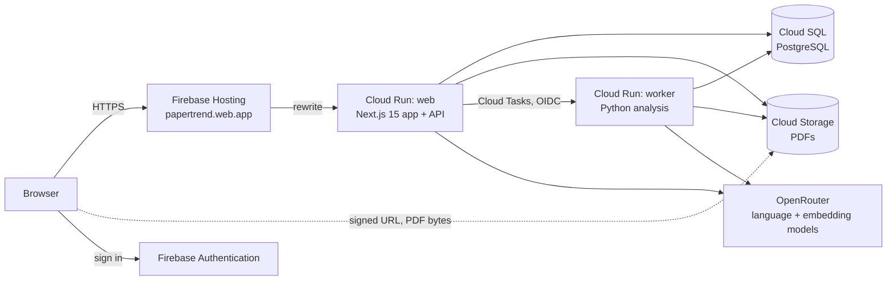

# Papertrend

Papertrend reads a whole collection of research papers the same way, then shows
how the field has moved and answers questions from the papers themselves.

You add PDFs to a repository. For each paper, Papertrend records its title, year,
methods, topics and research area, and keeps the sentence each one came from.
The Dashboard shows themes and research areas across the years, the Semantic Map
places related papers near each other, and Chat answers questions with a
numbered source on every claim that opens the paper at that passage.

It was built at the Faculty of Arts, Chulalongkorn University. Its first
collection is the research of the English as an International Language (EIL)
program, and it works with any set of papers or theses in English or Thai.

- **Live site:** https://papertrend.web.app (invite-only beta; anyone can
  request access from the sign-in page)
- **Second address:** https://research-trend-analysis.web.app (same service)

## What it does

| Area | What you can do |
| --- | --- |
| **Add papers** | Upload PDFs (up to 10 MB each) or pick them from Google Drive, into a repository. Analysis runs in the background and shows its current step. |
| **Analysis** | Each paper goes through the same 13-step pipeline: text extraction (with page images read when a PDF is scanned), year, methods, participants, keywords, topics and research area, each with its supporting passage. |
| **Research areas** | A repository uses one of three profiles: General Research, the EIL Tracks (English Linguistics, English Language Instruction, Language Assessment and Evaluation), or a Custom Taxonomy of 2 to 12 areas you define. |
| **Dashboard** | Four views of one repository: Semantic Map (a map and a free force graph of related papers), Area Analysis (themes and research areas by year), Keyword Explorer, and Adaptive (patterns worth a second look, with a checked write-up). |
| **Library** | Every paper in a list or a grid of first-page thumbnails. A paper opens in place with its overview, topics and evidence marked in the PDF. |
| **Table** | One row per paper and one column per question you write. Papertrend fills each cell from that paper and keeps the sentence it came from; a cell whose sentence is not in the paper is marked as not confirmed. The table downloads as an Excel file. |
| **Chat** | Ask across a repository in English or Thai. Choose the thinking effort (Low, Medium, High or Max), ask Chart mode to count and draw, and open any numbered source to the sentence it came from. |

## How it is built



- **Web** (`eil-dashboard/`): a Next.js 15 and React app. Its API routes check
  the Firebase sign-in, read and write Cloud SQL, sign Cloud Storage links, run
  the chat, and queue analysis work.
- **Worker** (repository root and `eil-dashboard/worker/`): a private Python
  service. Cloud Tasks calls it for each uploaded paper; it runs the analysis
  graph (`graphs.py`, `nodes/`, `prompts/`) and stores the results.
- **Data:** Cloud SQL for PostgreSQL holds accounts, repositories, papers,
  analysis results, chats and usage. Cloud Storage holds the PDFs, with separate
  buckets for production and the pilot.
- **Models:** language and embedding models come through OpenRouter; which
  model does which job is set in code (see [docs/04](docs/04-python-graphs-and-nodes.md)
  and [docs/03](docs/03-frontend-and-api-architecture.md)).

The project ran on Supabase and Vercel until 2026 and then moved to Google Cloud.
Files left from that time are marked as legacy in the
[module catalog](docs/09-module-catalog.md).

## Repository layout

| Path | What it holds |
| --- | --- |
| `eil-dashboard/` | The web app: `src/app` (pages and API routes), `src/components`, `src/lib`, `tests/`, `cloudsql/` (database migrations), `worker/` (the worker's queue and database code) |
| `graphs.py`, `state.py`, `nodes/`, `prompts/` | The paper analysis graph, its steps and their prompts |
| `node_service.py` | The worker's HTTP service, run on Cloud Run |
| `tests/` | Python tests for the worker and the analysis steps |
| `scripts/` | Evaluation, migration and operations scripts |
| `infra/` | Database setup files |
| `cloudbuild*.yaml`, `Procfile`, `firebase.json` | Build, deploy and hosting configuration |
| `docs/` | Documentation (see below) |

## Getting started

You need Node.js 22 and Python 3.13, the versions the CI tests run on
(`.github/workflows/tests.yml`). The full guide, including every environment
variable, is [docs/02](docs/02-setup-and-local-development.md).

```bash
git clone https://github.com/LLM-Project2005/papertrend_extractor_LLM.git
cd papertrend_extractor_LLM

# Web app
cd eil-dashboard
npm ci
npm test            # web test suite
npm run build       # production build

# Worker and analysis steps (from the repository root)
cd ..
python -m venv .venv
.venv/Scripts/activate      # Windows; on macOS or Linux: source .venv/bin/activate
pip install -r requirements.txt pytest
python -m pytest tests -q
```

Running the app against real data needs Google Cloud access and secrets that
are not in this repository.

## Deployment

Work happens on `development`. A pull request into `test` builds the pilot
services; a pull request from `test` into `main` builds production. Cloud Build
runs the tests before each deploy, and each service is rebuilt only when its own
files change. The runbook, with health checks and rollback, is
[docs/08](docs/08-deployment-and-operations-runbook.md).

## Documentation

Start with the reference chapters. They describe the system as it runs now.

1. [System overview and architecture](docs/01-system-overview-and-architecture.md)
2. [Setup and local development](docs/02-setup-and-local-development.md)
3. [Frontend and API](docs/03-frontend-and-api-architecture.md)
4. [Analysis graph and nodes](docs/04-python-graphs-and-nodes.md)
5. [Worker, queue and analysis pipeline](docs/05-worker-queue-and-analysis-pipeline.md)
6. [Data model and schema](docs/06-data-model-and-schema.md)
7. [Testing and quality](docs/07-testing-and-quality.md)
8. [Deployment and operations runbook](docs/08-deployment-and-operations-runbook.md)
9. [Module catalog](docs/09-module-catalog.md)

All nine chapters are also in one file, [PROJECT_DOCUMENTATION.md](PROJECT_DOCUMENTATION.md).
The other numbered files in `docs/` are records of each round of work, oldest
first; [docs/README.md](docs/README.md) lists them. Product and design
principles are in [PRODUCT.md](PRODUCT.md) and [DESIGN.md](DESIGN.md).

## Team

- **Jakapun Tachaiya**, Lecturer, Department of Linguistics, Faculty of Arts,
  and the Language and Information Technology program
- **Pheemaphat Chantarusorn**, Information Studies, Faculty of Arts
- **Thanawat Traipat**, Language and Information Technology, Faculty of Arts

All at Chulalongkorn University. More at https://papertrend.web.app/team.
