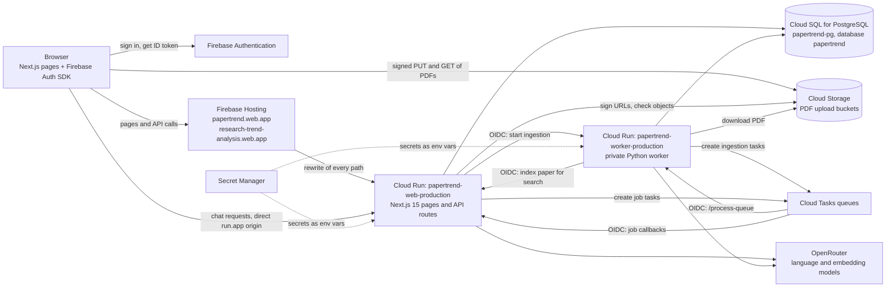

# System Overview and Architecture

This chapter explains what Papertrend does for a user, which services run it, how the three main requests (uploading a paper, reading the dashboard, asking in chat) travel through those services, how sign-in and data ownership work, and where things live in the repository. Later chapters go deeper: [Frontend and API](03-frontend-and-api-architecture.md), [Python graphs and nodes](04-python-graphs-and-nodes.md), [Worker and analysis pipeline](05-worker-queue-and-analysis-pipeline.md), [Data model](06-data-model-and-schema.md) and [Deployment and operations](08-deployment-and-operations-runbook.md).

The project moved from Supabase (database, storage, auth) and Vercel (hosting) to Google Cloud in 2026. The migration is recorded in docs/10 to docs/19. Some legacy code from that period is still in the tree and is marked as legacy in [Module catalog](09-module-catalog.md).

## What Papertrend does

Papertrend turns a collection of research papers (PDF files) into structured data that can be searched, charted and questioned. It was built for the English as an International Language (EIL) program, Faculty of Arts, Chulalongkorn University, and also works for general research collections.

The main ideas a user meets:

- **Repository.** A named collection of papers that belongs to one account. In the code and database a repository is a *project* (`eil-dashboard/src/app/api/workspace/projects/route.ts`). Each repository has an analysis profile (see [Repository taxonomy profiles](#repository-taxonomy-profiles)).
- **Upload.** The user adds PDFs from their computer or from Google Drive (Picker). The production limits are 10 MB per file (`MAX_UPLOAD_BYTES=10485760`) and 80 pages (`MAX_PDF_PAGES=80`), set in `cloudbuild.web.production.yaml`.
- **Analysis of each paper.** A background worker reads the PDF, translates it if needed, splits it into sections, and extracts metadata (title, year), the author's keywords, mined keywords grouped into topics, topic labels, a category under the repository's profile, a research typology and method facets. The graph is `build_ingestion_graph` in `graphs.py`; details are in chapters 04 and 05.

The signed-in workspace has these pages (navigation in `eil-dashboard/src/components/workspace/WorkspaceShell.tsx`):

| Page | Route | What it is for |
| --- | --- | --- |
| Home | `/workspace/home` | Recent papers, analysis progress, a place to continue. |
| Dashboard | `/workspace/dashboard` | Four tabs (`TAB_DEFINITIONS` in `eil-dashboard/src/components/DashboardClient.tsx`): **Semantic Map** (the default: papers placed by meaning, with relationship lines), **Area Analysis** (trends and categories over years), **Keyword Explorer** (keywords and themes), **Adaptive** (insights computed from the papers' data, with an optional checked write-up and a question box). |
| Chat | `/workspace/chat` | Questions answered from the selected papers, with citations to papers and passages. |
| Table | `/workspace/table` | An extraction table: papers as rows, user-chosen columns that the model fills from each paper (`eil-dashboard/src/app/api/workspace/tables/[id]/fill/route.ts`). |
| Library | `/workspace/library` | Every paper with its status, thumbnail, PDF preview and stored analysis; failed papers can be tried again and finished ones analysed again. |
| Settings | `/workspace/settings` | Repository settings (including the analysis profile) and account settings. |

A paper opens in place on any workspace page through `PaperViewerProvider` (`eil-dashboard/src/components/workspace/PaperViewerProvider.tsx`).

Chat has two controls worth knowing about:

- **Effort.** Low, Medium and High (`eil-dashboard/src/lib/chat-effort.ts`) answer inside the request; they differ in how many papers are read and how carefully claims are checked. **Max** is a separate research engine (`eil-dashboard/src/lib/deep-research/`) that plans, reads each chosen paper, writes and checks the answer as a background job.
- **Chart mode.** The model turns the question into a chart specification and code computes the numbers from the same data the dashboard uses (`eil-dashboard/src/lib/chat-chart.ts`). The model never writes a number into the chart.

The chat model list is in `eil-dashboard/src/lib/chat-models.ts` (currently GPT-6 Luna through OpenRouter). Embeddings for search use `REPOSITORY_EMBEDDING_MODEL` (`openai/text-embedding-3-small` in the production build file).

## Runtime topology

Everything runs in the Google Cloud project `research-trend-analysis`, region `asia-southeast1`.

| Component | What it does | Where it is defined |
| --- | --- | --- |
| Firebase Authentication | Signs users in with email and password, Google or Facebook (`eil-dashboard/src/components/auth/AuthPanel.tsx`, `eil-dashboard/src/lib/firebase-client.ts`). | Firebase project `research-trend-analysis`. |
| Firebase Hosting | Serves the two public hostnames and forwards every path to the web service. It holds no app code and no data. | `firebase.json`, `.firebaserc` (targets `production` and `short`). |
| Web service | Next.js 15 app: the pages and every `/api/*` route, including chat, search indexing, Max research, semantic maps and reclassification. | `eil-dashboard/`, deployed by `cloudbuild.web.production.yaml`. |
| Worker service | Private Python service (`node_service.py`) that runs the paper analysis pipeline (`graphs.py`, `nodes/`, `eil-dashboard/worker/`). It also creates the ingestion Cloud Tasks when the web service asks. | Repository root, deployed by `cloudbuild.worker.production.yaml`. |
| Cloud SQL | The application database (PostgreSQL). | Schema in `eil-dashboard/cloudsql/`. |
| Cloud Storage | PDF files. Production and the pilot use separate buckets. | `GCS_UPLOAD_BUCKET` in the build files. |
| Cloud Tasks | Runs long work outside a browser request. Three production queues: `papertrend-ingestion-production` (paper analysis, to the worker), `papertrend-app-tasks-production` (chat reports, semantic maps, reclassification, to the web) and `papertrend-research-production` (Max research, to the web). | Queue names in the build files. |
| Secret Manager | Credentials, mounted as environment variables at deploy time (`--set-secrets`). | See chapter 08 for the names. |
| OpenRouter | Language models for analysis and chat, and embedding models. Reached through an OpenAI-compatible client (`OPENAI_BASE_URL`, `eil-dashboard/src/lib/openai.ts`, `nodes/model_router.py`). | External. |

Two design choices shape the topology:

- **Firebase Hosting has a fixed 60-second request limit and buffers streamed responses** (comments in `eil-dashboard/src/lib/chat-http.ts` and `eil-dashboard/src/lib/chat-cors.ts`). So PDFs go straight between the browser and Cloud Storage, chat requests go straight to the web service's `run.app` address (`NEXT_PUBLIC_DIRECT_API_URL`), and anything longer runs as a Cloud Task that calls back on `APP_PUBLIC_URL` (the direct `run.app` address, never `web.app`).
- **The worker is not reachable from the internet without a Google identity.** Production deploys it with `--no-allow-unauthenticated`, and its handler checks an OIDC token on every POST (`_is_authorized_worker_request` in `node_service.py`).

A separate pair of pilot services (`papertrend-web-cloudsql-pilot`, `papertrend-worker-cloudsql-pilot`) runs the `test` branch against the same database with the staging bucket. Chapter 08 covers it.

## Flow 1: upload and analysis

1. The user picks files in the Add papers dialog (`eil-dashboard/src/components/workspace/AnalyzeFlowModal.tsx`). The browser hashes each file and sends name, size and hash to `POST /api/admin/import/prepare`.
2. The route verifies the user, checks the limits and skips files this account has already analysed successfully (matched by SHA-256 hash in `eil-dashboard/src/lib/cloudsql/ingestion-repository.ts`; a failed earlier upload does not block a retry). It creates one ingestion run per file in Cloud SQL, with a snapshot of the repository's profile, and returns signed upload URLs that are valid for 15 minutes (`UPLOAD_URL_MINUTES` in `eil-dashboard/src/lib/paper-upload-url.ts`).
3. The browser uploads each PDF directly to Cloud Storage with a `PUT` to its signed URL. The bytes never pass through Firebase Hosting or the web service.
4. The browser calls `POST /api/admin/import/finalize`. The route asks Storage whether each object really exists, marks those runs `queued` and calls `triggerWorkerQueueWithRetries` (`eil-dashboard/src/lib/worker-queue-start.ts`).
5. The web service calls the worker's `/enqueue-ingestion-tasks` with an OIDC identity token (`eil-dashboard/src/lib/worker-trigger.ts`). The worker creates Cloud Tasks on the ingestion queue that call its own `/process-queue`, each carrying an OIDC token for the tasks service account (`_enqueue_ingestion_tasks` in `node_service.py`). If that fails, the web service calls `/process-queue` directly.
6. `/process-queue` starts one background batch at a time (`NODE_SERVICE_ASYNC_MAX_RUNS=1`). A busy worker answers 429 to a Cloud Task so the task is retried later.
7. The batch (`eil-dashboard/worker/process_ingestion_queue.py`) claims a run, downloads the PDF from Cloud Storage, runs the ingestion graph, and writes the results to Cloud SQL while sending heartbeats. It records the model spend and leaves papers queued while the site-wide daily spend limit is reached (`eil-dashboard/worker/spend_limits.py`).
8. When a run succeeds, the worker asks the web service to index the paper for search (`SEARCH_INDEX_URL`, which is `/api/workspace/repository-memory/index`; `eil-dashboard/worker/search_index.py`). The web service chunks the text and stores embeddings.
9. Meanwhile the browser polls `POST /api/workspace/runs/status` (`eil-dashboard/src/hooks/useIngestionRuns.ts`) and shows progress. If papers are queued but never start, the progress card offers "Start processing now" (`/api/folder-analysis/start`).

## Flow 2: reading the dashboard

1. The browser loads `/workspace/dashboard` through Firebase Hosting. The page is a client component (`DashboardClient.tsx`).
2. The page gets a fresh Firebase ID token and calls `GET /api/workspace/dashboard-data` for the open repository (`eil-dashboard/src/app/api/workspace/dashboard-data/route.ts`, `maxDuration = 30`).
3. The route verifies the token, resolves the owner and reads papers, keywords, topics, categories and years for that owner and repository (`eil-dashboard/src/lib/dashboard-data-server.ts`).
4. Year, category and search filters are applied in the browser (`eil-dashboard/src/lib/dashboard-filters.ts`). "Show all" keeps every paper in the repository, including papers analysed under an older profile.
5. The Semantic Map tab reads a stored map from `/api/workspace/semantic-map`. Building or rebuilding a map is a Cloud Task that calls `/api/workspace/semantic-map/jobs/process`; it reuses stored embeddings and lays papers out with PCA or UMAP (`eil-dashboard/src/lib/semantic-map-math.ts`).
6. The Adaptive tab calls `/api/workspace/insights` and `/api/workspace/insights/ask`. Numbers are computed by code (`eil-dashboard/src/lib/insights/`); a model only writes the optional summary.
7. Opening a paper calls `/api/workspace/library/[runId]`, which returns the analysis and a signed read URL. The PDF itself is fetched from Cloud Storage.

## Flow 3: chat

1. The composer (`eil-dashboard/src/components/chat/ChatClient.tsx`) sends `POST /api/chat` to the direct web origin with `Accept: text/event-stream`. CORS on this route allows only the origins in `APP_ALLOWED_ORIGINS` (`eil-dashboard/src/lib/chat-cors.ts`).
2. The route verifies the user, checks the daily AI allowance (`assertAiTokenBudget`) and allows at most two answers in progress per user (`claimAnswerSlot`).
3. The question is saved to the conversation in Cloud SQL, together with its knowledge scope (all repositories, one repository, or selected papers).
4. For Low, Medium and High, `runRepositoryChat` (`eil-dashboard/src/lib/repository-chat.ts`) resolves the authorized scope, plans the answer, retrieves evidence (hybrid keyword and vector search), writes the answer with citations and checks it. Progress frames stream back while it works. Chart mode goes through `eil-dashboard/src/lib/chat-chart.ts`.
5. Some answers are too long for one request: web search, whole-repository synthesis, and analysis of every paper in a large scope (`shouldQueueRepositoryChat` in `eil-dashboard/src/lib/repository-chat-routing.ts`). These become a chat job. The route answers 202, a Cloud Task calls `/api/chat/jobs/process`, and the browser polls `/api/chat/jobs/[jobId]`.
6. Max sends `chatMode: "deep_research"`. The route first returns a plan, then on "continue" queues a research run (`eil-dashboard/src/lib/deep-research/actions.ts`). A Cloud Task calls `/api/chat/research/process`, which saves each step so an interrupted run resumes (`eil-dashboard/src/lib/deep-research/run.ts`).
7. The answer's model cost is recorded and logged (`chat_answer_spend`).

## Authentication and authorization

### Users

- **Sign-in** happens in the browser with the Firebase Auth SDK. Sign-up is invite-only in production (`INVITE_CODE_REQUIRED=true`); a new account redeems an invite code through `/api/auth/invite`.
- **Every API call** carries `Authorization: Bearer <Firebase ID token>`. The server verifies it with the Firebase Admin SDK, with a revocation check when `FIREBASE_CHECK_REVOKED=true` (`eil-dashboard/src/lib/auth/adapter.ts`). A verified identity is reused for at most 60 seconds and never past the token's expiry.
- **Owner mapping.** A Firebase UID is not used as the data key. `auth_identity_mappings` maps each Firebase identity to a stable Papertrend owner UUID (`eil-dashboard/src/lib/auth/identity-mapping.ts`, `eil-dashboard/src/lib/cloudsql/identity-repository.ts`). An existing account is linked by verified email; a new one is created only through an invite.
- **Owner scoping.** Every private query filters by that owner UUID, which always comes from the verified token and never from the browser. Database work runs in `withCloudSqlOwnerTransaction` (`eil-dashboard/src/lib/cloudsql/client.ts`), which sets the transaction-local setting `app.current_user_id`; row-level security policies in `eil-dashboard/cloudsql/schema.sql` read the same setting.
- **Project scoping.** Within an owner, a repository (project) id or a list of selected run ids narrows what a request may read. Ids sent by the browser can only narrow the owner's own data.
- **Pilot gate.** On the pilot (`DEPLOYMENT_ENV=pilot`) only admin accounts and the addresses in the `PILOT_ALLOWED_EMAILS` secret are admitted (`applyDeploymentGate` in `eil-dashboard/src/lib/auth/adapter.ts`, `eil-dashboard/src/lib/deployment.ts`).

### Services

Service-to-service calls use Google-signed OIDC identity tokens:

| Caller to callee | Token | Checked by |
| --- | --- | --- |
| Web to worker | Identity token from the Cloud Run metadata server, audience = worker URL (`eil-dashboard/src/lib/worker-trigger.ts`). | Worker: `WORKER_OIDC_AUDIENCE` and `WORKER_OIDC_SERVICE_ACCOUNTS` (`node_service.py`). |
| Cloud Tasks to worker | OIDC token for the tasks service account (`CLOUD_TASKS_OIDC_SERVICE_ACCOUNT`). | Same worker check. |
| Cloud Tasks to web (job callbacks) | OIDC token for the web service's own runtime account, audience = `APP_PUBLIC_URL` (`eil-dashboard/src/lib/cloud-tasks-oidc.ts`). | `isVerifiedTaskCaller` in the same file. |
| Worker to web (search indexing) | Identity token for the worker's account. | `isVerifiedServiceCaller`, accounts listed in `WORKER_CALLER_SERVICE_ACCOUNTS`. |

The shared `WORKER_WEBHOOK_SECRET` is still accepted by the worker as a fallback where an identity token is not available (`worker-trigger.ts`, `node_service.py`). The browser never receives database credentials, service-account keys or Secret Manager values; it gets only short-lived signed URLs for its own PDFs.

## Repository taxonomy profiles

Classification belongs to the repository. `eil-dashboard/src/lib/project-analysis-profile.ts` defines three modes:

| Mode | Name shown | Behaviour |
| --- | --- | --- |
| `general` | General Research | The default. No category classification. |
| `eil` | EIL Tracks | Classifies into English Linguistics (EL), English Language Instruction (ELI) and Language Assessment & Evaluation (LAE) using the official track definitions. |
| `custom` | Custom Taxonomy | 2 to 12 owner-defined categories (`MIN_CUSTOM_CATEGORIES`, `MAX_CUSTOM_CATEGORIES`), plus an automatic "Other / Unclassified". |

Each profile has a `profileHash`. Every ingestion run stores a snapshot of the profile it was analysed under. Changing a repository's profile applies to new uploads at once; existing papers change only through a reclassification job (`/api/workspace/projects/[projectId]/reclassify`, processed by a Cloud Task at `/api/workspace/projects/reclassify/process`). The design history is in docs/21-repository-taxonomy-v2.md.

## Workspace folder layout

| Path | Contents |
| --- | --- |
| `eil-dashboard/` | The Next.js app. `src/app/` has the pages and `src/app/api/` the API routes; `src/components/`, `src/hooks/`, `src/lib/` and `src/types/` hold the UI and server logic. |
| `eil-dashboard/worker/` | The Python worker's queue processor and helpers (database client, search indexing, spend limits, analysis pipeline wrapper). Deployed with the worker, not the web app. |
| `eil-dashboard/cloudsql/` | Cloud SQL schema and dated migrations. |
| `eil-dashboard/tests/`, `eil-dashboard/scripts/`, `eil-dashboard/evals/` | Web tests (`npm test`), maintenance and evaluation scripts, question banks. |
| `eil-dashboard/supabase/` | Legacy Supabase schema and migrations (history). |
| `nodes/` | One Python module per analysis step, plus the model router. |
| `prompts/` | Prompt templates used by the nodes. |
| `graphs.py`, `state.py`, `node_service.py`, `main.py` | The ingestion graph, its state types, the worker's HTTP service, and a local batch runner. |
| `tests/` | Python tests (`python -m pytest tests -q`). |
| `scripts/` | Operations, evaluation and migration scripts (`scripts/ops/` for Cloud Build triggers and monitoring). |
| `docs/` | This documentation and the dated plans and records (docs/10 onward). |
| Root deploy files | `cloudbuild.*.yaml`, `firebase.json`, `.firebaserc`, `gcs-cors.*.json`, `.gcloudignore`. See chapter 08. |
| `infra/`, `jobs/`, `firebase-hosting/` | An early schema copy, an unused notebook job, and the empty public folder Firebase Hosting requires. |

The full file-by-file list is in [Module catalog](09-module-catalog.md).
