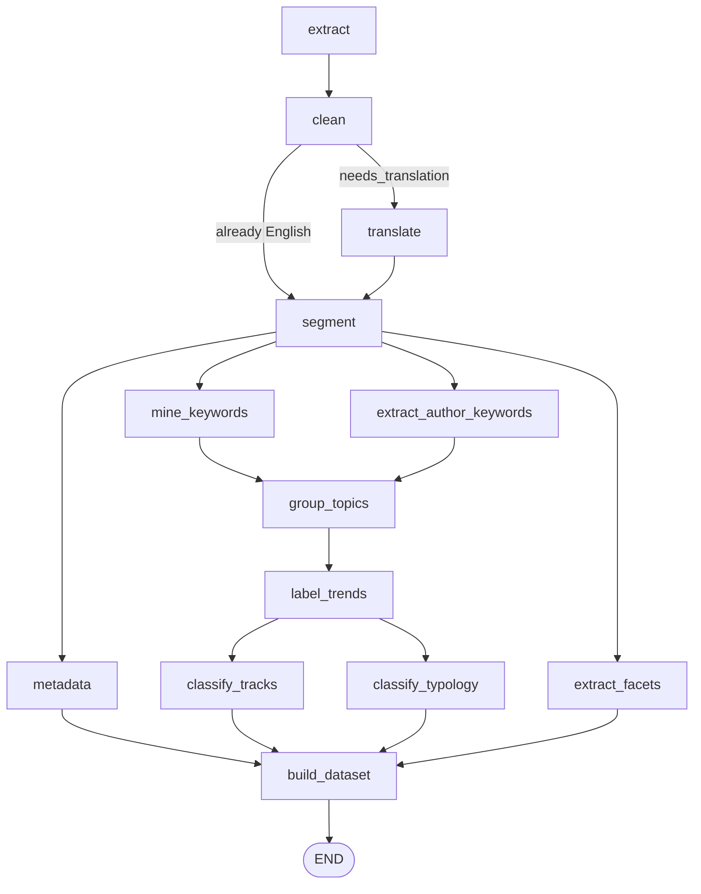

# Python Graphs and Nodes

This chapter describes the Python analysis graph that turns one PDF into structured rows: the LangGraph definition in `graphs.py`, the shared state in `state.py`, each node in `nodes/` in the order the graph runs it, the prompt files in `prompts/`, and how each step picks its language model. The worker that runs this graph for queued uploads, and what it saves, is described in [Worker queue and analysis pipeline](05-worker-queue-and-analysis-pipeline.md).

## Where the graph runs

- **Production and pilot:** the private worker service imports the graph through `eil-dashboard/worker/analysis_pipeline/pipeline.py` and runs it once per queued paper.
- **Locally:** through `main.py` (see the end of this chapter) or the worker scripts ([Setup](02-setup-and-local-development.md)).
- The graph never touches the database. It returns a `dataset` dictionary, and the worker saves it.

`graphs.py` defines only the ingestion graph. The Python workspace query graph (chat, keyword search, chart planning) and the deep research graph were removed; chat, charts and deep research now run in the web app (see the comment at the top of `graphs.py`, docs/31 and docs/32, and [Frontend and API](03-frontend-and-api-architecture.md)).

## The ingestion graph

`build_ingestion_graph()` in `graphs.py` builds a LangGraph `StateGraph(IngestionState)` with 13 nodes and compiles it once (it is cached with `lru_cache`). `run_ingestion_graph(initial_state)` invokes it. The worker uses `graph.stream(..., stream_mode="updates")` instead, so it can report progress after each node.

How to read it:

- The only conditional edge is after `clean`. `_route_translation` sends the paper to `translate` when `needs_translation` is true, and straight to `segment` otherwise.
- After `segment`, four branches run in parallel: `metadata`, `extract_author_keywords`, `mine_keywords` and `extract_facets`.
- `group_topics` waits for both `mine_keywords` and `extract_author_keywords` (a list of sources in `add_edge` is a join), because the paper's own keyword list is merged into the extracted concepts before grouping.
- `classify_tracks` and `classify_typology` run side by side after `label_trends`. Both read the labelled topics, and running them together keeps the longest path short.
- `build_dataset` waits for `metadata`, `classify_tracks`, `classify_typology` and `extract_facets`.
- Every edge after `clean` is unconditional. A node that fails sets `status` to `failed`, and the remaining nodes still run. The worker checks the final state (see [How failure is reported](#how-failure-is-reported)).

| Graph node | Function | Module |
|---|---|---|
| `extract` | `extract_pdf_node` | `nodes/extractor.py` |
| `clean` | `clean_and_route_node` | `nodes/cleaner.py` |
| `translate` | `smart_translate_node` | `nodes/translator.py` |
| `segment` | `segment_to_json_node` | `nodes/segmentation.py` |
| `metadata` | `infer_metadata_node` | `nodes/metadata.py` |
| `extract_author_keywords` | `extract_author_keywords_node` | `nodes/author_keywords.py` |
| `mine_keywords` | `grounded_keyword_extractor_node` | `nodes/keyword_extractor.py` |
| `extract_facets` | `extract_facets_node` | `nodes/facet_extractor.py` |
| `group_topics` | `semantic_keyword_grouper_node` | `nodes/keyword_grouper.py` |
| `label_trends` | `topic_labeler_node` | `nodes/topic_labeler.py` |
| `classify_tracks` | `classify_tracks_node` | `nodes/track_classifier.py` |
| `classify_typology` | `classify_research_typology_node` | `nodes/research_typology.py` |
| `build_dataset` | `build_dataset_node` | `nodes/dataset_builder.py` |

## Shared state (`state.py`)

`IngestionState` is a `TypedDict` with `total=False`. Its docstring states the main rule: every key a node returns must be declared there, because LangGraph silently drops undeclared keys. A test enforces this ([Testing](07-testing-and-quality.md)).

Reducers decide how parallel branches combine:

- `messages`, `warnings` and `errors` use `operator.add`, so each branch appends.
- `status` uses `keep_failure`: the latest status wins, except that `failed` stays `failed`. A branch that finishes later cannot hide an earlier failure.

The worker starts the graph with `pdf_path`, `source_path`, `source_filename`, `ingestion_run_id`, `owner_user_id`, `folder_id`, `input_payload` (the run's JSON payload), empty `errors`/`warnings`/`messages` and `status: "starting"`.

`state.py` also holds the Pydantic schemas used for structured model output: `SectionOutlineSchema`, `KeywordCandidateSchema`, `KeywordGrouperSchema`, `TopicLabelsSchema`, `TrackClassificationSchema`, `PaperMetadataSchema`, `PaperFacetSchema`, `AuthorProvidedKeywordSchema` and `ResearchTypologySchema`. The typology schema asks for plain integers because Gemini structured output does not support integer enums or nullable fields. `TRACK_KEYS` names the legacy EIL track columns (`EL`, `ELI`, `LAE`, `Other`).

## The repository's analysis profile

Several nodes read `input_payload.analysis_profile`, the taxonomy profile of the repository the paper belongs to. The web app writes it onto each run (profiles are built in `eil-dashboard/src/lib/project-analysis-profile.ts`, with the modes `general`, `eil` and `custom`). `normalize_analysis_profile()` in `nodes/common.py` turns it into: `version`, `mode`, `profile_hash`, `classification_enabled`, `domain`, `domain_definition`, `taxonomy_name`, `taxonomy_definition`, `additional_context` and `categories` (each with a slugged, unique `key`, a `label` and a `description`).

- `mine_keywords`, `extract_facets`, `classify_tracks` and `classify_typology` put the domain text into their prompts.
- `group_topics` adds an EIL-specific instruction when the mode is `eil`.
- `classify_typology` chooses the EIL or the general typology by mode.
- `classify_tracks` runs only when classification is enabled and categories exist. The `general` profile has none, so its papers get no category rows.

## Nodes in graph order

### extract

Reads `pdf_path`. Writes `raw_text`, `pdf_metadata`, `extraction_method` (`fitz_text`, `fitz_text+vision_pages` or `vision_fallback`) and `warnings`. It first checks for a `%PDF-` header (MuPDF also opens EPUB, XPS, SVG and images), then reads the text layer with PyMuPDF (`fitz`). The `VISION_OCR` model is called only for scanned documents, scanned pages and tables printed as pictures. The page limits and selection rules are in [Reading the PDF](05-worker-queue-and-analysis-pipeline.md#5-reading-the-pdf).

### clean

No model. `clean_and_route_node` caps the text at 2,000,000 characters before any regular expression runs, normalises line endings, removes NUL characters, joins words hyphenated across lines, replaces Markdown tables with `[TABLE_REMOVED]`, drops page-number lines and collapses whitespace. A year on a line of its own is kept (a thesis cover's "2020", or a Thai "2563"), because the year resolver needs it.

Language routing: if Latin letters make up less than 72% of all letters, `needs_translation` is set. For English papers the node also sets `cleaned_english_text`.

### translate (Thai and other non-English papers)

Model task `TRANSLATION`, prompt `translator.txt` (formal academic English, Markdown and paragraphs preserved, one English term per source term, output inside `<translated_content>` tags).

- The text is split into chunks of at most 12,000 characters at paragraph breaks.
- A document longer than `TRANSLATION_MAX_DOCUMENT_CHARS` (default 60,000, never below 12,000) is condensed first by `condensed_for_translation()`: the opening plus each main section found by the heading rules, each with an English heading written in front so `segment` can find it after translation. The strategy is then `section_translation` and a warning says how much was translated.
- A chunk that fails stays in the original language, with a warning. If every chunk fails, the untranslated text goes on (`multilingual_fallback`).
- Writes `cleaned_english_text`, `translation_strategy` and `translation_warning`.

The original text stays in `raw_text` (saved as `paper_content.raw_text`); the translated text is saved as `paper_content.body`.

### segment

Model task `SEGMENTATION`, prompt `segmenter.txt`. Reads `cleaned_english_text` and writes `final_json`: a `title` plus the sections `abstract_claims`, `introduction`, `literature_review`, `methods`, `results`, `discussion`, `conclusion` and `bibliography`. Two methods are combined:

1. **Heading rules.** `SECTION_ALIASES` lists English and Thai heading names for each section (for example "Methodology" and "วิธีดำเนินการวิจัย"). Numbering such as "Chapter 3", "บทที่ 3", "2.1" or Roman numerals is stripped. A line counts only when the alias is (almost) the whole line, lines that repeat three or more times (running headers and footers) are ignored, and back matter (acknowledgements, appendices, "ภาคผนวก") ends the section before it.
2. **Model outline.** `build_outline()` lists up to 220 heading-like lines as `L1: ...`, `L2: ...`. The model returns, for each section, the number of the line where it starts (or 0). The text between chosen headings becomes the section.

The model's section is used when it has at least 120 characters, otherwise the rule's. A missing abstract becomes the first 3,000 characters; a paper with neither conclusion nor discussion gets the last 3,500 characters before the references. With fewer than two outline lines, or when the model call fails, only the heading rules are used (`multilingual_headings`, with a warning on failure). The title comes from `pick_title()` in `nodes/common.py`, which skips journal headers and prefers the English title of a bilingual paper.

Theses and journal papers go through the same graph. Thesis structure is handled by the chapter-heading rules above, the cover-year rules in the year resolver, and the 400-page extraction limit.

### metadata

Model task `METADATA`, prompt `metadata_extractor.txt`. Writes `paper_metadata` (`title`, `year`, `year_source`, `year_confidence`, `year_evidence`) and `year_resolution` (the full audit).

- Year candidates are collected first (see [Publication year](#publication-year)). The prompt shows the top eight with their evidence and tells the model to choose only among them or answer "Unknown".
- The title is copied from the first page; a bilingual paper gives its English title, and a Thai-only title is translated.
- If the model fails, the title comes from the layout and the year from the resolver alone, with a warning.

### extract_author_keywords

Model task `AUTHOR_KEYWORD_EXTRACTION`, prompt `author_keyword_extractor.txt`. Finds labelled keyword lists ("Keywords:", "Key words", "Index terms", "คำสำคัญ") in the raw text, the translated text, the title and the abstract (up to eight windows). With no labelled list there is no model call and the list is empty. The model returns keywords only from an explicit list; if it returns none or fails, the list is split by rule (commas, semicolons, "and"; at most 24). Writes `author_keywords` (keyword, evidence, source section).

### mine_keywords

Model task `KEYWORD_EXTRACTION`, prompt `keyword_extractor.txt`. This is the grounded concept extraction that feeds topics.

- **Input.** Sections within fixed budgets (title 500 characters, abstract 3,000, introduction 4,500, literature review 3,500, methods 2,500, results 5,000, discussion 3,500, conclusion 3,000). The bibliography is left out. If the found sections hold under 4,000 characters, the running text before the references heading (up to 20,000 characters) is read instead.
- **Answer.** 12 to 20 candidates, each an exact phrase with `kind` `subject` or `method` (at most three methods), one evidence sentence, other surface forms and a section.
- **Grounding** (`ground_candidates`). Phrases are compared after folding (`nodes/text_matching.py`: NFKC, case-folded, typographic quotes and dashes unified, punctuation read as spaces, a trailing plural "s" dropped; Thai is left as it is). A concept that does not appear in the text is dropped; a paraphrased keyword is replaced by a form that does appear; occurrences are counted over all forms without double counting; evidence not found in the text is replaced by the first sentence that contains the keyword. Phrases that only name participants ("Thai EFL learners") are dropped (`nodes/participants.py`).
- **Retry and fallback.** A failed call, or one whose concepts are all missing from the text, is retried with a shorter inline prompt (`_compact_prompt`) and `max_completion_tokens=6000`. If that fails too, frequent phrases from the text (at most 20) are grounded the same way and used, with a warning. If even that finds nothing, the node fails.

### extract_facets

Model task `FACET_EXTRACTION`, prompt `facet_extractor.txt`. Returns up to four `objective_verb` facets (investigate, compare, evaluate...) and up to four `contribution_type` facets (instrument development, intervention evaluation...), each with verbatim evidence. On failure no facet is saved, so nothing is invented.

### group_topics

Model task `KEYWORD_GROUPING`, prompt `keyword_grouper.txt`.

- `merge_author_keywords()` first adds the paper's own keywords that appear in the text and are not already covered, skipping participant descriptors.
- The model groups the candidates. `assign_groups()` then enforces the rules: each candidate in exactly one topic, a subject and a method never in the same topic, a label that is one of the members (otherwise the most frequent member). Candidates the model left out become their own topics, with a warning.
- `merge_defined_acronyms()` merges two topics only when the paper defines one as the acronym of the other, as in "English-medium instruction (EMI)".
- If the call fails, every keyword becomes its own topic, with a warning; the dashboard's cross-paper grouping still gathers them into themes.

### label_trends

Model task `TOPIC_LABELING`, prompt `topic_labeler.txt`. Each topic gets a specific Title Case label of two to five words built from its own phrases, distinct within the paper. A label that breaks the length or distinctness rule is replaced by a member phrase that fits. Writes `final_labeled_topics` (label, kind, total count, justification, original keywords, matched terms, evidence, `status` `success` or `fallback`).

### classify_tracks

Model task `TRACK_CLASSIFICATION`, prompt `track_classifier.txt`. Classifies the paper against the repository's own categories.

- When the profile disables classification or has no categories, the node skips the model and records `classifier_model: "skipped"`; no category rows are saved.
- The prompt lists the allowed keys (`format_category_definitions()`: `- key: label -- description`, plus `other`) and the domain and boundary rules, then gives the title, abstract, methods, results and conclusion (up to 7,000 characters each) and the labelled concepts inside `<paper_evidence>` tags, which it tells the model to treat as untrusted content.
- The answer is `single_category_key`, `multi_category_keys` (primary first, at most two secondary keys) and a rationale. An unknown key gets one corrective re-ask; if it is still unknown, the paper goes to Other with a warning.
- The legacy `el`/`eli`/`lae`/`other` flags are also filled: the first three categories map to `el`, `eli` and `lae`, and a fourth or later category has no legacy column.
- Writes `track_single`, `track_multi` and `category_classification` (with a revision id, the model name and the profile hash and version).

### classify_typology

Model task `RESEARCH_TYPOLOGY`. Mode `eil` uses `research_typology_classifier.txt` with the groups Descriptive & Explanatory, Pedagogical & Intervention, Assessment & Measurement, and Policy, Sociolinguistic & Critical. Other modes use `research_typology_general.txt` with Descriptive & Explanatory, Intervention & Design, Measurement & Method, and Review, Theory & Critique. The model returns a primary group number, a secondary group (0 for none) and its reasoning (stated purpose, primary contribution, group match, boundary rule, verdict). A failure or an out-of-range group saves no typology, with a warning.

### build_dataset

No model. `build_dataset_node` turns the state into one `dataset` dictionary whose lists map to tables. The column details are in [Data model](06-data-model-and-schema.md).

| Dataset key | Table |
|---|---|
| `papers` | `papers` (title, year and the year audit columns) |
| `paper_content` | `paper_content` (raw text, sections, translated body, source file) |
| `keywords` | `paper_keywords` |
| `keyword_concepts` | `paper_keyword_concepts` |
| `tracks_single`, `tracks_multi` | `paper_tracks_single`, `paper_tracks_multi` |
| `paper_facets` | `paper_analysis_facets` |
| `author_keywords` | `paper_author_keywords` |
| `research_typologies` | `paper_research_typologies` |
| `category_definitions`, `category_assignments` | `paper_category_definitions`, `paper_category_assignments` |

It also sets:

- `paper_id`: the first 15 hex digits of the run's UUID read as an integer, or a hash of the source path when there is no run id (`infer_paper_id()`).
- The title: a title corrected in the paper library (`input_payload.user_overrides.title`) wins over the extracted one, so corrections survive re-analysis.
- `analysis_quality`: `degraded`, up to 20 `warnings`, `extraction_method`, `segmentation_strategy` and `translation_strategy`. The worker stores it on the run.
- `topic_kinds` (label to `subject` or `method`) and `year_resolution`.

## Publication year

The year is decided by evidence, not by the model. `nodes/year_resolver.py` does the local work and `nodes/year_web_lookup.py` is a strict fallback.

**1. Collect candidates** (`collect_year_candidates`). Each mention of a year between 1900 and next year becomes a candidate with a source and a confidence. Thai Buddhist-era years (25xx) are converted by subtracting 543. Digits inside an ISSN, ISBN, DOI, e-mail address or URL are skipped.

| Source | Base confidence |
|---|---|
| Import metadata on the run (`year`, `publication_year`, `paper_year`) | 0.96 |
| Import metadata (`published_at`, `publication_date`) | 0.88 |
| Title and abstract text | 0.74 |
| First 12,000 characters (`front_matter`) | 0.72 |
| Last 2,500 characters, labelled years only (`back_matter`) | 0.62 |
| Folder or file name | 0.45 to 0.55 |
| Body text from character 12,000 to 40,000 | 0.42 (capped at 0.48, or 0.55 when labelled) |
| PDF file metadata (other fields / creation and modification dates) | 0.28 / 0.25 |

Each text mention is then adjusted: an explicit "Published", "Available online" or copyright label (+0.18, +0.12 for online), a journal issue line ("Vol 28, No 2, May - August 2021") or a thesis cover year (+0.16), and nearby strong words (+0.05). It loses points for nearby non-publication words such as received, accepted, data collected, semester or participants (-0.20), reference or retrieval words (-0.22), a year that dates an event ("in 2007", "the 1980s", a Thai academic year) (-0.20), and a citation ("Smith (2010)", "et al.") (-0.30). On a thesis cover (thesis, dissertation, วิทยานิพนธ์ or สารนิพนธ์ in the opening text), "Academic Year 2020" or the Thai academic-year label counts as the thesis year. A year a previous worker run wrote into the payload is ignored on re-analysis, so it is resolved again from the source. Several sources agreeing on one year add up to +0.10.

**2. Decide** (`resolve_publication_year`), in this order:

1. A year corrected by a user in the paper library (`input_payload.user_overrides.year`) wins, including "Unknown".
2. Two equally strong publication years at the top evidence level (less than 0.08 apart) give "Unknown" and a review flag.
3. The model's year is accepted only if it equals a grounded candidate the model may confirm (publication evidence at 0.70 or more, or a front-matter or title/abstract year at 0.65 or more) and no stronger publication evidence (0.80 or more) points to another year. A confirmed year gains 0.06.
4. Otherwise the strongest publication evidence is taken at 0.80 or more, or at 0.65 or more when the model said "Unknown".
5. Otherwise the year is "Unknown" and `needs_review` is set. Any year below 0.75 is also flagged for review.

**3. Web fallback.** Only when the local result is "Unknown" or needs review (and is not a user correction), `resolve_year_from_web()` sends a DOI or a normalised title, never the paper body. A DOI is taken from the path or the front matter before any references heading; an exact Crossref DOI record scores 0.98. Otherwise a title of at least 20 characters is searched on Crossref and then OpenAlex, and accepted only on a strict match (an exact title, or a score of at least 0.93 with a clear margin over the next result and no close result with another year). `merge_web_year_resolution()` lets a web year fill an "Unknown" only at 0.88 or more and only if it does not contradict a front-matter year; agreement adds 0.03, and a confident web year (0.88 or more) that disagrees with a local year gives "Unknown", with both kept for review. The lookup can be turned off with `PAPER_YEAR_WEB_LOOKUP_ENABLED=false`; `CROSSREF_MAILTO` adds a contact address to the request's user agent.

## Helper modules

- `nodes/common.py`: `load_prompt()`, title picking, `infer_paper_id()`, `normalize_analysis_profile()`, `format_category_definitions()`, the legacy track row helpers and evidence span helpers.
- `nodes/text_matching.py`: folded phrase matching, counting, acronym spelling and sentence lookup, used to ground model output in the paper's text.
- `nodes/participants.py`: `is_participant_descriptor()`. A phrase whose head noun names people (student, learner, teacher...; Thai ผู้เรียน, นักศึกษา, ครู...) describes who took part, not what was studied. The same list lives in `eil-dashboard/src/lib/participant-terms.ts`, and a test keeps the two equal.
- `nodes/year_resolver.py` and `nodes/year_web_lookup.py`: see above.
- `nodes/model_router.py`: see [Model routing](#model-routing).

## How failure is reported

- **Soft fallbacks** (a model that failed, a rule used instead, a limit reached) add a line to `warnings`. `build_dataset` copies them into `analysis_quality`, and the paper is saved with `degraded: true`.
- **Hard failures** set `status: "failed"` with a message in `errors`: no PDF path, not a PDF, no usable text or an exception in `extract`; no text in `clean`, `translate` or `segment`; nothing at all in `mine_keywords`; no candidates in `group_topics`; no groups in `label_trends`.
- `process_pdf_run()` in `eil-dashboard/worker/analysis_pipeline/pipeline.py` raises `PipelineFailure` when the final status is `failed`, when there is no raw text, no dataset or no keyword rows. The failure carries the cost of the calls already made. What the worker does next is in [Failures, retries and recovery](05-worker-queue-and-analysis-pipeline.md#failures-retries-and-recovery).

## Prompts

Each prompt is a text file in `prompts/`, read by `load_prompt()` and filled with Python `str.format()`. A change must keep the placeholders the node passes, and the requested output must still match the Pydantic schema in `state.py`. None of the current prompts contains a literal brace; one would have to be written `{{` `}}`.

| Prompt file | Node | Placeholders |
|---|---|---|
| `segmenter.txt` | `segment` | `outline`, `opening` |
| `translator.txt` | `translate` | `input_text` |
| `metadata_extractor.txt` | `metadata` | `title_hint`, `fallback_year`, `year_candidates`, `first_page`, `abstract` |
| `author_keyword_extractor.txt` | `extract_author_keywords` | `candidate_text`, `title`, `abstract_claims` |
| `keyword_extractor.txt` | `mine_keywords` | `analysis_domain`, `domain_definition`, `additional_context`, `context_text` |
| `facet_extractor.txt` | `extract_facets` | domain fields, `title`, `abstract_claims`, `methods`, `results`, `conclusion` |
| `keyword_grouper.txt` | `group_topics` | `title`, `candidates`, `profile_note` |
| `topic_labeler.txt` | `label_trends` | `title`, `abstract`, `groups` |
| `track_classifier.txt` | `classify_tracks` | domain and taxonomy fields, `category_definitions`, paper sections, `concepts` |
| `research_typology_classifier.txt` | `classify_typology` (mode `eil`) | domain fields, paper sections, `concepts` |
| `research_typology_general.txt` | `classify_typology` (other modes) | domain fields, paper sections, `concepts` |

Some instructions live in code instead: the page OCR and table OCR instructions in `nodes/extractor.py`, the compact keyword retry prompt in `nodes/keyword_extractor.py`, and the corrective re-ask in `nodes/track_classifier.py`.

## Model routing

Every model call goes through `nodes/model_router.py`. A node asks for `get_task_llm(ModelTask.X)` and gets a `RoutedChatModel`, which builds `langchain_openai.ChatOpenAI` clients for an OpenAI-compatible endpoint.

- **Endpoint.** `OPENAI_BASE_URL` when set; otherwise OpenRouter (`https://openrouter.ai/api/v1`) when `MODEL_GATEWAY=openrouter` or the key is an OpenRouter key; otherwise the OpenAI API. The deployed workers set `MODEL_GATEWAY=openrouter` and read `OPENAI_API_KEY` and `OPENAI_BASE_URL` from Secret Manager (`cloudbuild.worker.production.yaml`).
- **Preset.** `MODEL_POLICY_PRESET` picks a table of `TaskProfile` entries (primary model, fallback, OpenRouter provider order, reasoning effort). The presets are `conservative` (the code default), `aggressive-cost`, `budget-structured`, `quality-first`, `gemini-2.5-flash-lite`, `gemini-3.1-flash-lite` and `gemma-4-31b` (alias `gemma-4-31b-it`). Both worker build files (`cloudbuild.worker.production.yaml`, `cloudbuild.worker.cloudsql.pilot.yaml`) set `budget-structured`.
- **Overrides.** `MODEL_TASK_<TASK>`, `MODEL_TASK_<TASK>_FALLBACK`, `MODEL_TASK_<TASK>_PROVIDER_ORDER` and `MODEL_TASK_<TASK>_REASONING_EFFORT` change one task without a code change. `OPENAI_MODEL_VISION`, when set, replaces the OCR model. Neither worker build file sets these.

Models used by the graph under `budget-structured` (from `BUDGET_STRUCTURED_PRESET`; the fallback is the other Flash-Lite model and is used only after a failed call):

| Task | Node | Primary | Fallback |
|---|---|---|---|
| `VISION_OCR` | `extract` | `google/gemini-3.1-flash-lite` | `google/gemini-2.5-flash-lite` |
| `TRANSLATION` | `translate` | `google/gemini-3.1-flash-lite` | `google/gemini-2.5-flash-lite` |
| `SEGMENTATION` | `segment` | `google/gemini-3.1-flash-lite` | `google/gemini-2.5-flash-lite` |
| `METADATA` | `metadata` | `google/gemini-2.5-flash-lite` | `google/gemini-3.1-flash-lite` |
| `AUTHOR_KEYWORD_EXTRACTION` | `extract_author_keywords` | `google/gemini-2.5-flash-lite` | `google/gemini-3.1-flash-lite` |
| `KEYWORD_EXTRACTION` | `mine_keywords` | `google/gemini-3.1-flash-lite` | `google/gemini-2.5-flash-lite` |
| `FACET_EXTRACTION` | `extract_facets` | `google/gemini-3.1-flash-lite` | `google/gemini-2.5-flash-lite` |
| `KEYWORD_GROUPING` | `group_topics` | `google/gemini-3.1-flash-lite` | `google/gemini-2.5-flash-lite` |
| `TOPIC_LABELING` | `label_trends` | `google/gemini-3.1-flash-lite` | `google/gemini-2.5-flash-lite` |
| `TRACK_CLASSIFICATION` | `classify_tracks` | `google/gemini-2.5-flash-lite` | `google/gemini-3.1-flash-lite` |
| `RESEARCH_TYPOLOGY` | `classify_typology` | `google/gemini-3.1-flash-lite` | `google/gemini-2.5-flash-lite` |

To see what a running service actually uses, read its environment with `gcloud run services describe papertrend-worker-production --region asia-southeast1`. The `conservative` preset, used when nothing is set (and in `eil-dashboard/.env.local.example`), mixes `openai/gpt-4.1-mini`, `openai/gpt-4o-mini` (vision), `google/gemini-2.5-flash`, `google/gemini-2.5-flash-lite` and `openai/gpt-4.1-nano`.

The remaining `ModelTask` values (`DEFAULT_TEXT`, `QUERY_EXPANSION`, `CHAT_SYNTHESIS`, `VISUALIZATION_PLANNING` and the `RESEARCH_*` tasks) belonged to the removed Python chat and research code. `nodes/__init__.py` still builds `llm_main` and `llm_fast` handles at import, but no node uses them. The web app has its own model settings ([Frontend and API](03-frontend-and-api-architecture.md)).

**How a call behaves.** Temperature is 0. Each attempt has a timeout of `MODEL_REQUEST_TIMEOUT_SECONDS` (default 180) and the client retries `MODEL_REQUEST_MAX_RETRIES` times (default 1). For structured output the order is: the primary model; the primary model again with a repair instruction that quotes what was wrong with the reply (and asks for a shorter answer when it was cut off); then the fallback model.

**Usage and cost.** Every attempt logs a `model_call` event with the task, model, whether the fallback or a repair was used, latency, tokens, an estimated cost from `MODEL_PRICE_USD_PER_1M_TOKENS` and the cost OpenRouter reported. `start_usage_session()` and `consume_usage_summary()` collect the events for one paper; the summary prefers the provider's figure. The worker stores it on the run and records the spend ([Spend limits](05-worker-queue-and-analysis-pipeline.md#spend-limits)).

## main.py (old local entry point)

`main.py` runs the graph over every PDF under `data/input/` and writes one JSON file per paper under `data/output/` with the status, metadata, labelled topics, facets, classification, dataset and errors. It writes nothing to the database or to storage, and it passes no `input_payload`, so papers get no repository profile (no category classification, general typology). Nothing in the deployed system calls it, and no `data/` folder is kept in the repository. It is still usable for a quick local experiment.

## Changing the graph

1. Declare every new state key in `IngestionState` (`state.py`).
2. Write the node; add a Pydantic schema in `state.py` if it asks for structured output, and a prompt file if it needs one.
3. Add the node and its edges in `graphs.py`, and a `ModelTask` in `nodes/model_router.py` (with a profile in each preset) if it calls a model.
4. Add its rows in `nodes/dataset_builder.py`, and if they go to a new table, add the table to `ALLOWED_WRITE_TABLES` and `PRIMARY_KEYS` in `eil-dashboard/worker/database_client.py` and to `paper_write_steps()` in `eil-dashboard/worker/analysis_pipeline/persistence.py` ([Data model](06-data-model-and-schema.md) for the schema).
5. Add a progress label for the node to `INGESTION_NODE_PROGRESS` in `eil-dashboard/worker/process_ingestion_queue.py`.
6. Add tests ([Testing](07-testing-and-quality.md)).
