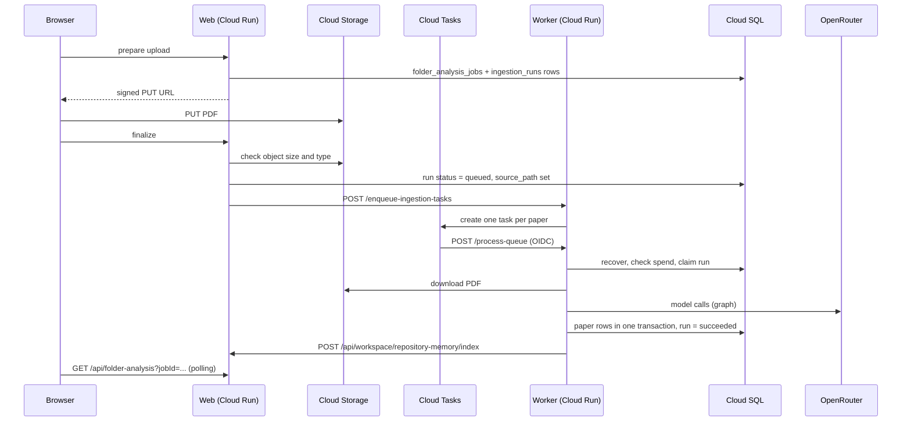

# Worker Queue and Analysis Pipeline

This chapter describes the private worker service that analyses uploaded PDFs: the HTTP service in `node_service.py`, the queue code in `eil-dashboard/worker/`, and the path one paper takes from a queued run to stored results. It covers how Cloud Tasks triggers the worker, how runs are claimed, kept alive and recovered, how the PDF is read, what is written to the database, the search index, and the spend limits. The analysis graph itself (nodes, prompts, models) is in [Python graphs and nodes](04-python-graphs-and-nodes.md); the web side of uploads is in [Frontend and API](03-frontend-and-api-architecture.md).

## The worker service

The worker is the Cloud Run service `papertrend-worker-production` in `asia-southeast1` (the pilot is `papertrend-worker-cloudsql-pilot`). Both are built by Cloud Build from the whole repository with Google Cloud buildpacks and started as `python node_service.py --host 0.0.0.0 --port 8080` (`cloudbuild.worker.production.yaml`, `cloudbuild.worker.cloudsql.pilot.yaml`; the build renames the root `Dockerfile`, which belongs to the web app). Deployment is covered in [Deployment and operations](08-deployment-and-operations-runbook.md).

Settings in `cloudbuild.worker.production.yaml` that shape how the queue behaves:

| Setting | Value | Effect |
|---|---|---|
| `--no-allow-unauthenticated` | | Only callers with invoke permission reach the service |
| `--cpu-throttling` | | CPU is allocated only while a request is being handled |
| `--timeout` | 900 s | Longest a single request (one analysis) may take |
| `--concurrency` / `--max-instances` | 4 / 2 | Requests per instance, and instances |
| `--memory` / `--cpu` | 1Gi / 1 | |
| `DATABASE_PROVIDER`, `STORAGE_PROVIDER` | `cloud-sql`, `gcs` | Cloud SQL client and GCS downloads |
| `WORKER_DEPLOYMENT` | `production` (`pilot` on the pilot) | Which runs this worker may touch |
| `MODEL_POLICY_PRESET` | `budget-structured` | Model table ([04](04-python-graphs-and-nodes.md#model-routing)) |
| Secrets | `OPENAI_API_KEY`, `OPENAI_BASE_URL`, `WORKER_WEBHOOK_SECRET`, `DATABASE_URL` | Read from Secret Manager |

The pilot and production workers share one Cloud SQL database but use different buckets and queues. The web app stamps each run's `input_payload.deployment`, and every list, claim and recovery query in `eil-dashboard/worker/database_client.py` filters on it (`DEPLOYMENT_FILTER`), so pilot code never analyses a production paper. Runs without the tag count as production. To read the live configuration, use `gcloud run services describe papertrend-worker-production --region asia-southeast1`.

Code layout:

- `node_service.py` (repository root): the HTTP server. It adds `eil-dashboard/worker` to `sys.path` and calls the queue code.
- `eil-dashboard/worker/process_ingestion_queue.py`: claiming, recovery, heartbeat, download, progress and the run's final state.
- `eil-dashboard/worker/analysis_pipeline/`: runs the graph (`pipeline.py`, which adds the repository root to `sys.path` to import `graphs.py` and `nodes/`), saves the dataset (`persistence.py`), duplicate detection and re-analysis rules.
- `eil-dashboard/worker/database_client.py`: the Cloud SQL client (`CloudSqlWorkerClient`, using psycopg).
- `eil-dashboard/worker/search_index.py` and `spend_limits.py`: search index requests and the site-wide spend check.

## HTTP endpoints (`node_service.py`)

`NodeServiceHandler` runs on a standard-library `ThreadingHTTPServer`.

| Method and path | What it does |
|---|---|
| `GET /health` | Small status object (`"status": "ok"`) |
| `POST /process-queue` | Runs a queue batch in the foreground or background |
| `POST /enqueue-ingestion-tasks` | Creates Cloud Tasks that each call `/process-queue` |
| `POST /gcs/signed-upload` | V4 signed `PUT` URL for a PDF in `GCS_UPLOAD_BUCKET` (1 to 60 minutes) |
| `POST /gcs/signed-read` | V4 signed `GET` URL for an existing object (1 to 60 minutes) |
| `POST /gcs/object-status` | Whether an object exists, its size and update time |
| `POST /debug/reset-queue-lock` | Clears the in-process "batch running" gate |

Any other path returns 404. POST bodies over `NODE_SERVICE_MAX_BODY_BYTES` (default 2,000,000) get 413. CORS headers are sent only for origins in `APP_ALLOWED_ORIGINS`.

The signed GCS helpers check the object path (no `..`, no backslash, at most 1,024 characters) and sign through the service account named by `GOOGLE_SERVICE_ACCOUNT_EMAIL`. They date from the migration (docs/10). The web app now signs and checks uploads itself (`eil-dashboard/src/lib/gcs-signed-urls.ts`, `eil-dashboard/src/lib/paper-upload-url.ts`), and nothing in the repository calls these three endpoints.

### How callers are authenticated

Two checks apply. Cloud Run first refuses callers without invoke permission (`--no-allow-unauthenticated`). Then `_is_authorized_worker_request()` checks every POST and accepts either:

- **A Google OIDC identity token.** It is verified with `google.oauth2.id_token.verify_oauth2_token` against `WORKER_OIDC_AUDIENCE`; the issuer must be `accounts.google.com` and the token's e-mail must be in `WORKER_OIDC_SERVICE_ACCOUNTS`. In production that list holds the Cloud Tasks service account and the web service's account.
- **The shared bearer secret** `WORKER_WEBHOOK_SECRET` (or `CRON_SECRET` / `ADMIN_IMPORT_SECRET`), compared in constant time.

The web app calls the worker from `eil-dashboard/src/lib/worker-trigger.ts`. On Cloud Run it fetches an identity token for `WORKER_SERVICE_URL` from the metadata server and falls back to the webhook secret. The web's `/api/cron/process-queue` route uses the webhook secret.

### Queue batches: foreground and background

`POST /process-queue` accepts `maxRuns` (1 to 5), `async`, `force` and `retryOnBusy`. A call marked as coming from Cloud Tasks or Cloud Scheduler (header `X-Papertrend-Task-Source`, or the Google user agent) defaults to `async: false` and `retryOnBusy: true`; other calls default to the opposite.

- **One batch per instance.** A module-level gate (`_QUEUE_THREAD_GUARD`, `_QUEUE_PROCESS_THREAD`) allows one batch at a time in each instance.
- **Foreground** (`async: false`). The batch runs in the request thread and the response (200) carries the summary, for example `{"processed_runs": 1, ...}`. If a batch is already running and `retryOnBusy` is true, the answer is 429 with `worker_already_running_retry_later`.
- **Background** (`async: true`). A daemon thread runs at most `NODE_SERVICE_ASYNC_MAX_RUNS` runs (production sets 1) and the answer is 202. The web's direct trigger uses this mode.
- **Stale gate.** A batch older than `NODE_SERVICE_QUEUE_STALE_LOCK_SECONDS` (production 1200) no longer blocks a new one; `force: true` also starts a new batch, and `/debug/reset-queue-lock` (called by the web's `folder-analysis/debug/clear-queue` route) clears the gate.

Cloud Tasks calls run in the foreground, so the analysis happens while the task's request is open. With CPU allocated only during requests, work left running after a response is not reliably given CPU (docs/32 records background catch-up requests failing for this reason).

### Cloud Tasks

`POST /enqueue-ingestion-tasks` creates `taskCount` tasks (capped at `CLOUD_TASKS_MAX_TASKS_PER_REQUEST`, production 50) in `CLOUD_TASKS_QUEUE` (production `papertrend-ingestion-production`, pilot `papertrend-ingestion-staging`), using `CLOUD_TASKS_PROJECT_ID` and `CLOUD_TASKS_LOCATION`.

- Each task is `POST <worker>/process-queue` with the body `{"async": false, "maxRuns": ..., "reason": ..., "force": ..., "retryOnBusy": true, "source": "cloud-tasks"}` and the header `X-Papertrend-Task-Source: cloud-tasks`.
- It carries an OIDC token for `CLOUD_TASKS_OIDC_SERVICE_ACCOUNT` with the audience `WORKER_OIDC_AUDIENCE`. Only when no service account is configured does it carry the shared secret instead.
- The worker URL comes from `CLOUD_TASKS_TARGET_BASE_URL`, `WORKER_SERVICE_URL` or `PYTHON_NODE_SERVICE_URL`, else from the request's host.
- Tasks are spaced `CLOUD_TASKS_TASK_SPACING_SECONDS` apart (production 15) after `CLOUD_TASKS_INITIAL_DELAY_SECONDS` (default 0).
- A task does not name a run. Each call takes the oldest queued run of its deployment, so the tasks are interchangeable. A busy instance answers 429, and Cloud Tasks retries the task later under the queue's retry settings, which are set on the queue in Google Cloud.

Cloud Scheduler calls are recognised as managed triggers, and `spend_limits.py` refers to a scheduled queue check. The schedule itself is not defined in this repository.

## One paper, from upload to stored results



### 1. Before the worker: prepare, upload, finalize (web)

- `POST /api/admin/import/prepare` creates a `folder_analysis_jobs` row and one `ingestion_runs` row per file (`eil-dashboard/src/lib/cloudsql/ingestion-repository.ts`). The run's `input_payload` records `source_kind`, `project_id`, the repository's `analysis_profile`, the `deployment` and progress fields. The browser then uploads the PDF straight to the bucket with a signed URL.
- `POST /api/admin/import/finalize` asks storage about each object: it must exist, be no larger than the upload limit and have a PDF content type; refused objects are deleted. Accepted runs become `status = 'queued'` with `source_path` set to the `gs://` path.
- `triggerWorkerQueueWithRetries()` (`eil-dashboard/src/lib/worker-queue-start.ts`) then calls `/enqueue-ingestion-tasks` with one task per paper and `maxRuns: 1`. If that fails it calls `/process-queue` directly (background mode), with up to three attempts, and records the outcome on the runs.

### 2. Claim (`process_once`)

Each `/process-queue` batch calls `process_batch()`, which repeats `process_once()` up to `maxRuns` times. `process_once()`:

1. Requeues recent "succeeded" runs that have no text or no keywords (`recover_invalid_succeeded_runs`).
2. Requeues stale "processing" runs (`recover_stale_processing_runs`, see [Failures, retries and recovery](#failures-retries-and-recovery)).
3. Stops if the site-wide daily spend limit is reached ([Spend limits](#spend-limits)).
4. Lists the oldest queued upload runs of this deployment (`WORKER_QUEUED_LIMIT`, default 3). With none, it runs the search index catch-up and stops.
5. **Quarantines** a queued run with no `source_path`: it is marked failed with "Upload did not produce a storage path; this run cannot be processed" (`last_error_stage: queue_validation`).
6. Claims the first remaining run with one atomic statement, `UPDATE ingestion_runs SET status = 'processing' ... WHERE id = %s AND status = 'queued' AND <deployment filter> RETURNING *`. If another worker got there first, nothing is returned and the next run is tried.
7. Processes the claimed run (`process_run`) and returns. One call handles at most one paper.

Parallelism therefore has two levels. Inside one paper, the graph runs its branches in parallel ([04](04-python-graphs-and-nodes.md#the-ingestion-graph)). Across papers, each instance runs one paper at a time, and production allows at most two instances.

### 3. Heartbeat and progress

`processing_heartbeat()` runs a background thread for the whole run. Every `WORKER_HEARTBEAT_INTERVAL_SECONDS` (code default 30, production 60) it sets `updated_at = now()` on the run while it is still `processing`. A failed heartbeat is logged and never stops the analysis.

Progress is written into `ingestion_runs.input_payload`: `progress_stage`, `progress_message`, `progress_detail`, `progress_updated_at`, and the lifecycle fields `lifecycle_state`, `lifecycle_rank` and `lifecycle_is_terminal`. Stages move from `preparing` and `downloading` through one stage per graph node (labels in `INGESTION_NODE_PROGRESS`) to `saving` and `completed`. Node progress is written at most every 3 seconds, except for `extract`, `segment` and `build_dataset`; `analysis_metrics.completed_graph_nodes` keeps the last 40 finished nodes with their time offsets. The run's `folder_analysis_jobs` row is recomputed from its runs (counts and overall status) at the main steps: when the run is prepared, when the analysis starts, before saving and at the end.

`ensure_run_active()` re-reads the run before the analysis, after every graph step, before saving and after saving. If the status is no longer `processing` (for example, the user cancelled in the web app), the worker stops at that point and leaves the run as the web set it.

### 4. Download

The PDF is saved to a temporary directory (`papertrend-run-*`) that is removed afterwards. For a `gs://` path, `download_gcs_object()` makes up to `GCS_DOWNLOAD_ATTEMPTS` (default 3) attempts: the storage client first, then authenticated HTTP to the virtual-hosted URL, then to the path-style URL. Bad requests, missing objects and permission errors (400, 401, 403, 404) are not retried, and an empty file counts as a failure.

### 5. Reading the PDF

The `extract` node (`nodes/extractor.py`) opens the file with PyMuPDF after checking for a `%PDF-` header in the first kilobyte. There are three paths.

- **Typed PDF.** The text layer of each page is read, up to `MAX_EXTRACT_PAGES` pages (default 400). Method `fitz_text`.
- **Scanned PDF.** If the text is empty or looks like garbage (fewer than 200 letters, very few distinct words, or a very short average word length; Thai text with enough distinct Thai letters passes), the pages are sent to the `VISION_OCR` model as images. Method `vision_fallback`. With more pages than `VISION_OCR_MAX_PAGES` (default 24), the first and last pages (up to 8 each) and pages spread evenly between them are read, and a warning says how many.
- **Typed PDF with scanned pages.** Pages with under 40 letters and an image count as scanned. They are read with OCR when a scanned page is among the first two (often the cover with the title and year) or when at least a fifth of the pages are scanned, up to `VISION_OCR_MAX_PAGES`. Method `fitz_text+vision_pages`.

Tables printed as pictures are handled separately. A page whose text layer has a "Table N" caption and whose images cover at least 12% of the page is sent to the vision model with an instruction to transcribe only the tables (up to `TABLE_IMAGE_MAX_PAGES` pages, default 12). The tables are converted to rows read across (`DA1 · 12.40`) and appended after the page's own text, because the cleaner removes Markdown tables.

Each page is rendered at 2.5x zoom, reduced so the image stays under 25 million pixels, and sent as PNG with a 4,096-token answer limit. Every limit that was reached adds a warning to the paper's `analysis_quality`. A PDF with more pages than `MAX_PDF_PAGES` (production 80) gets a warning from the worker. A file that is not a PDF, or yields no text, fails the run.

### 6. Analysis

`process_pdf_run()` (`analysis_pipeline/pipeline.py`) starts a usage session, streams the graph, merges each node's update into the state, calls the progress and cancellation callbacks, and returns a `PipelineResult` (dataset, raw text, usage summary). It raises `PipelineFailure`, carrying the usage so far, when the graph failed or produced no text, no dataset or no keyword rows.

### 7. Save

`persist_dataset()` (`analysis_pipeline/persistence.py`) builds an ordered list of steps (`paper_write_steps()`) and passes it to `CloudSqlWorkerClient.apply_paper_writes()`, which applies them in **one transaction**: upsert `papers`, `paper_tracks_single`, `paper_tracks_multi` and `paper_content`, then for each of `paper_keywords`, `paper_keyword_concepts`, `paper_analysis_facets`, `paper_author_keywords`, `paper_research_typologies`, `paper_category_definitions` and `paper_category_assignments`, delete the paper's old rows and insert the new ones. Either every step lands or none does.

The transaction first sets `app.current_user_id` to the run's owner (`set_transaction_owner()` in `cloudsql_authorization.py`), the setting the database's owner policies read ([Data model](06-data-model-and-schema.md#owner-scoping-and-row-level-security)). Every row must belong to that one owner, only tables in `ALLOWED_WRITE_TABLES` are accepted, and columns the database does not have are dropped with a logged warning instead of failing the save.

### 8. Finish

1. **Duplicate check.** `text_fingerprint()` (`analysis_pipeline/duplicates.py`) computes a 64-number MinHash over five-word shingles of the first 80,000 characters. It is compared with the owner's other succeeded runs in the same repository (`list_run_fingerprints`). A similarity of at least 0.8, or at least 0.4 when the titles match (a thesis chapter and the journal article of the same study), records `duplicate_of` on the run. Nothing is deleted.
2. **Run row.** `status = 'succeeded'`, `completed_at`, `provider` and `model` (kept from the run, or "Automatic task routing" and "automatic-task-routing" when empty), and in `input_payload`: `paper_id`, `paper_title`, `year`, `year_resolution`, `analysis_quality`, `topic_kinds`, `raw_text_length`, `keyword_count`, `text_fingerprint`, `duplicate_of`, `pipeline` ("worker-v1"), `ingestion_graph_mode` ("parallel_fanout_v1") and `analysis_metrics` (queue wait, download, graph and save seconds, model usage).
3. The folder job is recomputed.
4. The web is asked to index the paper for search ([Search index](#search-index-and-embeddings)).

### 9. Status polling (web)

The browser polls `GET /api/folder-analysis?jobId=...` (from `eil-dashboard/src/hooks/useIngestionRuns.ts`). The route returns the job and its runs with a trimmed `input_payload` (progress fields, `paper_title`, `analysis_metrics`, recovery counters and so on), which the progress card shows.

## Failures, retries and recovery

| Situation | What happens |
|---|---|
| A model call fails or answers off-schema | Repair attempt, then the fallback model ([04](04-python-graphs-and-nodes.md#model-routing)) |
| A node falls back to a weaker result | Warning in `analysis_quality`; the paper is saved as degraded |
| The graph fails, or any step of `process_run` raises | The cost of model calls already made is recorded; the run becomes `failed` with `error_message` (first 2,000 characters) and `last_error_stage: processing` |
| A **re-analysis** fails and the paper had results | The run stays `succeeded` with its earlier rows (the save is all-or-nothing); `reanalysis_failed_at` and `reanalysis_error` are recorded and the card says "Use Analyze again to retry" (`analysis_pipeline/reanalysis.py`) |
| The run's status was changed elsewhere (cancelled) | The worker stops and leaves the status alone |
| A worker instance dies mid-run | The heartbeat stops. After `WORKER_STALE_PROCESSING_AFTER_SECONDS` without an update (code default 900, production 360), the next batch requeues the run and adds 1 to `recovery_count` |
| A run stalls repeatedly | Once `recovery_count` reaches `WORKER_MAX_RECOVERY_ATTEMPTS` (default 2), it is failed: "The analysis worker stopped updating this run too many times." |
| A "succeeded" run has no text or no keywords | Requeued once (`completion_recovery_count`), among the latest `WORKER_INVALID_SUCCESS_SCAN_LIMIT` (default 25) succeeded runs |
| Queued run without a storage path | Quarantined as failed (step 2 above) |
| The worker is busy when a task arrives | 429; Cloud Tasks retries the task later |
| The direct trigger does not start | The web retries and shows "Uploaded, but analysis has not started" with a "Start processing now" action |

A failed paper is retried from the web (the `folder-analysis/retry` route, or "Analyze again" in the Library).

## Re-analysis

The web queues re-analysis in `queueReanalysis()` (`eil-dashboard/src/lib/cloudsql/analysis-job-repository.ts`). It sets the run back to `queued` and adds `reanalysis_requested_at`, counters, the repository's current `analysis_profile`, `project_id` and `deployment` to `input_payload`. It accepts only runs with a source path and limits how often one paper can be analysed again in a UTC day (`MAX_REANALYSES_PER_PAPER_PER_DAY`).

The worker then runs the normal path. The paper keeps its `paper_id`, because it is derived from the run id, so the transaction replaces the old rows. Corrections made in the Library (`user_overrides.title` and `user_overrides.year`) win over the new analysis, and a year the previous run wrote is resolved again from the source.

## What the worker writes to the database

| Table | Written by the worker |
|---|---|
| `ingestion_runs` | Status, `error_message`, `completed_at`, `provider`, `model`, `input_payload` (progress, metrics, results summary) |
| `folder_analysis_jobs` | Status, run counts, progress fields, `completed_at` |
| `papers`, `paper_content`, `paper_keywords`, `paper_keyword_concepts`, `paper_tracks_single`, `paper_tracks_multi`, `paper_analysis_facets`, `paper_author_keywords`, `paper_research_typologies`, `paper_category_definitions`, `paper_category_assignments` | The paper's analysis, replaced as a whole |
| `ai_usage_events` | One row per analysed paper with its model cost |
| `google_drive_connections` | Refreshed access tokens, for older Drive connector runs only |

It also reads `research_folders` (repository membership), `papers` (titles for duplicates) and `paper_retrieval_documents` (index freshness). Column details are in [Data model](06-data-model-and-schema.md).

## Search index and embeddings

Chunking and embeddings belong to the web app, beside the search that reads them (`search_index.py` docstring). The worker only asks for them.

- After a run succeeds, including after a re-analysis, `request_search_index()` posts `{ownerUserId, runId}` to `SEARCH_INDEX_URL`, which production points at the web route `/api/workspace/repository-memory/index`. The request carries a Google identity token for the worker's own service account, fetched from the metadata server.
- When there is nothing queued, `catch_up_search_index()` asks for up to 10 papers whose index is missing or older than their analysis (`list_runs_needing_search_index()`, checked owner by owner under row-level security). Runs with no owner, or in no repository's folder, are left out.
- The web route (`eil-dashboard/src/app/api/workspace/repository-memory/index/route.ts`) accepts only verified service callers, chunks the paper and embeds the chunks with `REPOSITORY_EMBEDDING_MODEL` (default `openai/text-embedding-3-small`, `eil-dashboard/src/lib/server-env.ts`), and stores them in `paper_retrieval_documents` and `paper_retrieval_chunks`. Its cost is tracked by the web.
- Indexing never fails an analysis. A refused or failed request is logged and the next idle check catches the paper up.

## Spend limits

The web keeps the spending limits (`eil-dashboard/src/lib/spend-limits.ts`, described in [Frontend and API](03-frontend-and-api-architecture.md)). The worker takes part in one of them, the **site-wide daily dollar limit** on all model calls (`spend_limits.py`):

- **Recording.** After each analysis, successful or not, `record_spend()` writes one `ai_usage_events` row for the paper's owner with the calls, tokens and `cost_usd` (OpenRouter's reported cost where available), with `metric: "spend"` and `source: "analysis"`. Analysis therefore counts toward the site-wide total. Per-person token budgets count chat tokens only, so analysis does not use them up.
- **Holding the queue.** Before claiming, `site_spend_limit_reached()` adds up `cost_usd` for every account since midnight UTC (`SITE_SPEND_SQL`, the same total the web uses) and compares it with `AI_DAILY_USD_LIMIT_SITE`. While the limit is reached, papers stay queued and are analysed after midnight UTC. If the total cannot be read, the queue is held as well and an error is logged.

Other limits bound the work per paper: the upload size checked at finalize, the page, OCR-page and image-size limits in [Reading the PDF](#5-reading-the-pdf), the per-paper daily re-analysis limit, and the model timeouts.

## Running the worker locally

`load_config()` (`analysis_pipeline/config.py`) reads the environment and stops with a list of anything missing. For Cloud SQL and GCS it needs `DATABASE_PROVIDER=cloud-sql`, `DATABASE_URL`, `CLOUD_SQL_INSTANCE_CONNECTION_NAME`, `STORAGE_PROVIDER=gcs`, `GCS_UPLOAD_BUCKET` and `OPENAI_API_KEY`.

```bash
# HTTP service on 127.0.0.1:8001 (the deployed service passes --host 0.0.0.0 --port 8080)
python node_service.py

# Queue worker without HTTP: one run, or poll every WORKER_POLL_INTERVAL_SECONDS (default 15)
python eil-dashboard/worker/process_ingestion_queue.py --once
python eil-dashboard/worker/process_ingestion_queue.py --loop
```

Remember that the database is shared with production and that each worker only takes runs of its own `WORKER_DEPLOYMENT` (see [Setup](02-setup-and-local-development.md)).

## Legacy code still in the worker

The project moved from Supabase and Vercel to Google Cloud in 2026 (docs/10 to docs/19). These parts remain:

- `SupabaseRestClient` in `process_ingestion_queue.py` (and the root `supabase_http.py` it imports), used only when `DATABASE_PROVIDER` is `supabase`.
- `cloudsql_mirror.py`, the Supabase-to-Cloud SQL dual-write used during the cutover; it runs only in Supabase mode.
- The Supabase fields in `analysis_pipeline/config.py`, `CloudSqlWorkerClient.download_storage_object()` (which refuses), and the `hasSupabase` and `hasResearchQueue` fields of `/health`.
- The Google Drive connector download (`source_kind: "google-drive"`). Files picked from Drive today are uploaded to the bucket like any other upload (`import_source: "google-drive"`).
- `CloudSqlWorkerClient` methods for workspace messages and threads (`insert_message`, `update_thread`, `delete_report_messages`), left from the removed Python research queue; nothing calls them.
- `eil-dashboard/worker/requirements.txt` lists only the graph's packages. The deployed service installs the root `requirements.txt`.
