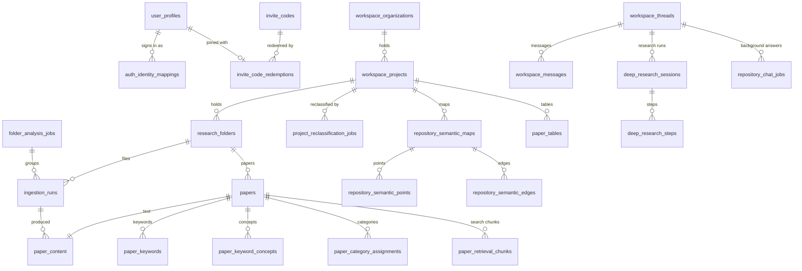

# Data Model and Schema

This chapter describes the PostgreSQL database that Papertrend runs on today: where the schema is kept, how migrations are applied and recorded, how every row is scoped to its owner, and what each group of tables holds. It ends with the layout of the PDF files in Google Cloud Storage. The project moved from Supabase and Vercel to Google Cloud in 2026 (see docs/10-19); the Supabase files that remain in the tree are noted as legacy.

## Where the schema lives

The database is a Cloud SQL for PostgreSQL instance (`papertrend-pg`, region asia-southeast1) holding the database `papertrend`. The web service and the worker both connect to it through the Cloud SQL connector that Cloud Run mounts (`--add-cloudsql-instances` in `cloudbuild.web.production.yaml` and `cloudbuild.worker.production.yaml`). The connection string comes from the Secret Manager secret `DATABASE_URL`. The pilot services use the same database as production.

| Path | What it is |
|---|---|
| `eil-dashboard/cloudsql/schema.sql` | The one authoritative schema. Run alone on an empty database, it builds the live structure: 42 tables, 8 views and their indexes. Every applied migration is folded into it. |
| `eil-dashboard/cloudsql/<date>_<name>.sql`, `phase*.sql` | The migrations, one file per change, applied to the live database in order. |
| `eil-dashboard/cloudsql/live-structure.json` | A snapshot of the live database: every table's columns with type and nullability, every index name and every view. |
| `eil-dashboard/tests/schema-authority.test.ts` | Builds `schema.sql` in PGlite (an in-process PostgreSQL) and fails if the result differs from `live-structure.json`. |
| `eil-dashboard/src/lib/migration-ledger.ts` | The rule every new migration must follow (see below). |
| `eil-dashboard/supabase/` | Legacy. The Supabase schema and migrations from before the move. Not applied anywhere. |
| `infra/cloudsql/schema.sql` | Legacy. A first five-table draft of the Cloud SQL schema. Nothing references it. |

The schema needs two extensions: `pgcrypto` (for `gen_random_uuid()`) and `vector` (pgvector, for the embeddings used by search and the semantic map).

Some application code still has a Supabase branch beside the Cloud SQL one, chosen by `DATABASE_PROVIDER` (`getDatabaseProvider()` in `eil-dashboard/src/lib/server-env.ts`). Every deployed service sets `DATABASE_PROVIDER=cloud-sql`, so only the Cloud SQL branches run.

## Migrations and the ledger

The table `schema_migrations` records which migration files have been applied (`eil-dashboard/cloudsql/20261002_schema_migrations.sql`). Its columns are `name` (the file name, primary key), `applied_at`, `applied_by` and `note`. The files applied before the ledger existed were recorded by that migration after a read-only check of the objects each one creates.

From 2026-10-02 on, every dated migration must:

1. be one transaction (`BEGIN;` ... `COMMIT;`);
2. grant the access it needs to the application role `papertrend_app`;
3. insert its own name into `public.schema_migrations` before `COMMIT`.

`ledgerProblems()` in `eil-dashboard/src/lib/migration-ledger.ts` checks the first and third rules, and the apply script refuses a file that breaks them. Because the record is inside the same transaction, a migration and its ledger row land together, whether the file is applied by the script or pasted into Cloud SQL Studio.

To apply a migration, start the Cloud SQL Auth Proxy locally, then run from `eil-dashboard/`:

```bash
# Which files are recorded as applied
DATABASE_URL=... npm run cloudsql:migrate -- --status

# Apply one file (refused if it is already recorded, unless --force)
DATABASE_URL=... npm run cloudsql:migrate -- cloudsql/20261029_paper_table_rows.sql --apply
```

The script (`eil-dashboard/scripts/apply-cloudsql-migration.ts`) connects to the proxy on `CLOUDSQL_PROXY_HOST`/`CLOUDSQL_PROXY_PORT` (default `127.0.0.1:5432`) and only accepts files inside `eil-dashboard/cloudsql/`. An older script, `scripts/apply_cloudsql_migration.py`, runs one file in a transaction and does not look at the ledger; the npm script is the one to use.

The routine for a schema change, as followed for the recent migrations (docs/32, docs/42):

1. Write the dated migration file. Keep it additive: new tables or columns with defaults, no change to existing rows unless that is the point.
2. Fold the same change into `schema.sql`.
3. Take an on-demand Cloud SQL backup, then apply the file.
4. Refresh `live-structure.json` from the live database and run `npm test`, so `schema-authority.test.ts` confirms the two match.

## Owner scoping and row-level security

Papertrend is a multi-user site on one database, so every row of user data carries its owner. In most tables the column is `owner_user_id` (a UUID that is `user_profiles.id`). `google_drive_connections` uses `user_id`, and `user_profiles` is keyed by the owner's id itself.

### How the owner reaches the database

1. The browser sends a Firebase ID token. The auth adapter verifies it and looks up the Firebase subject in `auth_identity_mappings` to find the owner id (`resolveCloudSqlIdentityOwner()` in `eil-dashboard/src/lib/cloudsql/identity-repository.ts`).
2. Repository code runs its queries inside `withCloudSqlOwnerTransaction(ownerUserId, ...)` (`eil-dashboard/src/lib/cloudsql/client.ts`). It opens a transaction and runs `SELECT set_config('app.current_user_id', <owner>, true)`. The third argument `true` makes the setting transaction-local: it ends with the transaction, so a pooled connection never carries one person's context into the next request.
3. Every query in the repositories also filters on the owner explicitly (`WHERE owner_user_id = $1`). The owner id always comes from the verified token, never from the request body.

The worker does the same in Python: `set_transaction_owner()` and `normalize_owner_id()` in `eil-dashboard/worker/cloudsql_authorization.py`, used by `eil-dashboard/worker/database_client.py` for owner-scoped writes.

A few trusted lookups have no single owner, for example resolving a sign-in to its account, redeeming an invite code, or adding up today's spend for the whole site. They run in `withCloudSqlServiceTransaction()`, which sets no owner context.

### Policies in the database

The function `public.papertrend_current_user_id()` reads `app.current_user_id`. Tables with row-level security have a policy named `papertrend_owner_access`:

```sql
CREATE POLICY papertrend_owner_access ON public.paper_tables
  FOR ALL USING (owner_user_id = public.papertrend_current_user_id())
  WITH CHECK (owner_user_id = public.papertrend_current_user_id());
```

Such tables are also set to `FORCE ROW LEVEL SECURITY`, so the policy applies to the table owner too. A transaction then sees and writes only rows whose owner matches its context. The policy is a second layer under the owner filter in the code (step 3 above), which every query has. The migrations grant table access to `papertrend_app`, a role separate from the migration administrator. The route test harness builds the schema in PGlite and runs every query as an equivalent role created `NOSUPERUSER NOBYPASSRLS` (`eil-dashboard/tests/support/route-harness.ts`), so the tests see the policies as the services do.

## Core tables at a glance

Each line in the diagram is a foreign key declared in `schema.sql`. Ownership links (`owner_user_id`) are left out to keep it readable.



## Identity and access

| Table | Purpose and key columns |
|---|---|
| `user_profiles` | One row per Papertrend account. `id` (the owner id used everywhere), `email`, `full_name`, `avatar_url`, `role` (`member` or `admin`), `workspace_profile` (JSON with the person's workspace settings). |
| `auth_identity_mappings` | Links a sign-in identity to an account. `provider` (`firebase`; `supabase` is allowed for old rows), `external_subject` (the Firebase UID), `owner_user_id`, `email`, `last_seen_at`. Unique on (`provider`, `external_subject`) and on (`provider`, `owner_user_id`). A trigger, `auth_identity_mapping_key_guard`, refuses any change to the key columns. |
| `invite_codes` | Sign-up is invite-only. Only the SHA-256 hash of a code is stored (`code_hash`). Also `label`, `bound_email` (a code made for one person), `max_uses` (1 to 50), `use_count`, `expires_at`, `revoked_at`, `created_by`. |
| `invite_code_redemptions` | Which account joined with which code. `owner_user_id` is unique: an account redeems one code. |
| `access_requests` | Requests for an invite from the public `/request-access` form: `name`, `email`, `affiliation`, `intended_use`, `status` (`pending`, `invited`, `declined`), `invite_code_id`, `reviewed_by`. One pending request per email (a partial unique index). The application deletes requests after 180 days (`ACCESS_REQUEST_RETENTION_DAYS` in `eil-dashboard/src/lib/access-request-limits.ts`). |
| `security_rate_limit_events` | One row per attempt counted by a rate limit, such as sign-in attempts. Subjects and addresses are stored as hashes (`subject_hash`, `ip_hash`). Written only by server code. |
| `google_drive_connections` | A per-user Google Drive link (`user_id`, `provider`, `external_email`, `expires_at`) kept from the earlier server-side Drive import. The worker can still read it for a Drive-sourced run. |

New accounts are created in one transaction by `provisionInTransaction()` (`eil-dashboard/src/lib/cloudsql/identity-repository.ts`). It takes an advisory lock on the identity, spends one use of the invite code with a conditional `UPDATE` (not revoked, not expired, uses left, email matches when the code is bound), creates the `user_profiles` row, writes the mapping and records the redemption. Two people redeeming the last use at the same moment cannot both succeed. An existing account signing in is linked without spending a code.

**Quota exemption** is not a separate table. An account whose `role` is `admin` is exempt from the per-person daily limits (`isQuotaExemptRole()` in `eil-dashboard/src/lib/quota-policy.ts`). Its use is still recorded. The one-off data migration `20260909_quota_exempt_admins.sql` gave the operators' accounts that role.

## Workspace: organizations, repositories and folders

A person's work is organised as organization, then project, then folder. The interface calls a project a **repository**.

| Table | Purpose and key columns |
|---|---|
| `workspace_organizations` | Top-level container. `owner_user_id`, `name` (unique per owner), `type` (`personal`, `academic`, `research_lab`, `department`, `company`, `other`). |
| `workspace_projects` | A repository. `organization_id`, `owner_user_id`, `name` (unique per organization), `description`, and the repository's analysis profile: `analysis_profile` (JSON), `analysis_profile_version`, `analysis_profile_hash`, `analysis_profile_updated_at`. |
| `research_folders` | Folders inside a repository. `project_id`, `organization_id`, `owner_user_id`, `name` (unique per owner and project). Uploads go to a folder named `Repository` unless another is named (`DEFAULT_REPOSITORY_NAME` in `eil-dashboard/src/lib/constants.ts`, used by `sanitizeFolderName()` in `eil-dashboard/src/lib/research-folders.ts`). |
| `project_reclassification_jobs` | A job that classifies a repository's papers again after its profile changes: `target_profile`, `target_profile_hash`, `target_profile_version`, `status`, `total_items`, `processed_items`, `failed_items`, `progress_stage`. |
| `project_reclassification_items` | One row per paper in such a job: `job_id`, `paper_id`, `status`, `result_payload`, `classifier_model`. Unique on (`job_id`, `paper_id`). |

### The analysis profile (taxonomy)

Each repository has its own profile in `workspace_projects.analysis_profile`, introduced by `20260910_project_analysis_profiles.sql`. The JSON keys are `version`, `mode` (for example `general`, `custom`, or `eil` for the EIL track preset), `displayName`, `domain`, `domainDefinition`, `taxonomyName`, `taxonomyDefinition`, `additionalContext`, `classificationEnabled` and `categories` (a list of `{key, label, description}`). When a paper is queued, a snapshot of the profile is copied into the run's `input_payload.analysis_profile`, so the worker classifies against the profile that was current at upload time. Category rows record the `profile_hash` and `profile_version` they were made with, which is how stale classifications are found after a profile edit.

## Papers and ingestion runs

An **ingestion run** is one uploaded file and its trip through the analysis pipeline. A **paper** is the analysed result. The paper's id is derived from the run's id: the first 15 hex digits of the run UUID, read as a 60-bit integer (`infer_paper_id()` in `nodes/common.py`, mirrored in SQL by `paperIdFromRunSql()` in `eil-dashboard/src/lib/cloudsql/paper-copy.ts`).

| Table | Purpose and key columns |
|---|---|
| `ingestion_runs` | The Library row for a file. `owner_user_id`, `folder_id`, `folder_analysis_job_id`, `source_type` (`upload` or `batch`), `status` (`queued`, `processing`, `succeeded`, `failed`), `source_filename`, `display_name`, `source_path` (the `gs://` path of the PDF), `mime_type`, `file_size_bytes`, `provider`, `model`, `is_favorite`, `trashed_at` (Trash), `copied_from_run_id` (a copy made from another run), `input_payload` (JSON), `error_message`, `completed_at`. |
| `folder_analysis_jobs` | Groups the runs of one upload batch into a folder (`eil-dashboard/src/lib/cloudsql/ingestion-repository.ts`): counters `total_runs`, `queued_runs`, `processing_runs`, `succeeded_runs`, `failed_runs`, and `progress_stage`, `progress_message`, `progress_detail` for the progress tray. |
| `file_fingerprints` | The SHA-256 of each uploaded file per owner, with `latest_run_id`. Used to refuse a duplicate upload (`eil-dashboard/src/lib/cloudsql/ingestion-repository.ts`). |
| `papers` | The paper header. `id` (BIGINT, derived as above), `owner_user_id`, `folder_id`, `title`, and the publication year: `year` (text, `Unknown` when not found), `year_confidence`, `year_source`, `year_evidence`, `year_candidates` (JSON list of the candidates considered). |
| `paper_content` | The paper's text by section: `raw_text`, `abstract`, `abstract_claims`, `body`, `methods`, `results`, `conclusion`, plus `source_filename`, `source_path` and `ingestion_run_id`. One row per paper. |
| `paper_term_index` | Exact term counts per paper for the chat's keyword channel: `content_hash`, `total_words`, `term_counts` (JSON). |

`ingestion_runs.input_payload` carries the run's working state: the profile snapshot, progress fields while it is processed, and `deployment` (`pilot` or `production`). Because the pilot shares the production database, each worker lists, claims and recovers only runs whose `deployment` matches its own (`DEPLOYMENT_FILTER` in `eil-dashboard/worker/database_client.py`). See [Worker queue and analysis pipeline](05-worker-queue-and-analysis-pipeline.md) for the state machine.

## Extracted analysis

The worker writes these tables together when a run succeeds (`eil-dashboard/worker/analysis_pipeline/persistence.py`; the allowed set is `ALLOWED_WRITE_TABLES` in `eil-dashboard/worker/database_client.py`). Every row has `paper_id`, `owner_user_id` and `folder_id`, and is deleted with its paper.

| Table | What a row holds |
|---|---|
| `paper_keywords` | One keyword under one topic: `topic`, `keyword`, `keyword_frequency`, `evidence` (supporting text from the paper). |
| `paper_keyword_concepts` | A keyword concept with its surface forms: `concept_label`, `matched_terms`, `related_keywords`, `total_frequency`, and where it first appears (`first_section`, `first_span_start`, `first_span_end`, `first_evidence`, `evidence_snippets`). |
| `paper_author_keywords` | Keywords the authors listed themselves: `keyword`, `normalized_keyword`, `source_section`, `position`, `evidence`. |
| `paper_analysis_facets` | Higher-level labels: `facet_type` (`objective_verb` or `contribution_type`), `label`, `evidence`. |
| `paper_research_typologies` | The research type: `primary_group_number` and `secondary_group_number` (1 to 4) with names, `stated_purpose`, `primary_contribution`, `verdict`, `classifier_source`. |
| `paper_category_definitions` | The repository categories as they were when the paper was classified: `category_key`, `category_label`, `category_description`, `taxonomy_name`, `domain`, plus provenance (`project_id`, `profile_hash`, `profile_version`, `classifier_model`, `classified_at`). |
| `paper_category_assignments` | The paper's categories: `category_key`, `category_label`, `assignment_type` (`single` for the primary one, `multi` for every one that applies), `is_other`, `rationale`, with the same provenance columns. |
| `paper_tracks_single`, `paper_tracks_multi` | Legacy flag columns `el`, `eli`, `lae`, `other` (0 or 1) from the original EIL track design. They are kept as storage slots for the first three categories (`LEGACY_CATEGORY_STORAGE_SLOTS` in `nodes/common.py`); dynamic categories live in the two tables above. |

### Views

`schema.sql` defines eight flat views that join `papers` to one child table each: `trends_flat`, `tracks_single_flat`, `tracks_multi_flat`, `papers_full`, `concepts_flat`, `paper_facets_flat`, `author_keywords_flat` and `research_typologies_flat`. They come from the Supabase design. The Cloud SQL code paths (for example `eil-dashboard/src/lib/dashboard-data-server.ts`) query the base tables directly; the view reads sit in the legacy Supabase branches.

## Search index and embeddings

The chat finds passages through a hybrid index: full-text search plus vector similarity. The web service owns indexing (`eil-dashboard/src/lib/repository-memory.ts`). The worker asks it to index a paper as soon as the paper's run succeeds, and catches up older papers when idle (`eil-dashboard/worker/search_index.py`).

| Table | Purpose and key columns |
|---|---|
| `paper_retrieval_documents` | One Markdown digest per paper (`digest_markdown`, `content_hash`, `digest_version`), scoped by `project_id` and `folder_id`. |
| `paper_retrieval_chunks` | The paper's sections cut into chunks: `section`, `chunk_index`, `content`, `token_count`, `embedding_model`, `embedding_version`, `embedding VECTOR(1536)`. Indexed with a GIN full-text index (`to_tsvector('simple', content)`) and an HNSW cosine index on `embedding`. |

The embedding model is set by `REPOSITORY_EMBEDDING_MODEL` (1536 dimensions, `REPOSITORY_EMBEDDING_DIMENSIONS`), called through OpenRouter. A chunk whose embedding call fails is stored without a vector and is still found by full-text search.

## Semantic map

The semantic map draws a repository's papers by similarity (docs/18-repository-semantic-map.md).

| Table | Purpose and key columns |
|---|---|
| `paper_semantic_embeddings` | One document embedding per paper and representation: `representation_version`, `embedding_model`, `embedding_dimensions`, `embedding VECTOR(1536)`, `content_hash`. |
| `repository_semantic_maps` | One map build for a repository: `status`, `source_hash` (what the papers looked like at build time), `projection_algorithm`, `projection_parameters`, `random_seed`, `paper_count`, `quality_metrics`, `clusters`, progress columns. A partial unique index allows only one queued or processing build per repository and source hash. |
| `repository_semantic_points` | One paper's position on a map: `x`, `y`, `cluster_id`, and copies of `title`, `year`, `folder_name`, `categories`, `topics`, `keywords` for drawing. |
| `repository_semantic_edges` | Similarity links between pairs of papers on a map: `source_paper_id` < `target_paper_id`, `cosine_similarity`, `euclidean_distance`, `edge_rank`, `shared_signals`. |

## Chat and deep research

| Table | Purpose and key columns |
|---|---|
| `workspace_threads` | A conversation: `owner_user_id`, `mode` (`normal` or `deep_research`), `title`, `summary`, `updated_at`. |
| `workspace_messages` | A message in a thread: `role` (`user`, `assistant`, `system`), `message_kind` (`chat`, `deep_research_plan`, `deep_research_report`, `status`), `content`, `citations` (JSON), `metadata` (JSON). |
| `deep_research_sessions` | One deep research run in a thread: `status`, `prompt`, `plan_summary`, `final_report`, `last_error`. A new question adds a session, so earlier reports stay in the conversation. |
| `deep_research_steps` | The run's steps in order (`position`): `title`, `tool_name` (`dr2_read`, `dr2_web`, `dr2_write`, `dr2_check`), `status`, `input_payload`, `output_payload`. |
| `repository_chat_jobs` | A chat answer computed in the background for a large scope: `prompt`, `execution_plan`, `status`, `progress_current`, `progress_total`, `result_text`, `citations`, `charts`, `coverage`, `limitations`. `project_id` may be null for an answer across all of a person's repositories. |

A running deep research session is held by a lease: its `updated_at`, refreshed while it runs. A session whose lease is older than `LEASE_SECONDS` (75) can be picked up again (`eil-dashboard/src/lib/deep-research/store.ts`). See [Frontend and API architecture](03-frontend-and-api-architecture.md) for the chat engine itself.

## Usage, spend and caches

| Table | Purpose and key columns |
|---|---|
| `ai_usage_events` | The ledger of model use. `owner_user_id`, `usage_kind` (`chat_message`, `web_search`, `chart`, `deep_research`), `units`, `metadata` (JSON), `created_at`. |
| `workspace_analytics_cache` | Cached computed results keyed by (`owner_user_id`, `scope_type`, `scope_key`), with `version_hash` and `payload`. Used by the dashboard summary (`eil-dashboard/src/lib/dashboard-summary-cache.ts`), topic themes (`eil-dashboard/src/lib/topic-theme-service.ts`) and the Adaptive insights write-up (`eil-dashboard/src/lib/insights/server.ts`). A stale entry is recognised by its `version_hash`, and entries are deleted when papers are deleted or a repository is reclassified. |

`ai_usage_events` holds two kinds of rows:

- **Request rows** have no `metadata.metric`. Each counts one use against the daily message, web search and deep research limits (`AI_USAGE_COUNT_SQL` in `eil-dashboard/src/lib/security-guards.ts`).
- **Spend rows** have `metadata.metric = "tokens"`, with `prompt_tokens`, `completion_tokens`, `model_calls`, `cost_usd`, `cost_source` and `source` (for example `chat`, `deep-research`, `paper-table`, `search-index`; the worker writes `analysis`). `units` is the token count. These rows feed the daily token limit (`AI_DAILY_TOKEN_LIMIT`), the daily dollar limits per person and for the whole site (`AI_DAILY_USD_LIMIT_PER_PERSON`, `AI_DAILY_USD_LIMIT_SITE`) and the monthly budget alert (`AI_MONTHLY_BUDGET_USD`). See `eil-dashboard/src/lib/spend-limits.ts` and `eil-dashboard/src/lib/ai-usage-today.ts`.

## Paper tables

`paper_tables` holds the Table page (docs/42). A table belongs to one owner and one repository (`project_id`) and has a `name`. Its content is JSON:

- `columns`: the reader's columns, each `{id, name, instruction, kind}`;
- `cells`: keyed `"<paper id>:<column id>"`, each with the value and the paper's sentence. A fill merges each batch with `cells || <new cells>` under a row lock, so batches that finish together do not overwrite each other;
- `left_out`: papers the reader left out, by paper id, with the reason;
- `cell_chats`: the chat thread opened from a cell, by cell key.

Rows are not stored. They are the repository's papers when the table opens, so a paper added later appears with empty cells. A repository holds at most 30 tables (`MAX_TABLES_PER_REPOSITORY` in `eil-dashboard/src/lib/paper-table.ts`).

## Cloud Storage layout

PDFs are kept in Google Cloud Storage, one bucket per environment, named in the Cloud Build files:

| Environment | Bucket (`GCS_UPLOAD_BUCKET`) |
|---|---|
| Production | `research-trend-analysis-papertrend-uploads-production` |
| Pilot | `research-trend-analysis-papertrend-uploads-staging` |

Object names follow one pattern, set by the upload route (`eil-dashboard/src/app/api/admin/import/prepare/route.ts`):

```text
pending/<folder name>/<ingestion run id>/<sanitised file name>
```

The full path is stored on the run as `ingestion_runs.source_path`, for example `gs://<bucket>/pending/Repository/<run id>/paper.pdf`. The browser uploads straight to the bucket with a V4 signed `PUT` URL and reads with a signed `GET` URL (`eil-dashboard/src/lib/gcs-signed-urls.ts`). Because the pilot shares production's database, a stored path may name the other environment's bucket; `GCS_KNOWN_UPLOAD_BUCKETS` lists the bucket a service may also read (`getKnownUploadBuckets()` in `eil-dashboard/src/lib/server-env.ts`). A copy of a paper keeps the original's `source_path`. A permanent delete removes an object only when no remaining run uses its path (`eil-dashboard/src/lib/cloudsql/permanent-delete.ts`).

## Rules for changing the data model

- Add, do not rewrite. New columns get defaults; old readers must keep working while the services roll out.
- Give every new user-data table an `owner_user_id`, a `papertrend_owner_access` policy with `FORCE ROW LEVEL SECURITY`, and grants to `papertrend_app`, as `20261028_paper_tables.sql` does.
- Query through `withCloudSqlOwnerTransaction()` and filter on the owner in the SQL as well.
- Write behaviour tests that run the new SQL on PGlite as the application role (see [Testing and quality](07-testing-and-quality.md)).
- Follow the migration routine above: migration file, fold into `schema.sql`, backup, apply, refresh `live-structure.json`.
